# WattPrint backend

API, worker và cơ sở dữ liệu của WattPrint: đọc công tơ tổng của hộ gia đình, tách điện từng thiết bị (NILM), tính hóa đơn theo biểu giá bậc thang, dự báo cuối kỳ, cảnh báo, và trợ lý Wappi trả lời bằng dữ liệu của chính nhà đó.
FastAPI, TimescaleDB và Keycloak, chạy bằng Docker Compose.

- Web dashboard: repo `wattprint-web` (https://github.com/daFoggo/wattprint-nextjs). Trong bản nộp, cả hai nằm cạnh nhau và chạy chung bằng `./setup.sh` ở thư mục gốc.
- Dịch vụ text2sql mà Wappi dùng cho câu hỏi dữ liệu tự do: repo `wattprint-text2sql-mcp`.

## Kiến trúc



| Dịch vụ | Công nghệ | Cổng | Vai trò |
|---|---|---|---|
| `api` | FastAPI, SQLAlchemy 2 async, Alembic | 11093 | API nghiệp vụ `/api/v1`, OpenAPI ở `/docs` |
| `db` | TimescaleDB 2.31 trên PostgreSQL 18, pgvector | 11096 | Cơ sở dữ liệu ứng dụng |
| `keycloak` + `keycloak-db` | Keycloak 26.2 và Postgres riêng | 11095 | Đăng nhập, người dùng, vai trò. Realm `wattprint` được nạp từ `keycloak/realm/` ở lần chạy đầu |
| `mailpit` | Mailpit | 11099 | Hộp thư thử: thư xác nhận, đặt lại mật khẩu, cảnh báo |
| `replay` | `scripts.replay_refit` | không | Phát lại dữ liệu CSV của các nhà demo như công tơ thật, mỗi 5 giây |
| `insight` | `app.modules.insight.worker` | không | Hóa đơn, dự báo, cảnh báo, kế hoạch, thư. Mỗi việc chạy theo nhịp riêng và có khóa advisory để chỉ một bản chạy |
| `nilm` | `app.modules.nilm.worker`, PyTorch CPU | không | Tách điện từng thiết bị từ công tơ tổng |

### Đường đi của dữ liệu



Dữ liệu đo vào bảng `tb_reading` (hypertable của TimescaleDB) duy nhất qua `ops.ingest_readings`. Worker `nilm` đọc `tb_reading`, không bao giờ sửa nó, và ghi `tb_device_estimate`.
Các màn hình và worker `insight` đọc các bảng tổng hợp liên tục `reading_1m`, `reading_1h`, `reading_1d` và `device_estimate_1m`, `device_estimate_1h`, `device_estimate_1d`. API chỉ đọc `tb_reading` thô cho giá trị mới nhất và luồng `/energy/stream`
(`app/modules/energy/services/meter.py`).

### Trợ lý Wappi



`POST /api/v1/copilot/chat` trả luồng SSE với các sự kiện `meta`, `step`, `token`, `done` và `error` (`app/modules/copilot/services/chat.py`).

- **Công cụ trước, mô hình sau**: mọi con số đến từ 17 công cụ xác định (`app/modules/copilot/services/tools.py`): `devices_breakdown`, `current_bill`, `bill_forecast`, `bill_history`, `device_forecast`, `explain_usage`, `compare_periods`, `weather`, `cohort`, `alerts`, `standby`, `query_data`, `search_documents`, `propose_plan`, `create_watch`, `list_watches`, `cancel_watch`. Mô hình chỉ lập kế hoạch và diễn đạt.
- **Vòng lặp**: tối đa 4 lần gọi công cụ, rồi một lượt trả lời không có công cụ. Lịch sử giữ 12 tin nhắn, kết quả công cụ cắt ở 6.000 ký tự.
- **Nhà cung cấp LLM** theo thứ tự `COPILOT_LLM_ORDER` (mặc định `openrouter,astralx`): nhà cung cấp lỗi cứng được nghỉ 60 giây; lỗi trước chữ đầu tiên thì chuyển sang nhà tiếp theo.
- **An toàn**: dữ liệu cá nhân (email, thẻ, CCCD, số điện thoại, số tài khoản) được thay bằng nhãn trước khi lưu hay gửi (`services/privacy.py`); regex chặn prompt injection chạy trước, Llama Guard (`COPILOT_GUARD_MODEL`) chạy song song với lượt LLM đầu và không chữ nào hiện ra trước khi guard trả lời (`services/guard.py`). Công cụ chỉ đọc nhà đang hỏi.
- **Câu hỏi dữ liệu tự do** (`query_data`): tạo token phạm vi 5 phút rồi gọi dịch vụ text2sql; dữ liệu đi qua role `wattprint_copilot_ro` và view `copilot_ro` chỉ thấy đúng một nhà.
- **Hỏi đáp văn bản pháp luật** (`search_documents`): tìm kết hợp từ khóa và vector trong `tb_chunk` (embedding `baai/bge-m3` qua OpenRouter, dự phòng AstralX), luôn ưu tiên biểu giá mới nhất. Chi tiết: `docs/rag-research.md`. Nạp văn bản: `scripts/ingest_documents.py` từ `docs/sources/`.
- Mỗi câu trả lời mang một mức nguồn gốc số liệu (`measured`, `document`, `estimated`, `inferred`) để giao diện hiện nhãn "Đo trực tiếp", "Theo văn bản", "Ước tính", "Suy luận bối cảnh". Đánh giá chất lượng: `docs/chatbot-eval.md`.

### Mô-đun

`app/modules/` có chín mô-đun (`auth`, `home`, `energy`, `billing`, `expect`, `insight`, `copilot`, `nilm`, `ops`); mô-đun này chỉ import mô-đun khác qua `api.py` của nó (`scripts/check_boundaries.py` kiểm tra). Vai trò và phụ thuộc từng mô-đun: [app/modules/README.md](app/modules/README.md).

### Cơ sở dữ liệu

- Extension: `timescaledb`, `vector`, `unaccent`, `pg_trgm`. Schema: `public` (nghiệp vụ), `ai` (hội thoại, tin nhắn, lệnh gọi công cụ, giọng nói), `etl` (mốc nạp dữ liệu), `copilot_ro` (view chỉ đọc cho Wappi).
- Hypertable `tb_reading`, `tb_device_estimate`, `tb_device_cycle`; bảng tổng hợp liên tục nói ở trên.
- Role: `wattprint_app`, `wattprint_ingest`, `wattprint_copilot_ro` (`statement_timeout` 5 giây), `wattprint_ai`. Thiết kế: [docs/database-design-guide.md](docs/database-design-guide.md).
- Migration viết tay trong `alembic/versions/{public,ai,updates}` (hypertable, bảng tổng hợp, quyền và view cần DDL tường minh).

## Cài đặt và chạy

> Trong bản nộp, bỏ qua phần này và chạy `./setup.sh` ở thư mục gốc: script tự làm các bước dưới đây, kể cả giải nén dữ liệu và nạp nhà demo.

### Yêu cầu

Docker với Compose v2; [uv](https://docs.astral.sh/uv/) và Python 3.14 (để chạy script nạp dữ liệu và lint trên máy). Cần 8 GB RAM trống.

### Các bước

```bash
cp .env.example .env
```

Điền vào `.env` (compose dừng nếu thiếu một biến bắt buộc):

| Biến | Giá trị |
|---|---|
| `POSTGRES_USER`, `POSTGRES_DB`, `POSTGRES_PASSWORD` | Tài khoản và mật khẩu cơ sở dữ liệu ứng dụng |
| `KEYCLOAK_ADMIN_PASSWORD`, `KEYCLOAK_DB_PASSWORD` | Mật khẩu quản trị Keycloak và cơ sở dữ liệu của nó |
| `WATTPRINT_ADMIN_PASSWORD` | Mật khẩu người dùng `admin` của realm: từ 12 ký tự, có chữ hoa, chữ thường, số và ký tự đặc biệt (chính sách của realm) |
| `WATTPRINT_WEB_CLIENT_SECRET` | Bí mật của client `wattprint-web`, từ 32 ký tự: `openssl rand -hex 32`. Dashboard dùng cùng giá trị |
| `DEMO_ADMIN_CLIENT_SECRET` | Một chuỗi ngẫu nhiên dài; tài khoản dịch vụ tạo và xóa khách demo |
| `GOOGLE_CLIENT_ID`, `GOOGLE_CLIENT_SECRET` | Bắt buộc không rỗng. Không dùng Google thì điền giá trị bất kỳ |
| `APP_DB_PASSWORD`, `INGEST_DB_PASSWORD`, `COPILOT_DB_PASSWORD`, `AI_DB_PASSWORD` | Mật khẩu các role cơ sở dữ liệu ít quyền (để trống thì role bị khóa đăng nhập) |
| `DEMO_PASSWORD` | Mật khẩu các tài khoản demo (chính sách như `WATTPRINT_ADMIN_PASSWORD`) |
| `OPENROUTER_API_KEY`, `ASTRALX_API_KEY`, `OPENWEATHER_API_KEY` | Tùy chọn. Không có khóa thì chat Wappi, giọng nói và thời tiết trả 503, các phần khác vẫn chạy. `ASTRALX_API_KEY` là khóa speech-to-text, đồng thời là nhà cung cấp dự phòng cho chat và embedding |

```bash
docker compose up --build -d
```

Image `api` chạy `alembic upgrade head` trước khi khởi động uvicorn (compose dev thêm `--reload`). Kiểm tra: http://localhost:11093/docs và http://localhost:11095 (Keycloak, người dùng `admin`).

### Nạp nhà demo

Cần `dataset/CLEAN_House<n>.csv` (REFIT đã làm sạch; không nằm trong git, xem `docs/nilm-datasets.md`; `scripts/unpack_dataset.py` giải nén `dataset/archive.zip` chứa nhà 2), các mô hình ở `dataset/models/nilm/` và `DEMO_PASSWORD`:

```bash
uv run python -m scripts.seed_demo_homes   # các nhà trong scripts/demo_homes.toml, mỗi nhà một năm dữ liệu
docker compose up -d replay nilm           # công tơ chạy tiếp, ước tính thiết bị theo sau khoảng 1 phút
```

Chỉ một `replay` chạy cùng lúc (bản thứ hai thoát ngay). Chạy lại sau khi sửa mã: `docker compose restart replay`.
Mỗi nhà có một mô hình riêng (`tb_nilm_model`). Việc nạp cần Internet để lấy thời tiết lịch sử (Open-Meteo).

### Wappi

Điền khóa vào `.env` rồi `docker compose up -d api insight`. Câu hỏi dữ liệu tự do cần thêm dịch vụ text2sql (`TEXT2SQL_URL`, `TEXT2SQL_CONNECTION_ID`, `TEXT2SQL_SERVICE_KEY`; container gọi tới `host.docker.internal:11101`) — phần còn lại của Wappi chạy không cần nó.

## Kiểm thử, lint và CI

```bash
docker compose exec -T api pytest -q                                   # dùng cơ sở dữ liệu <db>_test, không đụng dữ liệu dev
uv run ruff check app tests alembic scripts
uv run ruff format --check app tests alembic scripts
uv run python scripts/check_boundaries.py                              # ranh giới mô-đun
```

`.github/workflows/ci.yml` chạy ba lệnh lint trên mỗi push và pull request. Bộ test cần TimescaleDB nên chạy trong container `api`. Lưu ý: `alembic/versions/**` không được format lại.

## Cấu trúc thư mục

```
app/
  main.py            điểm vào, gắn router của từng mô-đun dưới /api/v1
  config.py          cấu hình từ biến môi trường
  database.py        engine async, session, Base
  modules/<tên>/     models, schemas, services, routes, api.py (phần mô-đun khác được import)
  routers/           health
alembic/             migration viết tay (versions/public, ai, updates)
keycloak/realm/      realm xuất sẵn, nạp ở lần chạy đầu
keycloak/providers/  jar giao diện đăng nhập, build từ wattprint-web, không commit
scripts/             nạp demo, replay, đánh giá NILM và Wappi (xem scripts/README.md)
dataset/             mô hình NILM, mã huấn luyện, kết quả nghiên cứu; CSV thô không nằm trong git
docs/                thiết kế, đánh giá, nguồn văn bản pháp luật, sơ đồ (docs/diagrams)
tests/
```

Thêm mô-đun: tạo `app/modules/x/` như các mô-đun khác, `routes/__init__.py` xuất `router = APIRouter(prefix="/x", tags=["x"])`, thêm vào danh sách router ở `app/main.py`.

## Tài liệu

- [docs/database-design-guide.md](docs/database-design-guide.md), [docs/database-design.md](docs/database-design.md): thiết kế cơ sở dữ liệu.
- [docs/keycloak-auth.md](docs/keycloak-auth.md): đăng nhập và phân quyền.
- [docs/chatbot-eval.md](docs/chatbot-eval.md), [docs/rag-research.md](docs/rag-research.md): đánh giá Wappi và tìm kiếm văn bản.
- [docs/nilm-datasets.md](docs/nilm-datasets.md), [docs/nilm-eval.md](docs/nilm-eval.md): dữ liệu và đánh giá NILM.
- [docs/legal-basis.md](docs/legal-basis.md): căn cứ pháp lý của biểu giá và VAT.
- Sơ đồ: [docs/diagrams/](docs/diagrams) (mỗi sơ đồ có tệp `.html` nguồn và `.svg`).

## Chi tiết kỹ thuật

### Auth flow (Keycloak)

- Sign-in is email + password on Keycloak's login page (the `wattprint` theme built in wattprint-web, sign-up with email
  verification and password reset enabled; mail goes to the SMTP of the realm, dev: Mailpit on http://localhost:11099), or Google
  (set `GOOGLE_CLIENT_ID` and `GOOGLE_CLIENT_SECRET`, redirect URI `http://localhost:11095/realms/wattprint/broker/google/endpoint`;
  compose requires both to be non-empty, any placeholder works if Google is not used). A new user gets the role `user`; give
  `admin` in the Keycloak console (http://localhost:11095, realm `wattprint`, Users > Role mapping). The seeded `admin` user has a
  password; the Keycloak console itself lives in the `master` realm.
- Realm `wattprint`: public client `wattprint-mobile` (authorization code + PKCE, redirect `wattprint://auth`, no direct
  grants), resource client `wattprint-api` (bearer only; its audience is added to access tokens by a mapper), realm roles
  `admin` and `user`, self-registration off, brute-force protection on.
- First start imports `keycloak/realm/wattprint-realm.json` (later starts skip it: edit realms in the console, or
  `docker compose rm -sfv keycloak keycloak-db` and delete the `wattprint_keycloak_pg18data` volume to re-import). It creates
  the user `admin` (email `admin@wattprint.local`, roles `admin`+`user`) with the password from `WATTPRINT_ADMIN_PASSWORD`
  (at least 12 characters, the realm's password policy).
- Sessions: access token 15 min; the refresh token lives as long as the Keycloak SSO session (idle 30 days, max 90 days;
  Keycloak's default is 30 min idle, which would sign the mobile app out after half an hour unused). Refresh-token rotation
  is on (`revokeRefreshToken=true`, `refreshTokenMaxReuse=0`, RFC 9700): see `docs/keycloak-auth.md`. Login and admin events are kept 7 days.
- The app signs users in with Keycloak and sends `Authorization: Bearer <access_token>`. The API verifies it locally with the
  realm's JWKS (RS256; `iss`, `aud=wattprint-api`, `azp` in `KEYCLOAK_CLIENT_IDS` (default `wattprint-mobile,wattprint-web`), `exp`). No Keycloak call per request.
- `tb_users` is a local profile with a UUIDv7 `id` (`uuidv7()` server default, `uuid.uuid7` in the ORM); the first valid request stores the token's external `sub` in
  `keycloak_sub`. Business tables use the local UUID for foreign keys. A v7 id reveals its creation time (`uuid_extract_timestamp`), so ids are not secrets. A user whose email already exists under
  another account gets 409. Roles come from `realm_access.roles`.
- `GET /api/v1/users/me` returns the profile and roles; `GET /api/v1/users` needs the `admin` role (403 otherwise).
- Issuer: `KEYCLOAK_ISSUER` must equal the URL clients use (`KEYCLOAK_PUBLIC_URL`); the API itself reaches Keycloak as
  `http://keycloak:11095` (`KEYCLOAK_JWKS_URL`). A phone with `adb reverse tcp:11095 tcp:11095` uses `localhost`. On a LAN phone set
  `KEYCLOAK_BIND=0.0.0.0`, `API_BIND=0.0.0.0` and both URLs to the LAN IP.
- Compose runs Keycloak in production mode (`start --import-realm`) with `KC_HTTP_ENABLED=true` and `KC_PROXY_HEADERS=xforwarded`: TLS is expected to end at a reverse proxy (the host nginx in production). Use a real hostname, TLS and a secret admin password outside local development.

Swagger (`/docs`) cannot obtain tokens (the web client is confidential and the mobile client uses a custom redirect); call the API with an access token taken from a login through the web dashboard.

#### Hardening before production

Known deviations from Keycloak/OAuth best practice, kept on purpose for development:

- Refresh-token rotation is on. Clients refresh single-flight (the web dashboard: in-process only, so several web instances
  need a shared lock or sticky sessions).
- Web sign-out is RP-initiated (redirect with `id_token_hint` + `post_logout_redirect_uri`).
- Local compose serves Keycloak over HTTP with `sslRequired=external`: production needs TLS, a real hostname, `sslRequired=all`, https redirect URIs and secrets from a secret store.
  redirect URIs and secrets from a secret store.
  code, Android App Links would be stricter.
- Access tokens stay valid until `exp` (15 min) after logout; the API does not check revocation.

### Migrations and tests

Revisions are hand-written (not autogenerate), because hypertables, continuous aggregates, grants and
cross-schema views need explicit DDL. Put new public business objects in `versions/public/`, new AI
objects in `versions/ai/`, and changes to existing objects or the shared linear migration flow in
`versions/updates/`. All three locations feed the same Alembic revision chain.

```bash
docker compose exec api alembic revision -m "initial module" --version-path alembic/versions/public
# Use --version-path alembic/versions/ai for AI schema revisions.
# Use --version-path alembic/versions/updates for changes to existing objects or shared flow.
docker compose exec api alembic upgrade head
docker compose exec api pytest
docker compose exec api ruff check app tests alembic
```

Tests run inside the `api` container (database access). Token tests sign with a throwaway RSA key and stub the JWKS lookup, so Keycloak is not needed.
