# Copilot chat: test screenshots

Each question asked in a new chat of the mobile web app (`localhost`), talking to the new backend
with the real model (`qwen/qwen3.7-flash`) on the legacy dump (REFIT House 2, 29 Oct – 4 Nov 2026,
today pinned to 5 Nov). Screenshots at 430 px wide; the SQL panel is opened where the answer has one.
Household rules (first-order logic) are tested in [fol-rules.md](fol-rules.md).
`results.json` holds the full API response of each question. The prompts are in [prompts.md](prompts.md).

| # | Question | Expected | Copilot's numbers | Verdict | Screenshot |
| --- | --- | --- | --- | --- | --- |
| 1 | Hôm qua nhà tôi dùng bao nhiêu điện? | 17.25 kWh (4 Nov), whole home, measured | energy_kwh=17.25 (measured) | PASS | [01.png](01.png) |
| 2 | Ngày nào tuần qua dùng nhiều điện nhất? | 30 Oct, 36.72 kWh | day=2026-10-30, energy_kwh=36.72 (measured) | PASS | [02.png](02.png) |
| 3 | Tuần qua ấm đun nước dùng bao nhiêu? | 5.20 kWh, NILM estimate (plug covers 1 of 7 days) | device=Kettle, energy_kwh=5.2 (estimated) | PASS | [03.png](03.png) |
| 4 | may giat hom qua | Washing Machine 1.62 kWh, estimated | device=Washing Machine, energy_kwh=1.62 (estimated) | PASS | [04.png](04.png) |
| 5 | Tivi tốn điện không? | links the TV (not the electric car); no data → says so | no rows (estimated) | PASS | [05.png](05.png) |
| 6 | Quạt trần dùng bao nhiêu? | links the Overhead Fan (fan); no data → says so | no rows (estimated) | PASS | [06.png](06.png) |
| 7 | Điện hôm qua? | whole home 17.25 kWh | energy_kwh=17.25 (measured) | PASS | [07.png](07.png) |
| 8 | Ngày 29/10 lò vi sóng thực đo bao nhiêu? | 0.06 kWh measured by plug | device=Microwave, energy_kwh=0.06 (measured) | PASS | [08.png](08.png) |
| 9 | Tủ lạnh dùng bao nhiêu? | Fridge-Freezer exists, no data → says so | no rows (estimated) | PASS | [09.png](09.png) |
| 10 | Máy sấy dùng bao nhiêu? | no such device, logged as a miss | Mình không tìm thấy thiết bị “máy sấy” trong nhà bạn. | PASS | [10.png](10.png) |
| 11 | Thời tiết mai thế nào? | polite out-of-scope answer, no SQL | Mình chỉ trả lời được các câu hỏi về điện của nhà bạn: mức dùng, chi p | PASS | [11.png](11.png) |
| 12 | 4 ngày gần đây so với 4 ngày trước? | 66.92 vs 77.04 kWh; earlier period covers 75% | period=current, energy_kwh=66.92; period=previous, energy_kwh=77.04 (measured) | PASS | [12.png](12.png) |
| 13 | Dùng bao nhiêu điện? | whole home, last 7 days: 143.96 kWh, says so | energy_kwh=143.96 (measured) | PASS | [13.png](13.png) |
| 14 | Cái máy đó dùng bao nhiêu? | card with the 4 tracked appliances, no SQL | card: Dishwasher, Kettle, Microwave, Washing Machine | PASS | [14.png](14.png) |
| 15 | How much did the washing machine use yesterday? | Washing Machine 1.62 kWh, in English | device=Washing Machine, energy_kwh=1.62 (estimated) | PASS | [15.png](15.png) |
| 16 | Tháng này tiền điện bao nhiêu? | November bill so far: 66.92 kWh, 137,386 đ incl. VAT | 66.917 kWh, 137,386 đ | PASS | [16.png](16.png) |
| 17 | Làm sao để tiết kiệm điện? | the open suggestions with their monthly saving | Sắp lên bậc giá 4 (753.961 đ/tháng); Xem lại ngày dùng điện cao (431.901 đ/tháng); Tìm thiết bị chạy ngầm ban đêm (203.154 đ/tháng) | PASS | [17.png](17.png) |

**17/17 pass.**

## 1. Hôm qua nhà tôi dùng bao nhiêu điện?

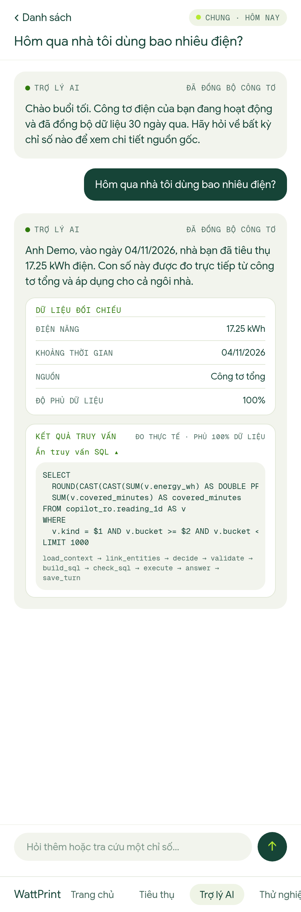

## 2. Ngày nào tuần qua dùng nhiều điện nhất?

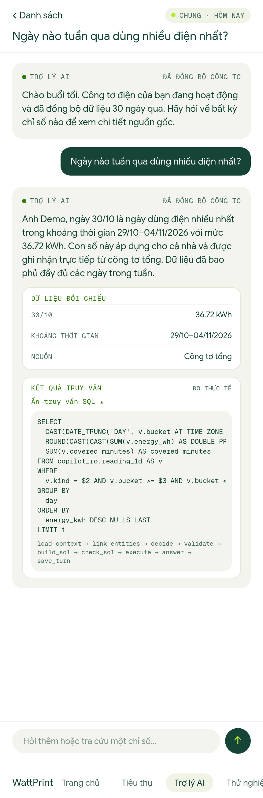

## 3. Tuần qua ấm đun nước dùng bao nhiêu?

## 4. may giat hom qua

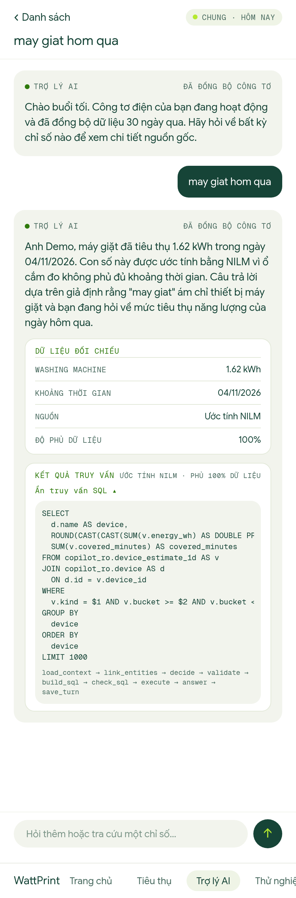

## 5. Tivi tốn điện không?

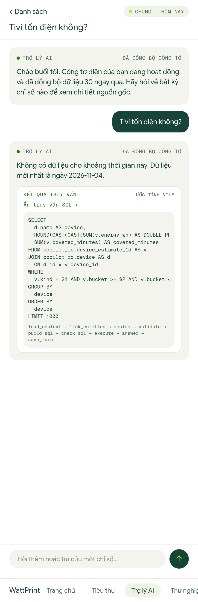

## 6. Quạt trần dùng bao nhiêu?

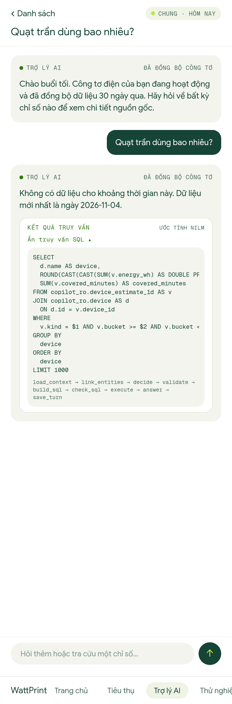

## 7. Điện hôm qua?

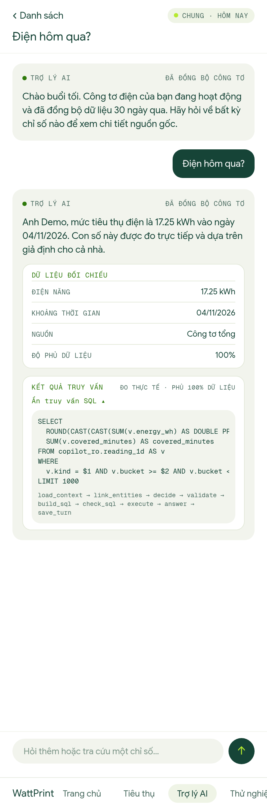

## 8. Ngày 29/10 lò vi sóng thực đo bao nhiêu?

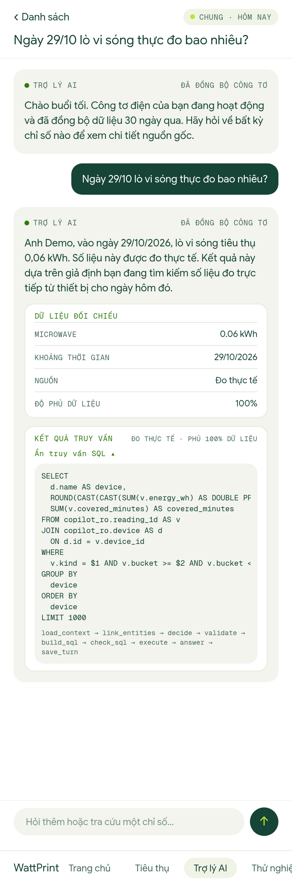

## 9. Tủ lạnh dùng bao nhiêu?

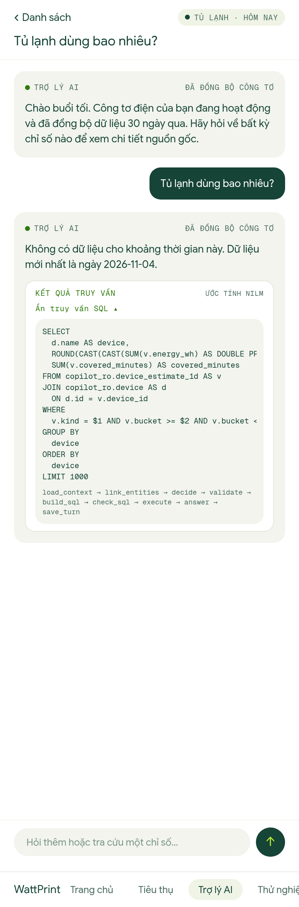

## 10. Máy sấy dùng bao nhiêu?

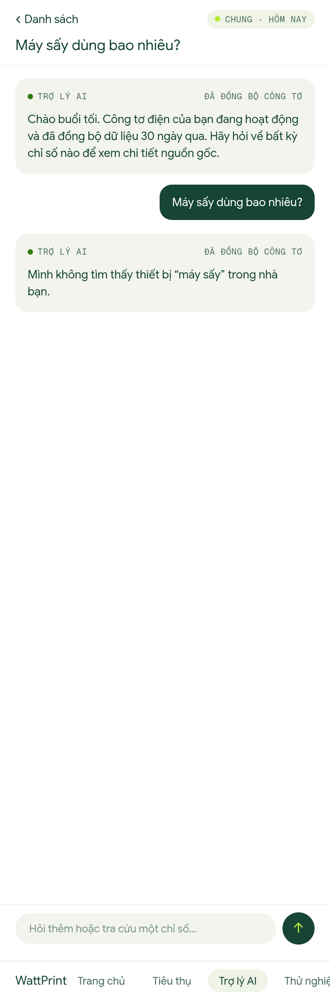

## 11. Thời tiết mai thế nào?

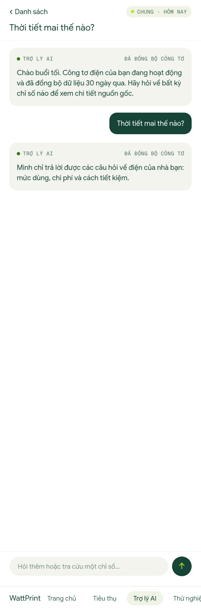

## 12. 4 ngày gần đây so với 4 ngày trước?

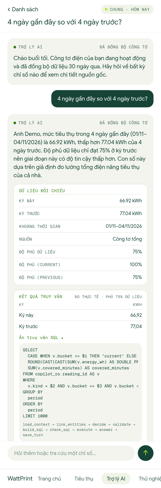

## 13. Dùng bao nhiêu điện?

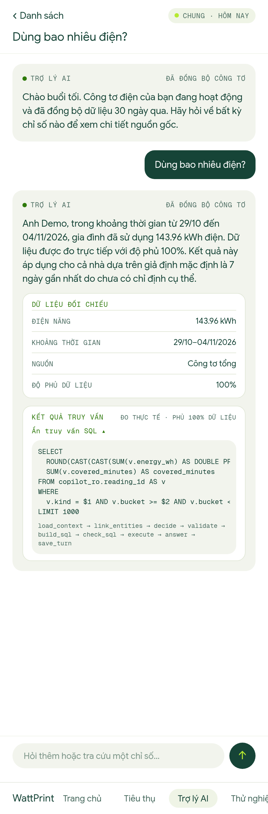

## 14. Cái máy đó dùng bao nhiêu?

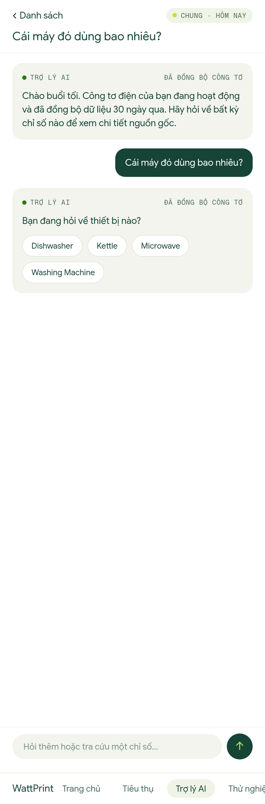

## 15. How much did the washing machine use yesterday?

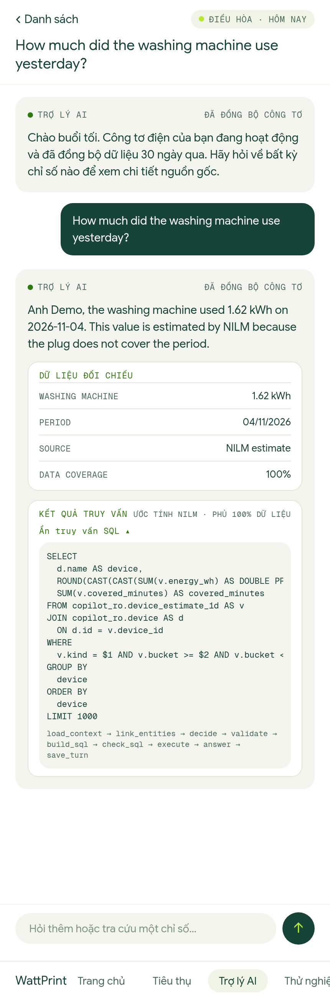

## 16. Tháng này tiền điện bao nhiêu?

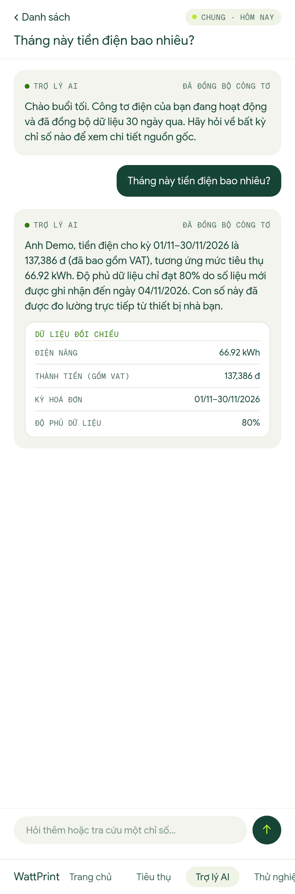

## 17. Làm sao để tiết kiệm điện?

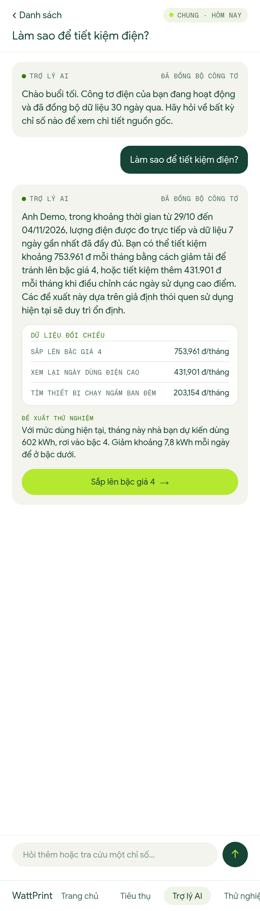
