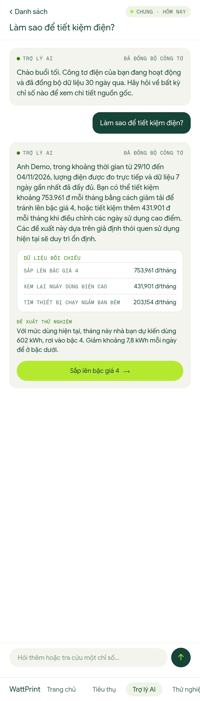

# Household rules (first-order logic): test

Rules posted to `POST /api/v1/copilot/rules` as the home's owner, on the legacy dump (today pinned
to 5 Nov 2026, window 29 Oct – 4 Nov). The expected hit counts come from the raw data: nights'
lowest hourly load 121, 2,729, 103, 327, 402, 388, 248 W; days 24.78, 36.72, 15.54, 14.58, 17.16,
17.93, 17.25 kWh (median 17.25).

Advice refresh before the test: 0 new suggestions stored.

| Rule | Logic | Expected | Got | Verdict |
| --- | --- | --- | --- | --- |
| FOL ≥3 đêm > 300 W | |{n ∈ night(7d) : min_w(n) > 300}| ≥ 3 ⇒ standby_hunt | 201, 4 hits (fires) | 201, 4 hits | PASS |
| FOL mọi đêm > 100 W | ∀n ∈ night(7d) : min_w(n) > 100 ⇒ standby_hunt | 201, 7 hits (fires) | 201, 7 hits | PASS |
| FOL mọi đêm > 200 W | ∀n ∈ night(7d) : min_w(n) > 200 ⇒ standby_hunt (29/10 and 31/10 are below) | 201, 0 hits (does not fire) | 201, 0 hits | PASS |
| FOL ngày gấp đôi | ∃d ∈ day(7d) : ratio(d) > 2 ⇒ high_day_review | 201, 1 hits (fires) | 201, 1 hits | PASS |
| FOL lồng nhau | ∃d : (kwh(d) > 20 ∧ ratio(d) > 1.3) ∨ ¬(kwh(d) > 10) ⇒ high_day_review | 201, 2 hits (fires) | 201, 2 hits | PASS |
| FOL ấm đun 2 lần | ∀device: |{r ∈ repeat_use(7d)}| ≥ 2 ⇒ kettle_refill (only 4/11 repeats) | 201, 0 hits (does not fire) | 201, 0 hits | PASS |
| FOL ≥5 đêm > 300 W | |{n : min_w(n) > 300}| ≥ 5 ⇒ standby_hunt (only 4 nights) | 201, 0 hits (does not fire) | 201, 0 hits | PASS |
| FOL sai: motif lạ | unknown motif | 422 | 422: unknown motif 'laundry_party'; motifs: ['day_above_usual', 'long_run', 'night_baseline', 'repeat_use', 'tier_crossing'] | PASS |
| FOL sai: fact lạ | kwh is not a fact of night_baseline | 422 | 422: motif night_baseline has no fact 'kwh'; facts: ['excess_w', 'median_w', 'min_w', 'night', 'ratio'] | PASS |
| FOL sai: đơn vị | min_w is in W, not kWh | 422 | 422: 'min_w' is in W, not kWh | PASS |
| FOL sai: so sánh nhãn | night is a date label | 422 | 422: fact 'night' is a label and cannot be compared | PASS |
| FOL sai: theo thiết bị | night_baseline is about the whole home | 422 | 422: motif night_baseline is about the whole home, use per: home | PASS |
| FOL sai: thiếu n | at_least needs n | 422 | 422: quantifier at_least needs n | PASS |
| FOL sai: lệch loại | standby advice text needs night facts | 422 | 422: standby_hunt is advice about night_baseline, not day_above_usual | PASS |

**14/14 pass.**

## Rules and their SQL

### FOL ≥3 đêm > 300 W

`|{n ∈ night(7d) : min_w(n) > 300}| ≥ 3 ⇒ standby_hunt`

```json
{"motif": "night_baseline", "window_days": 7, "when": {"quantifier": "at_least", "n": 3, "where": {"fact": "min_w", "op": ">", "value": 300, "unit": "W"}}, "then": {"suggest": "standby_hunt", "per": "home"}}
```

Compiled (runs on the read-only Copilot login, through the SQL guard):

```sql
SELECT CAST(NULL AS UUID) AS device_id, count(*) FILTER (WHERE (CAST(facts ->> 'min_w' AS DOUBLE PRECISION) > $3)) AS hits, array_agg(id) FILTER (WHERE (CAST(facts ->> 'min_w' AS DOUBLE PRECISION) > $3)) AS instances FROM copilot_ro.motif_instance WHERE motif = $1 AND start_ts >= $2 HAVING count(*) FILTER (WHERE (CAST(facts ->> 'min_w' AS DOUBLE PRECISION) > $3)) >= 3 LIMIT 100
```

### FOL mọi đêm > 100 W

`∀n ∈ night(7d) : min_w(n) > 100 ⇒ standby_hunt`

```json
{"motif": "night_baseline", "window_days": 7, "when": {"quantifier": "every", "where": {"fact": "min_w", "op": ">", "value": 100}}, "then": {"suggest": "standby_hunt", "per": "home"}}
```

Compiled (runs on the read-only Copilot login, through the SQL guard):

```sql
SELECT CAST(NULL AS UUID) AS device_id, count(*) FILTER (WHERE (CAST(facts ->> 'min_w' AS DOUBLE PRECISION) > $3)) AS hits, array_agg(id) FILTER (WHERE (CAST(facts ->> 'min_w' AS DOUBLE PRECISION) > $3)) AS instances FROM copilot_ro.motif_instance WHERE motif = $1 AND start_ts >= $2 HAVING bool_and((CAST(facts ->> 'min_w' AS DOUBLE PRECISION) > $3)) AND count(*) > 0 LIMIT 100
```

### FOL mọi đêm > 200 W

`∀n ∈ night(7d) : min_w(n) > 200 ⇒ standby_hunt (29/10 and 31/10 are below)`

```json
{"motif": "night_baseline", "window_days": 7, "when": {"quantifier": "every", "where": {"fact": "min_w", "op": ">", "value": 200}}, "then": {"suggest": "standby_hunt", "per": "home"}}
```

Compiled (runs on the read-only Copilot login, through the SQL guard):

```sql
SELECT CAST(NULL AS UUID) AS device_id, count(*) FILTER (WHERE (CAST(facts ->> 'min_w' AS DOUBLE PRECISION) > $3)) AS hits, array_agg(id) FILTER (WHERE (CAST(facts ->> 'min_w' AS DOUBLE PRECISION) > $3)) AS instances FROM copilot_ro.motif_instance WHERE motif = $1 AND start_ts >= $2 HAVING bool_and((CAST(facts ->> 'min_w' AS DOUBLE PRECISION) > $3)) AND count(*) > 0 LIMIT 100
```

### FOL ngày gấp đôi

`∃d ∈ day(7d) : ratio(d) > 2 ⇒ high_day_review`

```json
{"motif": "day_above_usual", "window_days": 7, "when": {"quantifier": "at_least_one", "where": {"fact": "ratio", "op": ">", "value": 2}}, "then": {"suggest": "high_day_review", "per": "home"}}
```

Compiled (runs on the read-only Copilot login, through the SQL guard):

```sql
SELECT CAST(NULL AS UUID) AS device_id, count(*) FILTER (WHERE (CAST(facts ->> 'ratio' AS DOUBLE PRECISION) > $3)) AS hits, array_agg(id) FILTER (WHERE (CAST(facts ->> 'ratio' AS DOUBLE PRECISION) > $3)) AS instances FROM copilot_ro.motif_instance WHERE motif = $1 AND start_ts >= $2 HAVING count(*) FILTER (WHERE (CAST(facts ->> 'ratio' AS DOUBLE PRECISION) > $3)) >= 1 LIMIT 100
```

### FOL lồng nhau

`∃d : (kwh(d) > 20 ∧ ratio(d) > 1.3) ∨ ¬(kwh(d) > 10) ⇒ high_day_review`

```json
{"motif": "day_above_usual", "window_days": 7, "when": {"quantifier": "at_least_one", "where": {"any": [{"all": [{"fact": "kwh", "op": ">", "value": 20}, {"fact": "ratio", "op": ">", "value": 1.3}]}, {"not": {"fact": "kwh", "op": ">", "value": 10}}]}}, "then": {"suggest": "high_day_review", "per": "home"}}
```

Compiled (runs on the read-only Copilot login, through the SQL guard):

```sql
SELECT CAST(NULL AS UUID) AS device_id, count(*) FILTER (WHERE (((CAST(facts ->> 'kwh' AS DOUBLE PRECISION) > $3) AND (CAST(facts ->> 'ratio' AS DOUBLE PRECISION) > $4)) OR (NOT (CAST(facts ->> 'kwh' AS DOUBLE PRECISION) > $5)))) AS hits, array_agg(id) FILTER (WHERE (((CAST(facts ->> 'kwh' AS DOUBLE PRECISION) > $3) AND (CAST(facts ->> 'ratio' AS DOUBLE PRECISION) > $4)) OR (NOT (CAST(facts ->> 'kwh' AS DOUBLE PRECISION) > $5)))) AS instances FROM copilot_ro.motif_instance WHERE motif = $1 AND start_ts >= $2 HAVING count(*) FILTER (WHERE (((CAST(facts ->> 'kwh' AS DOUBLE PRECISION) > $3) AND (CAST(facts ->> 'ratio' AS DOUBLE PRECISION) > $4)) OR (NOT (CAST(facts ->> 'kwh' AS DOUBLE PRECISION) > $5)))) >= 1 LIMIT 100
```

### FOL ấm đun 2 lần

`∀device: |{r ∈ repeat_use(7d)}| ≥ 2 ⇒ kettle_refill (only 4/11 repeats)`

```json
{"motif": "repeat_use", "window_days": 7, "when": {"quantifier": "at_least", "n": 2}, "then": {"suggest": "kettle_refill", "per": "device"}}
```

Compiled (runs on the read-only Copilot login, through the SQL guard):

```sql
SELECT device_id, count(*) FILTER (WHERE TRUE) AS hits, array_agg(id) FILTER (WHERE TRUE) AS instances FROM copilot_ro.motif_instance WHERE motif = $1 AND start_ts >= $2 GROUP BY device_id HAVING count(*) FILTER (WHERE TRUE) >= 2 LIMIT 100
```

### FOL ≥5 đêm > 300 W

`|{n : min_w(n) > 300}| ≥ 5 ⇒ standby_hunt (only 4 nights)`

```json
{"motif": "night_baseline", "window_days": 7, "when": {"quantifier": "at_least", "n": 5, "where": {"fact": "min_w", "op": ">", "value": 300}}, "then": {"suggest": "standby_hunt", "per": "home"}}
```

Compiled (runs on the read-only Copilot login, through the SQL guard):

```sql
SELECT CAST(NULL AS UUID) AS device_id, count(*) FILTER (WHERE (CAST(facts ->> 'min_w' AS DOUBLE PRECISION) > $3)) AS hits, array_agg(id) FILTER (WHERE (CAST(facts ->> 'min_w' AS DOUBLE PRECISION) > $3)) AS instances FROM copilot_ro.motif_instance WHERE motif = $1 AND start_ts >= $2 HAVING count(*) FILTER (WHERE (CAST(facts ->> 'min_w' AS DOUBLE PRECISION) > $3)) >= 5 LIMIT 100
```

## End to end: a household rule drives the advice

The owner keeps `FOL ≥3 đêm > 300 W`, rejects the open standby suggestion once, and refreshes the
advice. Both the shared rule (one night above 1.5 × the median) and the owner's rule fire; ranking
keeps one standby suggestion, the one with the larger saving.

- Stored: **Tìm thiết bị chạy ngầm ban đêm**: Đêm 30/10, công suất nền lên tới 2.729 W so với 327 W thường ngày. Tìm và tắt thiết bị chạy ngầm có thể tiết kiệm khoảng 203.200 đ mỗi tháng.
- Saving: 54.429 kWh/tháng, 203,154 đ/tháng
- From rule: `FOL ≥3 đêm > 300 W`; nights matched: 4

The chat answer to "Làm sao để tiết kiệm điện?" afterwards: [fol-chat.png](fol-chat.png)


