# Copilot app: skills, tools and memory screens

These screenshots come from the Expo web build of the mobile app (`mobile-app`, Expo 57, expo-router) at a 430 px wide viewport, running against the local backend on the demo home (REFIT House 2, owner `owner@example.com`). The model is `deepseek/deepseek-v4-flash` with bge-m3 embeddings, and the backend date is pinned to 2026-11-05 (`COPILOT_TODAY`), so "hôm qua" is 04/11/2026 and "tuần qua" is 29/10–04/11/2026. The database was freshly set up with `scripts/copilot_skill_eval.py --setup`, the catalog synced, and no household skills, alerts or memory before the first flow. Everything below was done by clicking through the app in a headless Chromium.

| # | Screen | What it shows | Screenshot |
|---|--------|---------------|------------|
| 01 | Kỹ năng | Skill list before the home has any skill of its own; the system skills with their switches | [01-skills-list.png](01-skills-list.png) |
| 02 | Tạo kỹ năng | Name, "Khi nào dùng?", example questions, extra instructions, follow-up questions | [02-editor-top.png](02-editor-top.png) |
| 03 | Tạo kỹ năng | Tool picker grouped by category, each tool marked Đọc or Ghi – sẽ hỏi trước | [03-editor-tools.png](03-editor-tools.png) |
| 04 | Tạo kỹ năng | "Thiết lập sẵn" for Tra cứu điện năng: Kettle and Microwave, group by device | [04-editor-presets.png](04-editor-presets.png) |
| 05 | Kỹ năng | The new skill "Báo cáo bếp" listed under "Của nhà bạn", status Sẵn sàng | [05-skills-list-mine.png](05-skills-list-mine.png) |
| 06 | Sửa kỹ năng | The saved skill reopened in the editor | [06-editor-existing.png](06-editor-existing.png) |
| 07 | Thử | Which skill a question would pick, with score bars | [07-try-sheet.png](07-try-sheet.png) |
| 08 | Trợ lý AI | Answer from the household skill, with the expanded step chip | [08-chat-skill-chip.png](08-chat-skill-chip.png) |
| 09 | Trợ lý AI | Confirmation card before a write (create alert) | [09-chat-confirm.png](09-chat-confirm.png) |
| 10 | Trợ lý AI | The same thread after pressing Có: alert created | [10-chat-confirmed.png](10-chat-confirmed.png) |
| 11 | Kỹ năng | System skill "Gợi ý tiết kiệm" switched off | [11-skill-off.png](11-skill-off.png) |
| 12 | Kỹ năng | The same skill switched back on | [12-skill-on.png](12-skill-on.png) |
| 13 | Kỹ năng | "Phân tích lại ngay" result | [13-advice-refresh.png](13-advice-refresh.png) |
| 14 | Copilot nhớ gì | Memory switch, remembered facts, summarised past session | [14-memory.png](14-memory.png) |
| 15 | Quy tắc gợi ý | Rule list: the home's own rule first, shared rules read-only | [15-rules.png](15-rules.png) |
| 16 | Thêm quy tắc | Rule editor: motif, window, count, condition | [16-rule-editor.png](16-rule-editor.png) |
| 17 | Thêm quy tắc | After saving: how many times the rule would have fired | [17-rule-saved.png](17-rule-saved.png) |
| 18 | Trợ lý AI | Follow-up "Còn hôm kia?" with the step chip and follow-up chips | [18-chat-followup-chip.png](18-chat-followup-chip.png) |

## Create a household skill (01–07)

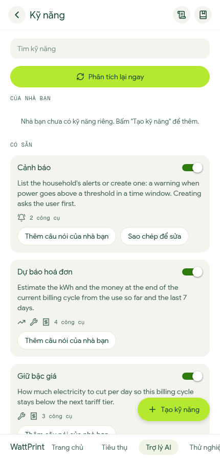
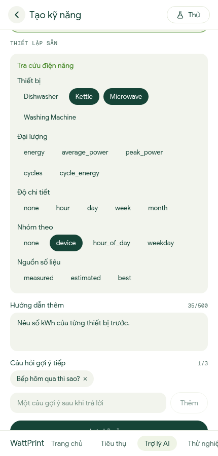

The user opens Kỹ năng from the chat header, taps "Tạo kỹ năng", names it "Báo cáo bếp", adds two example questions ("Báo cáo bếp tuần qua", "Bếp tuần qua tốn bao nhiêu điện") and one follow-up, and picks the tool Tra cứu điện năng. For that tool the presets are Kettle and Microwave and group by device; the device list comes from the disaggregation report because the app has no devices endpoint yet. Saving sends `POST /copilot/skills`, which chunks and embeds the examples before it returns, so the list shows Sẵn sàng straight away.

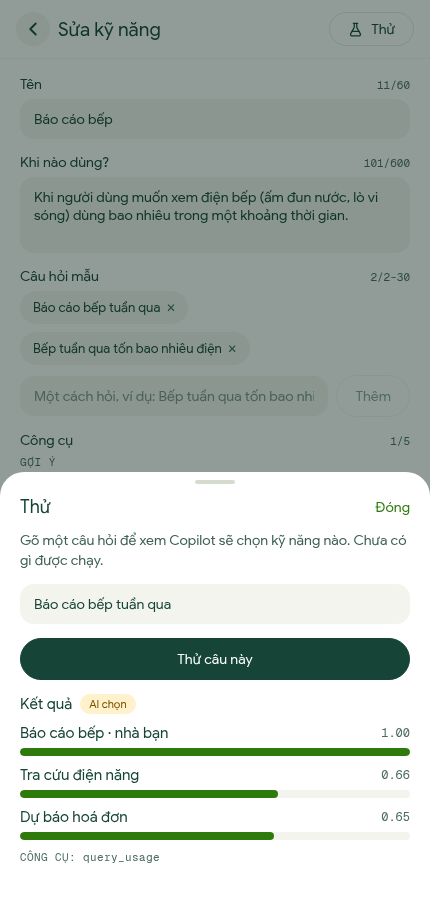

In the Thử sheet the question "Báo cáo bếp tuần qua" ranks the household skill first with score 1.00, ahead of Tra cứu điện năng at 0.66. The case is "AI chọn" (backend case `choose`: a candidate is close enough, and the model picks among the top three when the question is asked for real). Nothing runs; `POST /copilot/skills/try` only returns the candidates and the tools of the top skill (`query_usage`).

## Ask the household skill (08)

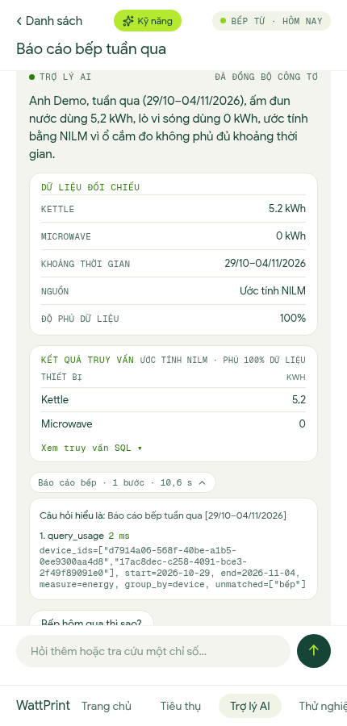

The user asks "Báo cáo bếp tuần qua" in a new thread. The backend picks the skill Báo cáo bếp, calls `query_usage` once with the preset device ids and `group_by=device`, and answers for 29/10–04/11/2026: Kettle 5,2 kWh and Microwave 0 kWh, estimated by NILM at 100% coverage. The chip "Báo cáo bếp · 1 bước · 10,6 s" is expanded: it shows the question as understood and the tool call with its arguments (2 ms).

## Confirm a write (09, 10)

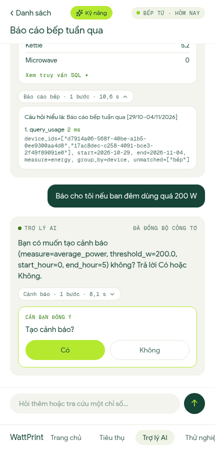
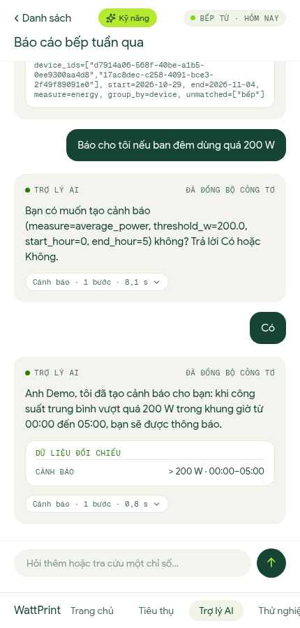

The user writes "Báo cho tôi nếu ban đêm dùng quá 200 W". The Cảnh báo skill prepares `create_alert` (average power above 200 W, 00:00–05:00) but, because the tool writes, it stops and returns a `confirm` card, shown as "Tạo cảnh báo?". Có sends `{question: "Có", conversation_id, confirm_call_id}`; the backend then runs the tool (0,8 s) and says the alert was created, with the "> 200 W · 00:00–05:00" row. Không would send "Không" and nothing would be written.

## Follow-up question (18)

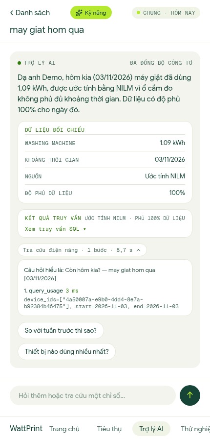

In a new thread the user asks "may giat hom qua" (no tones) and gets 1,62 kWh for the washing machine on 04/11/2026. Then "Còn hôm kia?": the backend rewrites it to "Còn hôm kia? — may giat hom qua [03/11/2026]" and calls `query_usage` for the washing machine device only, answering 1,09 kWh. The expanded chip shows that rewritten question and the single call; the two chips under the answer are the skill's follow-up questions.

## Switch a system skill and re-run the analysis (11–13)

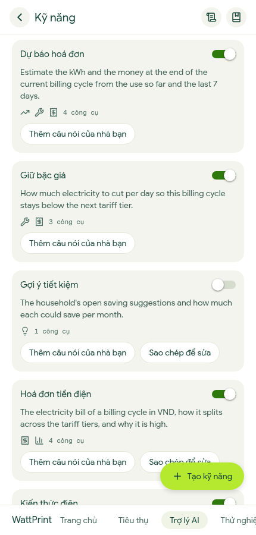
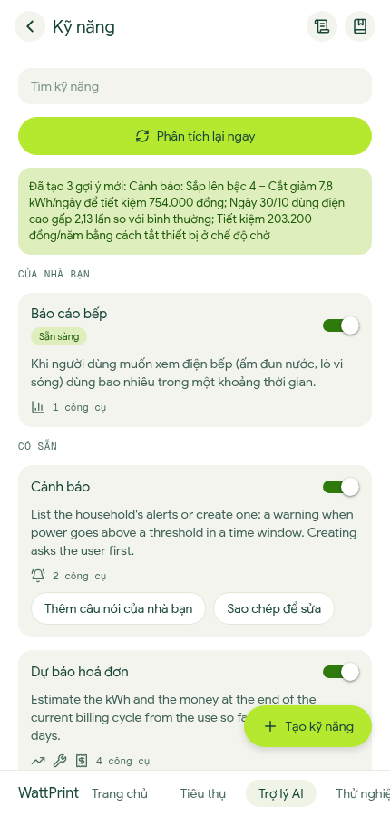

"Gợi ý tiết kiệm" is a system skill; its switch sends `PUT /copilot/skills/{id}/enabled` (a per-home setting, the skill itself is unchanged), and the list reloads with the switch off, then on again. "Phân tích lại ngay" calls `POST /copilot/suggestions/refresh`, which runs the daily advice pipeline; here it stored 3 suggestions (tier warning with 7,8 kWh/day to cut, a high day on 30/10, and standby power).

## Memory (14)

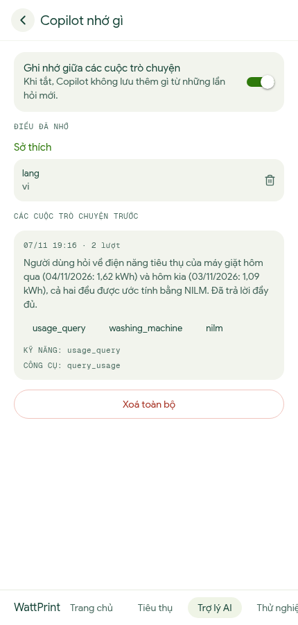

"Copilot nhớ gì" lists the facts kept for the home (here the language preference, with a delete button) and the sessions summarised by `python -m app.cli.copilot_run --sessions --idle-minutes 0`. The one session shown is the washing machine thread: topics, the skill `usage_query` and the tool `query_usage`. The switch turns memory off (`PUT /copilot/memory/enabled`) and "Xoá toàn bộ" deletes all facts and summaries after a second press.

## Rules (15–17)

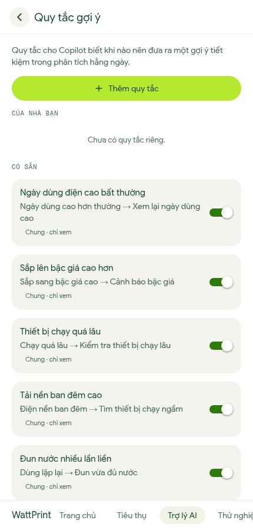
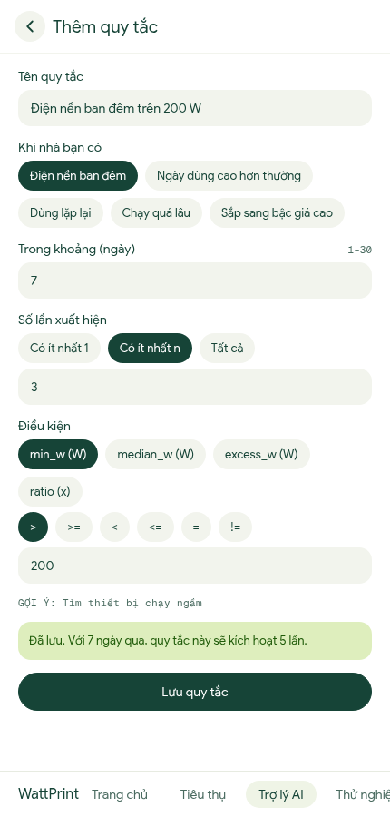

The rule list shows the home's own rule above the shared ones, which are read-only (their switches are disabled). In the editor the user names the rule "Điện nền ban đêm trên 200 W", keeps the motif Điện nền ban đêm, at least 3 occurrences in 7 days where `min_w` > 200 W. Saving sends `POST /copilot/rules`; the backend validates and dry-runs it on the last 7 days and the screen shows "sẽ kích hoạt 5 lần" (`dry_run_hits`).

## How these were made

Backend: `uvicorn app.main:app --port 8097` on a scratch database on `127.0.0.1:5499`, with `COPILOT_TODAY=2026-11-05` and `HF_HUB_OFFLINE=1`. App: `EXPO_PUBLIC_API_URL=http://127.0.0.1:8097` plus the demo login variables, `expo export -p web -c`, served on port 8096. Memory summaries were created by running the session job once, because it is a scheduled job and does not run on its own in this setup.
