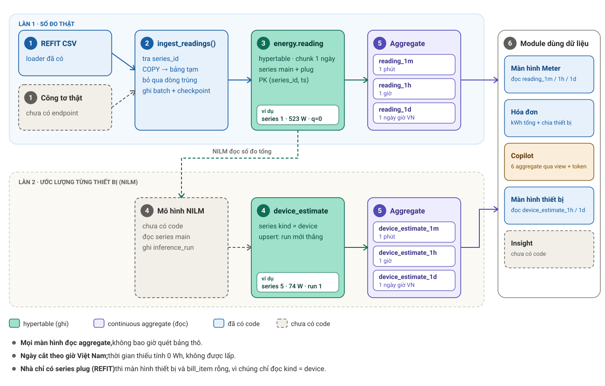
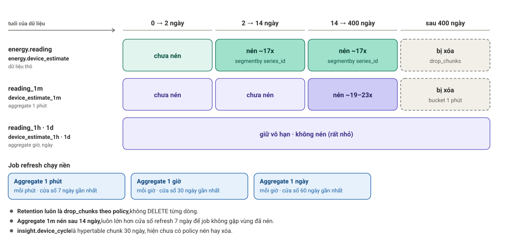
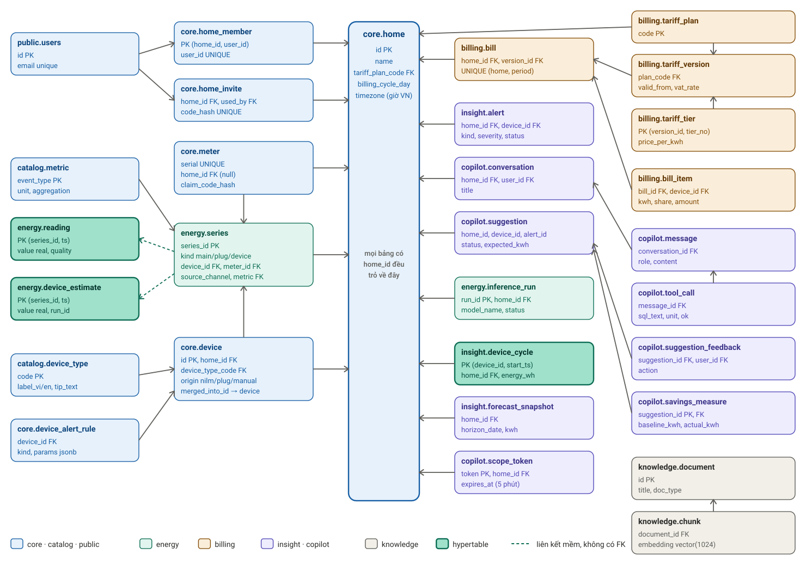

# Thiết kế database WattPrint — bản hướng dẫn

Tài liệu cho người mới: database lưu gì, dữ liệu chảy qua đâu, vì sao thiết kế như vậy và đã kiểm chứng
đến đâu. Mọi chi tiết được đối chiếu với model (`app/models`), migration (`alembic/versions`), service
(`app/services`) và bản audit (`docs/database-audit.md`). Bản tóm tắt cũ hơn: `docs/database-design.md`.

**Trạng thái hiện tại, đọc trước để khỏi hiểu nhầm**

| Đã có code/audit trước khi khởi tạo AI data mart | Đã có revision, chưa xác nhận tích hợp trên database mới |
|---|---|
| Ingest, continuous aggregates + backfill, read model Meter, tính hóa đơn và loader REFIT | Schema `ai`: role, dimensions, energy facts, metrics và conversation; cần lượt kiểm chứng tích hợp riêng trước khi gọi là production-ready |

Alembic hiện có một chuỗi tuyến tính 26 revision từ database bootstrap đến AI conversation/indexes. Revision mới cho đối tượng nghiệp vụ đặt trong `versions/public/`; data mart và conversation AI đặt trong `versions/ai/`; thay đổi đối tượng đã có hoặc luồng chung đặt trong `versions/updates/`. Các thư mục này cùng dùng một chuỗi `down_revision`, không tạo nhánh độc lập. Ba revision database-wide cũ nằm trực tiếp trong `versions/`.

Hai điểm cần xử lý trong lần dọn migration tiếp theo: TimescaleDB được bật lặp ở bootstrap, revision `a1c3f5b7d9e2` và `foundation`; revision `cf93b7d8a102` cấp quyền app rộng hơn ma trận quyền phía sau và để lại default privileges rộng. Vì các revision đã được commit lên `main`, thay đổi grants nên được sửa tiến bằng revision mới trong `versions/updates/`, không sửa lịch sử đã commit.

Dữ liệu `tb_device_estimate` hiện có là **giả lập**: harness audit copy các kênh `Appliance1-9` của REFIT thành
series `kind = 'device'` để đo khối lượng. Loader REFIT không làm việc này.

---

## 1. Nhu cầu lưu trữ

Hệ thống đo **một cảm biến duy nhất ở aptomat**, rồi NILM tách điện năng từng thiết bị. Từ đó cần lưu 5 nhóm:
số đo và ước lượng (rất lớn), nhà và thiết bị, tiền điện, kết quả phân tích, trợ lý AI.

| Schema | Bảng | Mục đích |
|---|---|---|
| `public` | Các bảng nghiệp vụ `tb_*` và catalog `cat_*` | Home, device, hồ sơ người dùng, energy raw/aggregates, billing, insight, ops, knowledge và suggestions |
| `ai` | `ai_conversation`, `ai_message`, `ai_tool_call` | Hội thoại AI; `wattprint_app` và `wattprint_ai` được đọc/ghi |
| | `dim_tariff_plan`, `dim_home`, `dim_device` | Dimensions đồng bộ từ nguồn `public`; AI chỉ đọc |
| | `fact_reading_1m`, `fact_estimate_1m`, `fact_energy` | Views dữ liệu phút, khóa theo dimension; AI chỉ đọc |
| | `metric_definition` | Metric seed cùng SQL truy vấn fact; AI đọc, app quản lý |
| `copilot_ro` | 15 view + `current_home()` | Lớp đọc giới hạn theo home của role Copilot cũ; không phải lớp truy cập của `wattprint_ai` |

---

## 2. Luồng hoạt động của dữ liệu

**Từng bước**

1. **Nguồn.** Công tơ thật gửi số đo (endpoint chưa có). Hiện chỉ có dữ liệu seed REFIT House 2,
   nạp bởi revision Alembic `e2b726548f8c` khi `alembic upgrade head`: mỗi dòng CSV 13 cột được tách
   thành 10 reading (Aggregate và Appliance1-9), cột `Issues = 1` thành `quality = 1`. Revision này
   ghi thẳng vào `public.tb_reading` (không qua bước Ingest bên dưới), nạp phần test trước rồi phần
   train, theo dõi tiến độ trong `etl.tb_watermark` để chạy lại tiếp từ chỗ dừng. Đặt `SEED_REFIT=0`
   để bỏ qua.
2. **Ingest** (`app/services/ingest.py::ingest_readings`) là cửa vào duy nhất. Hàm tra `series_id` từ
   `(meter, kênh)`, nạp vào bảng tạm bằng COPY rồi `INSERT … ON CONFLICT (series_id, ts) DO NOTHING`.
   Dòng sai (kênh lạ, NaN, ngoài miền `real`, `ts` không có múi giờ) được đếm vào `rows_bad`, không ghi.
   Mỗi lần gọi ghi một dòng `public.tb_ingest_batch` với `rows_in = rows_new + rows_dup + rows_bad`, và cập
   nhật `public.tb_ingest_checkpoint` theo từng series. Nạp lại cùng file không đổi dữ liệu.
3. **`public.tb_reading`** giữ số đo thật: series `main` (công tơ tổng) và `plug` (ổ cắm đo riêng).
4. **NILM** *(chưa có code)*. Thiết kế: mô hình đọc series `main`, tạo một dòng `public.tb_inference_run`, rồi
   gọi `ingest_estimates()` để **upsert** vào `public.tb_device_estimate` (series `kind = 'device'`, kèm
   `run_id`). Chạy lại mô hình thì ghi đè: lần chạy mới nhất thắng, không tích lũy phiên bản.
5. **Continuous aggregate** xếp tầng `1m → 1h → 1d` cho cả hai họ. Mỗi tầng có `avg_w, min_w, max_w,
   last_w, n, energy_wh`; tầng 1h và 1d có thêm `covered_minutes`. Ngày được cắt theo
   `Asia/Ho_Chi_Minh` (17:00 UTC). Real-time aggregation bật nên dữ liệu mới hơn watermark vẫn hiện.
6. **Module dùng dữ liệu**
   - *Meter* (`services/meter.py`): `meter_series` chọn bước nhỏ nhất trong `1m, 5m, 15m, 30m, 1h, 3h,
     6h, 1d` sao cho không quá `max_points` (tối đa 2000, cửa sổ tối đa 90 ngày); `latest_power` lấy
     bucket 1 phút đã đóng mới nhất trong 7 ngày.
   - *Hóa đơn* (`services/public.py::compute_bill`): kWh tổng từ `reading_1d` series `main`, áp bậc
     giá của version hiệu lực tại `period_start`; chia theo thiết bị từ `device_estimate_1d`, phần
     không giải thích được thành item `other`. Idempotent theo `(home, period_start)`.
   - *Màn hình thiết bị*: `device_breakdown` đọc `device_estimate_1h` (≤ 3 ngày) hoặc `_1d`.
   - *Copilot*: chỉ đọc view `copilot_ro` (mục 3).

**Hai điều dễ nhầm với NILM**

- `reading_1m` chỉ tính mẫu tốt (`quality & 1 = 0`), còn `device_estimate_1m` không lọc gì. Vì vậy tổng
  kWh các thiết bị có thể lớn hơn kWh công tơ; `compute_bill` chuẩn hóa và không tạo item `other` khi đó.
- Màn hình thiết bị và `tb_bill_item` chỉ đọc series `kind = 'device'`. Loader REFIT chỉ tạo `main` và
  `plug` (device có `origin = 'plug'`), nên một nhà chỉ có `plug` sẽ ra danh sách thiết bị **rỗng** cho
  tới khi có NILM hoặc một quyết định đọc cả `plug`.

---

## 3. Nguyên tắc thiết kế

### 3.1 Nguyên tắc chung

| Nguyên tắc | Áp dụng | Lý do |
|---|---|---|
| Một DB cho tất cả | PostgreSQL 18 + TimescaleDB 2.31 + pgvector (`timescale/timescaledb:2.31.0-pg18`, pin cứng) | Billing, Copilot và màn hình cần join chuỗi thời gian với dữ liệu quan hệ; chỉ một nơi backup, phân quyền |
| Thời gian UTC | Mọi cột là `timestamptz`; ngày cắt theo giờ Việt Nam; `home.timezone` có CHECK = `Asia/Ho_Chi_Minh` | Tránh lệch ngày khi tính hóa đơn |
| Kiểu dữ liệu theo vai trò | Tiền `numeric`; công suất `real` (W); năng lượng suy ra `double precision` | Không dùng float cho tiền |
| Ghi một đường duy nhất | Mọi nguồn đi qua `ingest_readings`, kể cả REFIT | Có idempotency, checkpoint, audit ở một nơi |
| Con số do code tính | kWh, VND, đơn vị tính bằng SQL/service; Copilot chỉ đọc và giải thích; mỗi `ai.ai_tool_call` lưu SQL và đơn vị | Kiểm toán được từng số |
| Thiếu dữ liệu thì nói thiếu | Phút thiếu tính 0 Wh, không lấp; `covered_minutes`; hóa đơn có coverage < 95% là `partial` | Không âm thầm tính thiếu |
| Riêng tư | Mã mời và mã ghép cặp chỉ lưu hash; `tb_cohort_stat` CHECK `n_homes >= 10` | Không lộ danh tính nhóm nhỏ |
| Có thể dựng lại | Mọi thay đổi là một revision Alembic viết tay; dựng được từ volume rỗng không cần bước tay | Không có drift giữa môi trường |

### 3.2 Yêu cầu và quy tắc cho hypertable

| Quy tắc | Cụ thể |
|---|---|
| Hypertable là **nơi ghi**, continuous aggregate là **nơi đọc** | Màn hình không bao giờ quét `tb_reading` thô; raw chỉ để ingest, audit, cửa sổ ngắn |
| Khóa chính phải chứa cột thời gian | `PRIMARY KEY (series_id, ts)`; `tb_device_cycle` là `(device_id, start_ts)` |
| Khóa nhỏ | Hypertable chỉ mang `series_id integer`, không lặp home hay device; ID và FK của bảng quan hệ dùng integer identity/integer |
| Không FK vào hai bảng lớn | `tb_reading`, `tb_device_estimate` không có FK; toàn vẹn của `series_id` do ingest bảo đảm (tra từ `public.tb_series`) |
| Không index phụ | Chỉ có khóa chính, trừ khi một truy vấn đo được cần |
| Chunk | 1 ngày cho `tb_reading`, `tb_device_estimate`; 30 ngày cho `tb_device_cycle` (ít dòng hơn nhiều) |
| Nén | `segmentby series_id`, `orderby ts DESC`; `ON CONFLICT` vẫn chạy trên chunk đã nén (đã kiểm chứng) |
| Retention là policy | `drop_chunks` qua job, không `DELETE` từng dòng |
| Aggregate tạo `WITH NO DATA` | Trong transaction migration không được `WITH DATA` hay refresh; refresh chạy trong `autocommit_block()` |
| `refresh_continuous_aggregate` không chạy trong hàm | Nên backfill là hàm Python (`app/services/aggregates.py`), kết nối AUTOCOMMIT |
| Aggregate xếp tầng | `1h` đọc từ `1m`, `1d` đọc từ `1h`; `energy_wh` tầng trên **cộng** `energy_wh` bucket con |
| Quy tắc năng lượng | Tầng 1m: phút có ít nhất một mẫu tốt tính `avg_w × 60 / 3600` Wh |
| Aggregate 1m cũng nén | `compress_after` 14 ngày phải **lớn hơn** `start_offset` 7 ngày của refresh policy, kẻo job refresh gặp cửa sổ đã nén |

### 3.3 Quy tắc vận hành cần nhớ

- **`alembic upgrade head` bật cả 14 policy job.** Trước khi nạp lịch sử cũ hơn 400 ngày phải chạy
  `SELECT public.set_policies(false)`, nếu không retention xóa chính dữ liệu vừa nạp; nạp xong, backfill rồi
  `set_policies(true)`. CLI REFIT từ chối chạy (mã thoát 2) khi policy sẽ đụng dữ liệu; `--shift-days`
  dời ngày vào cửa sổ, `--allow-active-policies` để ép.
- **Không backfill cửa sổ cũ hơn retention của raw:** refresh trên vùng raw đã bị drop sẽ xóa bucket
  1h/1d đang có. `backfill_aggregates` có guard theo từng series và ngày: ngày nào số dòng đã materialize
  lớn hơn số raw còn lại thì bỏ qua và trả về `SkippedWindow`. Giới hạn: dòng trễ cùng series có thể che
  mất phần đã mất; qua guard không chứng minh raw còn nguyên.
- **Ingest** phải được chia nhỏ 50k-500k dòng mỗi lần gọi (vòng phân loại giữ mọi dòng trong bộ nhớ);
  hàm chỉ flush, caller tự commit.

### 3.4 Quyền và cô lập Copilot

| Role | Quyền |
|---|---|
| Login owner (`POSTGRES_USER`) | Chạy migration; sở hữu các view `copilot_ro` |
| `wattprint_app` | DML trên bảng API và AI conversation/dimensions; quản lý `metric_definition`; phát/xóa `tb_scope_token`; đọc aggregate |
| `wattprint_ingest` | Đọc `tb_meter`, `tb_series`; INSERT `tb_reading`; INSERT/UPDATE `tb_device_estimate`, `public.ingest_*` |
| `wattprint_copilot_ro` | SELECT trên view `copilot_ro` và whitelist `public` (documents/chunks, catalogs, tariffs); `statement_timeout = 5s` |
| `wattprint_ai_user` (member của `wattprint_ai`) | DML conversation; SELECT dimensions, facts và metrics; `statement_timeout = 30s` |

**Lưu ý cần xử lý trong migration:** revision `cf93b7d8a102` cấp `ALL PRIVILEGES` trên schema/table và default privileges cho `wattprint_app`; revision ma trận quyền sau đó không thu hồi các quyền rộng này. Vì vậy quyền thực tế của `wattprint_app` hiện rộng hơn bảng này mô tả và rộng hơn least privilege. Không xem ma trận dưới đây là đã được xác nhận thực tế cho tới khi sửa và kiểm tra lại grants.

Copilot cũ không đọc bảng mà đọc 15 view
`copilot_ro` (`security_barrier`). Phạm vi home do `copilot_ro.current_home()` phân giải từ
`app.copilot_token`; token thiếu, sai định dạng, không tồn tại hoặc quá 5 phút thì trả `NULL` nên mọi
view trả 0 dòng (fail closed). Backend phải đặt token bằng bind parameter với `is_local = true`. Executor
SQL của Copilot phải có login riêng và validator SELECT-only trên parse tree (chưa viết).

---

## 4. Quan hệ CSDL

- **`public.tb_home` là trung tâm.** Bảng nào có `home_id` đều `ON DELETE CASCADE` về đây (riêng `tb_meter.home_id`
  không cascade, `public.tb_ingest_batch.home_id` là `SET NULL`).
- **`tb_users` 1—1 `tb_home_member` N—1 `tb_home`** (`UNIQUE (user_id)`: một tài khoản, một home; nới ra sau này
  chỉ là bỏ một ràng buộc). `tb_users` còn là chủ của `tb_home_invite.used_by`, `ai.ai_conversation`,
  `tb_suggestion_feedback`.
- **Đo lường:** `tb_meter` và `tb_device` cùng sinh ra `tb_series`; `tb_series` 1—N `tb_reading` / `tb_device_estimate` bằng
  liên kết mềm (nét đứt, không FK). `tb_device_estimate.run_id` cũng là liên kết mềm tới `tb_inference_run`.
- **Billing:** `tb_home.tariff_plan_code` → `tb_tariff_plan.code`; `tb_tariff_plan` 1—N `tb_tariff_version` 1—N
  `tb_tariff_tier`; `tb_bill.version_id` ghi version đã dùng; `tb_bill` 1—N `tb_bill_item`; `tb_bill_item.device_id`
  là `SET NULL` khi xóa thiết bị.
- **Thiết bị:** `tb_device.merged_into_id` tự trỏ vào `tb_device` (gộp thiết bị); `tb_device_cycle`, `tb_alert`,
  `tb_suggestion`, `tb_device_alert_rule`, `tb_series`, `tb_bill_item` đều có `device_id`.
- **Copilot:** `ai.ai_conversation` → `ai.ai_message` → `ai.ai_tool_call`; `tb_suggestion` → `tb_suggestion_feedback`,
  `tb_savings_measure`; `tb_suggestion.alert_id` → `public.tb_alert`.
- **Chưa có ràng buộc chặn chéo home:** `tb_series.device_id`, `tb_bill_item.device_id`, `tb_suggestion.alert_id` có
  thể trỏ sang id của home khác (chỉ lộ số ID, join sang view không ra dòng nào).

---

## 5. Chi tiết từng bảng

Quy ước: `PK` khóa chính, `FK` khóa ngoại, *null* là cho phép NULL. Cột ID dùng `integer identity`,
các FK tương ứng dùng `integer`; `created_at` mặc định `now()`. `public.tb_scope_token.token` vẫn là UUID
ngẫu nhiên vì đó là bearer token, không phải ID bản ghi.

### 5.1 `core`

| Bảng | Cột | Ràng buộc và ghi chú |
|---|---|---|
| `tb_home` | `id`, `name`, `postal_code`, `province_code`, `home_type`, `floor_area_m2 numeric(8,2)`, `year_built`, `occupants`, `timezone`, `tariff_plan_code`, `billing_cycle_day`, `created_at` | `home_type` ∈ apartment/house/other; `billing_cycle_day` 1-28 (mặc định 1); `timezone` CHECK = `Asia/Ho_Chi_Minh` (cột có sẵn để sau này hỗ trợ đa múi giờ); `tariff_plan_code` FK `ON UPDATE CASCADE ON DELETE SET NULL` |
| `tb_home_member` | `home_id`, `user_id`, `role`, `joined_at` | PK `(home_id, user_id)`; `UNIQUE (user_id)`; `role` ∈ owner/member |
| `tb_home_invite` | `id`, `home_id`, `code_hash`, `role`, `expires_at`, `used_by`, `used_at` | `code_hash` UNIQUE (chỉ lưu hash) |
| `tb_meter` | `id`, `serial`, `home_id` *null*, `claim_code_hash` *null*, `claimed_at`, `firmware`, `last_seen_at`, `status` | `serial` UNIQUE; `claim_code_hash` UNIQUE khi khác NULL; `status` ∈ new/active/retired. Meter xuất xưởng với mã ghép cặp dùng một lần, lần claim đầu gắn nó vào home |
| `tb_device` | `id`, `home_id`, `device_type_code`, `name`, `room`, `origin`, `show_on_timeline`, `active_from`, `active_to`, `merged_into_id`, `deleted_at`, `created_at` | `origin` ∈ nilm/plug/manual; CHECK `active_to > active_from`. Kênh REFIT bị đổi tên giữa chừng thành device mới có khoảng hiệu lực riêng |
| `tb_device_alert_rule` | `id`, `device_id`, `kind`, `params jsonb`, `enabled` | `kind` ∈ on/off/custom |

### 5.2 `catalog`

| Bảng | Cột | Ghi chú |
|---|---|---|
| `cat_metric` | `event_type` PK, `unit`, `aggregation` | `aggregation` ∈ mean/max/public. Seed: `power_w` (W), `energy_wh` (Wh), `reactive_power_var`, `voltage_v`, `current_a` |
| `cat_device_type` | `code` PK, `label_vi`, `label_en`, `typical_watts` *null*, `tip_text` | Seed 22 loại (ac, fridge, washing_machine, … `always_on`, `other`); nuôi thẻ "About" và gợi ý Copilot |

### 5.3 `energy`

**`tb_series`**: cầu nối duy nhất giữa số đo và thế giới quan hệ.

| Cột | Kiểu | Ghi chú |
|---|---|---|
| `series_id` | `integer` identity PK | Là thứ duy nhất hypertable mang theo |
| `home_id` | `integer` FK | cascade |
| `kind` | `varchar(16)` | `main` công tơ tổng · `plug` ổ cắm đo riêng (kênh Appliance của REFIT) · `tb_device` kết quả NILM |
| `device_id` | `integer` *null* FK | cascade |
| `meter_id` | `integer` *null* FK | `SET NULL`: thay meter thì series và lịch sử còn nguyên |
| `source_channel` | `text` *null* | Tên kênh nguồn, ví dụ `Appliance3` |
| `metric` | `varchar(64)` FK | → `public.cat_metric` |
| `unit` | `text` | |

Ràng buộc: `main` thì `device_id` phải NULL; `plug` và `tb_device` thì `device_id` bắt buộc;
`UNIQUE (home_id, kind, device_id, metric) NULLS NOT DISTINCT` nên một nhà chỉ có đúng một `main` mỗi
metric; index unique `(meter_id, source_channel)` khi cả hai khác NULL, là chỗ ingest đổi "meter X, kênh
Appliance3" thành `series_id`.

**Hai hypertable ghi** (chunk 1 ngày, nén sau 2 ngày, giữ 400 ngày):

| Bảng | Cột | Ghi chú |
|---|---|---|
| `tb_reading` | `ts timestamptz`, `series_id int`, `value real` (W), `quality smallint` (mặc định 0) | PK `(series_id, ts)`. `quality` là bit cờ: bit 1 (giá trị 1) = nguồn báo lỗi (REFIT `Issues`), bị loại khỏi aggregate; ingest chấp nhận 0..32767 |
| `tb_device_estimate` | `ts`, `series_id`, `value real` (W), `run_id int` *null* | PK `(series_id, ts)`; ghi bằng upsert, lần chạy mới nhất thắng |

**Sáu aggregate** (`reading_*` và `device_estimate_*`, real-time aggregation bật):

| Cột | Kiểu | Ý nghĩa |
|---|---|---|
| `bucket` | `timestamptz` | Đầu bucket; tầng 1d cắt theo 17:00 UTC |
| `series_id` | `integer` | |
| `avg_w` | `double precision` | Tầng 1m: `avg(value)`; tầng trên: trung bình **có trọng số** `sum(avg_w·n)/sum(n)`, không phải trung bình của trung bình |
| `min_w`, `max_w`, `last_w` | `real` | |
| `n` | `bigint` | Số mẫu |
| `energy_wh` | `double precision` | 1m: `avg_w × 60/3600`; 1h, 1d: tổng `energy_wh` bucket con |
| `covered_minutes` | `bigint` | Chỉ có ở 1h, 1d: số phút có dữ liệu; coverage = `covered_minutes` / phút kỳ vọng |

Policy: refresh 1m mỗi phút (cửa sổ 7 ngày), 1h mỗi giờ (30 ngày), 1d mỗi giờ (60 ngày); 1m giữ 400
ngày và nén sau 14 ngày; 1h, 1d giữ vô hạn, không nén.

| Bảng | Cột | Ghi chú |
|---|---|---|
| `tb_inference_run` | `run_id` identity PK, `home_id` FK, `model_name`, `model_version`, `window_start`, `window_end`, `started_at`, `finished_at` *null*, `status` | `status` ∈ running/ok/failed. Ai đã tạo ước lượng nào |
| `tb_weather_hourly` | `province_code`, `ts`, `temp_c real`, `humidity_pct real` | PK `(province_code, ts)`; bảng thường |

### 5.4 `billing`

| Bảng | Cột | Ràng buộc và ghi chú |
|---|---|---|
| `tb_tariff_plan` | `code` PK, `name`, `currency` (mặc định VND) | Home trỏ vào **mã** plan |
| `tb_tariff_version` | `id`, `plan_code`, `valid_from`, `valid_to` *null*, `vat_rate numeric(5,4)`, `source_doc` | `UNIQUE (plan_code, valid_from)`. EVN đổi giá thì thêm một version, không sửa home nào. Chưa có ràng buộc chống chồng lấn ngày hiệu lực |
| `tb_tariff_tier` | `version_id`, `tier_no`, `from_kwh`, `to_kwh` *null*, `price_per_kwh numeric(12,2)` | PK `(version_id, tier_no)`. Bậc phủ khoảng `(from_kwh, to_kwh]`; bậc cuối `to_kwh` NULL |
| `tb_bill` | `id`, `home_id`, `period_start`, `period_end`, `version_id`, `kwh_total numeric(12,3)`, `amount_before_vat`, `vat_amount`, `amount_total`, `coverage numeric(5,4)`, `tariff_straddle`, `status`, `computed_at` | `UNIQUE (home_id, period_start)`; `status` ∈ open/partial/closed |
| `tb_bill_item` | `id`, `bill_id`, `device_id` *null*, `label`, `kwh`, `share numeric(7,6)`, `amount` | Chi phí thiết bị = tỉ lệ kWh × tiền trước VAT; `label = 'other'` cho phần chưa giải thích |

Seed: plan `vn_residential` với hai version: **1279/QĐ-BCT** (từ 2025-05-10, 6 bậc: 1.984 · 2.050 · 2.380 ·
2.998 · 3.350 · 3.460 đồng/kWh) và **2892** (từ 2026-11-01, 5 bậc: 1.901 · 2.289 · 2.894 · 3.456 ·
3.844). Cả hai đang để `vat_rate = 0.08` theo đợt giảm VAT, **chưa xác nhận** từ văn bản chính thức.
Chu kỳ vắt qua ngày đổi giá chỉ được đánh dấu `tariff_straddle`, chưa chia hóa đơn hay prorate bậc vì quy
tắc chính thức chưa có.

### 5.5 `insight`

| Bảng | Cột | Ghi chú |
|---|---|---|
| `tb_device_cycle` *(hypertable theo `start_ts`, chunk 30 ngày)* | `home_id`, `device_id`, `start_ts`, `end_ts`, `energy_wh double`, `peak_w real` | PK `(device_id, start_ts)`; CHECK `end_ts > start_ts`; index `(home_id, start_ts DESC)`. Dựng timeline "máy lạnh bật 13 phút" |
| `tb_alert` | `id`, `home_id`, `device_id` *null*, `kind`, `severity`, `ts`, `payload jsonb`, `status` | `severity` ∈ info/warning/critical; `status` ∈ open/acknowledged/resolved |
| `tb_forecast_snapshot` | `id`, `home_id`, `generated_at`, `horizon_date`, `kwh`, `amount`, `tier_cross_date` *null*, `model_version` | `UNIQUE (home_id, generated_at, horizon_date)` |
| `tb_cohort_stat` | `cohort_key`, `period`, `p10_w`, `p33_w`, `p66_w`, `p90_w`, `n_homes` | PK `(cohort_key, period)`; CHECK `n_homes >= 10` |

### 5.6 `copilot`

| Bảng | Cột | Ghi chú |
|---|---|---|
| `tb_scope_token` | `token uuid` PK, `home_id integer` FK, `expires_at` (mặc định `now() + 5 phút`), `created_at` | Chỉ `wattprint_app` đọc/ghi; **không có job dọn**, backend tự xóa token hết hạn |
| `ai.ai_conversation` | `id`, `home_id`, `user_id`, `title`, `created_at` | |
| `ai.ai_message` | `id`, `conversation_id`, `role`, `content`, `created_at` | `role` ∈ user/assistant/tool/system |
| `ai.ai_tool_call` | `id`, `message_id`, `tool`, `input jsonb`, `sql_text`, `unit`, `duration_ms`, `ok` | Truy vết mỗi con số về truy vấn và đơn vị |
| `tb_suggestion` | `id`, `home_id`, `device_id`, `alert_id`, `kind`, `title`, `body`, `expected_kwh`, `expected_amount`, `status`, `created_at` | `status` ∈ proposed/shown/accepted/dismissed/done |
| `tb_suggestion_feedback` | `id`, `suggestion_id`, `user_id`, `action`, `at`, `note` | `action` ∈ accept/ignore/done/dislike |
| `tb_savings_measure` | `suggestion_id` PK, `baseline_kwh`, `actual_kwh`, `weather_adjusted_kwh` *null*, `method` (mặc định `M&V`), `measured_at` | Bản ghi đo tiết kiệm trước/sau |

`copilot_ro`: 9 view bọc bảng (`home`, `device`, `series`, `bill`, `bill_item`, `alert`, `device_cycle`,
`suggestion`, `forecast_snapshot`) và 6 view bọc aggregate (`reading_1m/1h/1d`,
`device_estimate_1m/1h/1d`). Mọi view lọc theo `current_home()`, và đi qua `tb_series` / `tb_device` / `tb_home` chứ
không tin `home_id` phi chuẩn hóa.

### 5.7 `knowledge` và `ops`

| Bảng | Cột | Ghi chú |
|---|---|---|
| `public.tb_document` | `id`, `title`, `doc_type`, `lang` (mặc định vi), `source_url`, `version`, `license_note`, `published_at` | `doc_type` ∈ standard/guide/tariff/expert_rule/other |
| `public.tb_chunk` | `id bigint` identity, `document_id`, `ord`, `body`, `tsv`, `embedding vector(1024)`, `embedding_model`, `token_count` | `UNIQUE (document_id, ord)`; `tsv` là cột sinh sẵn `to_tsvector('simple', immutable_unaccent(body))` (bỏ dấu tiếng Việt); index GIN trên `tsv`, HNSW cosine (`m = 16`, `ef_construction = 64`) trên `embedding`; tên model lưu theo từng dòng để phát hiện đổi model |
| `public.tb_ingest_batch` | `id`, `source`, `home_id` *null*, `started_at`, `finished_at`, `rows_in/new/dup/bad`, `status`, `note` | `status` ∈ running/ok/failed; dòng `failed` mang nội dung lỗi |
| `public.tb_ingest_checkpoint` | `source`, `series_id`, `last_ts`, `updated_at` | PK `(source, series_id)`; `last_ts` không bao giờ lùi |
| `public.series_daily_coverage` | view | Mỗi series mỗi ngày địa phương: `covered_minutes`, `coverage` trên 1440 phút. Series chưa có reading nào thì không xuất hiện |
| `public.stale_series` | view | Series có checkpoint mới nhất cũ hơn 60 phút. Series chưa bao giờ báo dữ liệu thì không xuất hiện |
| `public.set_policies(bool)` | hàm | Bật/tắt idempotent toàn bộ 14 policy job |

---

## 6. Thử nghiệm và kiểm chứng

### 6.1 Cách kiểm

- **Audit với dữ liệu thật:** REFIT nhà 1-3 nạp qua đúng đường ingest production, **196,881,280 reading**
  và **177,193,152 dòng `tb_device_estimate` giả lập** (khoảng 5.1 home-year), ngày được dời để kết thúc
  vào 2026-10-31, policy tắt lúc nạp. Máy: PostgreSQL 17.11 (trước khi lên PG18), TimescaleDB 2.31.0, 16 CPU, `shared_buffers`
  3 GB. Harness ở `tests/audit`, số liệu gốc `docs/audit-results.json`.
- **Test tự động:** 254 hàm test trong `tests/db` (foundation, bảng, ingest, aggregate, backfill guard,
  nén aggregate, meter, billing, loader REFIT, role). *Chưa chạy lại trong phiên viết tài liệu này.*

### 6.2 Kết quả theo tiêu chí

| # | Tiêu chí | Kết quả | Số liệu (**đo** trừ khi ghi khác) |
|---|---|---|---|
| 1 | Idempotency | **PASS** | Nạp lại 1,000,000 reading: 0 mới, 1,000,000 trùng; số dòng và checksum `reading_1d` không đổi, kể cả chunk đã nén |
| 2 | Đúng năng lượng, 1% mỗi home-day | **FAIL** | Xem 6.3 |
| 3 | Độ trễ đọc | **PASS** | p95 (ms, warm / đổi cửa sổ): series 1d/90 ngày 4.0 / 3.7 · 6h/90 ngày 6.3 / 5.3 · Week (15m/7 ngày) 11.6 / 52.3 · `latest_power` 2.5 / 4.3 · thiết bị 30 ngày 3.9 / 3.4 · `compute_bill` 16.3 / 17.0. Mục tiêu 100 ms, `latest_power` 20 ms |
| 4 | Tốc độ nạp và tăng trưởng | Đã đo trên 3 nhà | 49,583 reading/s một luồng (bulk, batch 30k dòng CSV, policy tắt); 81,141/s tổng với hai luồng; nén 17x (`tb_reading` 18.8 GB → 1.1 GB, 5.6 byte/reading); 0.88 GB mỗi home-year (chưa nén, chỉ `tb_reading` + aggregate của nó) |
| 5 | Kịch bản lỗi | **PASS** 5/5 | Batch trùng · dữ liệu trễ/sai thứ tự · khoảng trống 90 phút · dòng `Issues` · job refresh dừng |
| 6 | Cô lập | **PASS** | 2 home, 15 view, 4 biến thể token xấu, không truy cập bảng trực tiếp, không ghi được |
| 7 | Dựng lại từ DB rỗng | **PASS** | Rỗng → `alembic upgrade head` → nạp 100,000 reading, không bước tay; 14 policy job sau migration |

Kiểm chứng thêm:
- **Retention × aggregate:** drop raw không chạm bucket 1m/1h/1d; job retention 1m xóa bucket 1m
  (71,280 → 0), 1h (1,200) và 1d (50) còn nguyên; backfill không guard trên vùng đã drop xóa 1h/1d về 0,
  backfill mặc định bỏ qua và giữ nguyên (đo trên bản sao).
- **Nén aggregate 1m:** 19.1x (`reading_1m`) và 23.1x (`device_estimate_1m`) trên bản sao một tháng của
  nhà 1; áp lên toàn bộ dữ liệu audit dự kiến còn khoảng 0.3 GB (**ngoại suy**, chưa đo trên toàn bộ).
- **Watermark tụt:** 772 dòng raw mới hơn cả ba watermark vẫn hiện ở điểm cuối mọi tầng (p95 1.9-11.3 ms).
- **Caveat:** khi job refresh dừng, dòng *trễ* nằm trong vùng đã materialize có trong raw nhưng không hiện
  qua aggregate cho tới khi refresh; chỉ dữ liệu mới hơn watermark là luôn tươi.
- **Chi phí refresh 1d** khi backfill toàn bộ lịch sử: 1,478-1,621 s so với ~21 s cho 1h; ở trạng thái ổn
  định thì không đáng kể (13-17 ms mỗi ngày bị invalidate). Nguyên nhân mới suy ra, **chưa chứng minh**:
  nhánh real-time của view nguồn bị tính trong lúc refresh. Nên backfill từ mới về cũ.

### 6.3 Điểm còn mở

1. **Gate sai số năng lượng 1% mỗi ngày: FAIL.** Với tham chiếu đã sửa (giữ qua mẫu gắn cờ, cap 120 s) số
   ngày vượt 1% là 19/512, 16/432, 30/415 (max 3.7 / 2.4 / 4.4%, p95 0.80 / 0.92 / 1.22%). Nguyên nhân chính:
   meter REFIT thường log ~62 s một lần trong khi `energy_wh` tính trọn phút. Cần chủ spec chọn giữ gate
   1% mọi ngày hay chấp nhận cách phát biểu "p95 ≈ 1%, max 4.4%". Test
   `test_energy_gate_one_percent` hiện là xfail mang số đo.
2. **Đọc `plug` hay dựng `tb_device` từ `plug`:** màn hình thiết bị và `tb_bill_item` chỉ đọc `kind = 'device'`.
3. **Ingest đồng thời chưa test:** mới đo bulk một/hai luồng; ingest batch nhỏ từ nhiều meter cùng nén và
   refresh chưa đo. Ngoại suy cho 10,000 nhà (**không phải số đo**): 1.8-3.1 TB/năm nếu nén aggregate 1m,
   tùy tần số lấy mẫu (chỉ công tơ tổng 1 Hz, hay 10 series mỗi 7 s như REFIT).
4. **Bảo mật cần xử lý trước khi lên môi trường thật:** migration đặt mật khẩu role dưới dạng literal
   (lộ trong log DDL nếu `log_statement = ddl|all`); ingest dùng bảng TEMP nên phụ thuộc quyền `TEMP` của
   `PUBLIC`; executor SQL của Copilot cần login riêng và validator.
5. **Chưa xác nhận:** VAT 8% trên cả hai version biểu giá; nhà 4-20 của REFIT chưa nạp.
6. **Việc nhỏ đã hoãn:** `alembic check` không dùng được (tên index model và migration lệch nhau);
   `device_breakdown` vẫn trả thiết bị đã xóa/gộp (lọc ở tầng API); chưa có `tb_bill_item` cho `always_on`;
   chưa có view "khoảng trống dài hơn N phút"; migration nén aggregate dùng tên option
   `timescaledb.compress*` cũ, cần xem lại khi nâng image.
