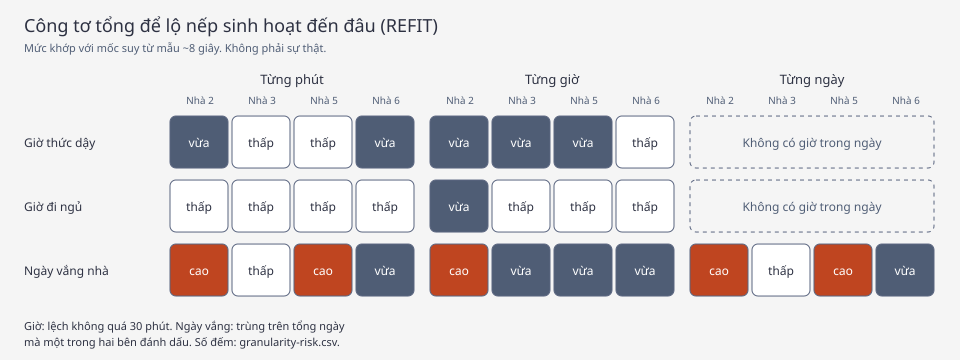

# Công tơ tổng để lộ nếp sinh hoạt đến đâu

Số đếm nằm trong [granularity-risk.csv](granularity-risk.csv). Chạy lại:
`uv run python scripts/privacy_risk_by_granularity.py`.

## Đọc kết quả

- Chỉ từ công tơ tổng, một quy tắc đơn giản đã đoán được một phần nếp sinh hoạt. Ngày vắng nhà lộ rõ ở
  một số nhà, giờ đi ngủ khó đoán hơn.
- Dữ liệu từng ngày **không cho ra giờ thức dậy hay giờ đi ngủ**, chỉ gợi ý ngày nào dùng ít bất thường.
  Nó vẫn có thể để lộ ngày vắng nhà.
- Dữ liệu từng phút không phải lúc nào cũng cho mức cao hơn từng giờ với quy tắc này. Điều đó không có
  nghĩa là dữ liệu từng phút an toàn hơn: người khai thác giỏi hơn có thể lấy được nhiều hơn.

## Cách làm

Dữ liệu: REFIT (Anh), nhà 2, 3, 5, 6, cột `Aggregate`, giờ địa phương Anh. Một ngày tính từ 04:00 đến
04:00 hôm sau, chỉ lấy ngày có ít nhất 90% số phút có số liệu.

**Mốc tham chiếu** (từ mẫu gốc, khoảng 8 giây một mẫu). Đây là mốc để so sánh, **không phải sự thật**:
không ai ghi lại người trong nhà thức, ngủ hay đi vắng lúc nào.

- Thức dậy: lần đầu từ 04:00 đến 12:00 có hai lần công suất tăng vọt (từ 200 W) cách nhau không quá 10 phút.
- Đi ngủ: lần cuối như vậy từ 20:00 đến 04:00.
- Vắng nhà: từ 07:00 đến 23:00 không có lần tăng nào từ 1000 W (cỡ bật ấm đun nước).

**Ước đoán** (mức nền đêm là trung vị công suất 01:00 đến 05:00; "hoạt động" là cao hơn mức nền 200 W):

| Dữ liệu | Thức dậy / đi ngủ | Vắng nhà |
| --- | --- | --- |
| Từng phút | đầu / cuối của đoạn 3 phút hoạt động liền nhau | ban ngày có không quá 30 phút hoạt động |
| Từng giờ | giữa giờ hoạt động đầu / cuối | ban ngày không có giờ nào hoạt động |
| Từng ngày | không có | công suất trung bình ngày dưới một nửa ngày điển hình của nhà đó |

**Mức khớp.** Giờ được coi là khớp khi lệch không quá 30 phút, tính trên các ngày có mốc tham chiếu (ngày
không đoán được tính là không khớp). Ngày vắng: số ngày cả hai cùng đánh dấu trên số ngày ít nhất một bên
đánh dấu. Cao: từ 7 trên 10; vừa: từ 4 trên 10; thấp: dưới mức đó; dưới 5 ngày để so thì không xếp mức.

## Giới hạn

- Mốc tham chiếu và ước đoán cùng lấy từ một công tơ, nên mức khớp chỉ cho biết dữ liệu thô hơn còn giữ lại
  được bao nhiêu điều mà dữ liệu mịn gợi ý.
- Thiết bị tự chạy (tủ lạnh, bình nóng hẹn giờ, máy giặt hẹn giờ) có thể bị tính là có người.
- Người ở nhà mà không bật thiết bị lớn có thể bị tính là vắng.
- Nhà 3 có điện mặt trời theo mô tả bộ REFIT, làm số công tơ ban ngày bị lệch.
- Các ngưỡng do chúng tôi chọn, chưa dò tối ưu; đổi ngưỡng thì mức có thể đổi.
- Chỉ bốn nhà ở Anh, 2013 đến 2015; không suy ra cho hộ Việt Nam.
