# Phân rã phụ tải hộ gia đình cho WattPrint: đánh giá TwoStageNILMFormer trên hộ mới và lợi ích–chi phí của cá nhân hóa

**Nhóm:** PTIT.UDU.S4U

**Tóm tắt.** WattPrint ước tính điện năng từng thiết bị từ một cảm biến công suất tổng bằng NILM. Nhóm đề xuất TwoStageNILMFormer (2Stage): bộ phát hiện bật/tắt GRU đặt trước bộ hồi quy NILMFormer, công suất dự đoán được nhân với mask bật/tắt. 2Stage được so với NILMFormer gốc (Baseline) trên 7 hộ REFIT, tập kiểm tra tách theo hộ. Với mô hình chung, F1 của 2Stage là 0,664 trên hộ được train và 0,535 trên hộ chưa thấy, so với 0,588 và 0,473 của Baseline. Với mô hình train riêng một hộ, trên hộ mới 2Stage đạt F1 0,415 so với 0,374 và MAE 17,4 so với 23,7 W. 2Stage giảm 67,6% số phút bỏ sót Dishwasher ở hộ mới nhưng báo bật nhầm nhiều hơn; Microwave vẫn chưa được nhận ra (F1 0,079). Ở các phút có từ hai thiết bị đích cùng bật, 2Stage vẫn hơn Baseline trên hộ mới (F1 0,597 so với 0,519); chồng lấp chủ yếu làm tăng bỏ sót, và 2Stage hay nhận WashingMachine thành Dishwasher. Trên hộ chưa thấy, mô hình chung của 2Stage (F1 0,535) tốt hơn mô hình train riêng trên chính hộ đó (0,479), chỉ cần cảm biến tổng, train khoảng 66 phút trên một GPU và suy luận một ngày dữ liệu trong khoảng 0,24 s trên CPU.

## 1. Mở đầu

### 1.1. Bối cảnh

**NILM là gì.** NILM (Non-Intrusive Load Monitoring – giám sát phụ tải không xâm lấn) ước tính công suất và điện năng của từng thiết bị trong nhà chỉ từ một phép đo công suất tổng tại công tơ hoặc tủ điện [1], [2]. Công suất tổng là tổng chồng chập của các thiết bị đang chạy; mô hình NILM học cách tách ngược tổng này thành từng thành phần, thay cho việc gắn cảm biến riêng cho mỗi thiết bị.

**Giải pháp WattPrint.** WattPrint dùng một cảm biến công suất tổng tại tủ điện, NILM để phân rã điện năng theo thiết bị, rồi đưa kết quả vào Dashboard tính tiền điện theo bậc thang, phát hiện bất thường, Trợ lý AI (LLM kết hợp Text2SQL và RAG) và thử nghiệm kịch bản tiết kiệm. Mọi số liệu theo thiết bị ở các khối sau đều là số ước tính từ NILM, nên chất lượng phân rã quyết định độ tin cậy của cả hệ thống. Mô hình phân rã dựa trên NILMFormer [3], kiến trúc attention xử lý tính phi dừng của chuỗi công suất, đã được EDF triển khai cho khoảng 3,6 triệu khách hàng.

**Vai trò của NILM và Trợ lý AI (Y2.3).** NILM là khối phân rã dữ liệu: biến chuỗi công suất tổng đo được thành công suất và điện năng ước tính của từng thiết bị. Trợ lý AI là bước hậu xử lý đặt sau NILM: nó dùng dữ liệu đo thật (điện tổng) và kết quả dự đoán của NILM đã lưu trong cơ sở dữ liệu, rồi chuyển chúng thành câu trả lời cho câu hỏi của người dùng, chẳng hạn truy vấn số liệu bằng Text2SQL ("tuần này máy giặt dùng bao nhiêu kWh?") và giải thích theo biểu giá, tài liệu bằng RAG. Trợ lý không thay đổi đầu ra của NILM, nên độ chính xác phân rã của bản có và không có trợ lý là như nhau. Bài này vì vậy chỉ đánh giá khối NILM; đóng góp của Trợ lý AI cần một thực nghiệm riêng với người dùng.

### 1.2. Yêu cầu đề bài

**Đề bài 1:** *"Hiệu năng phân rã có thể suy giảm với nhiều thiết bị chạy đồng thời hoặc loại thiết bị chưa thấy."* Yêu cầu: *"Đo sai số điện năng và F1 theo thiết bị/hộ mới/mức tải; tách tập kiểm tra theo hộ, báo trường hợp thiết bị bật đồng thời."* Minh chứng: *"Bảng theo thiết bị và hộ, đồ thị tổng điện/điện từng thiết bị, phân tích lỗi."*

**Đề bài 2:** *"Chưa rõ đóng góp cá nhân hóa/trợ lý so với NILM cơ sở và chi phí GPU/Docker cho hộ dùng."* Yêu cầu: *"So baseline NILM, bản không cá nhân hóa và bản không trợ lý trên cùng đầu vào; báo thời gian, thiết bị cảm biến và chi phí ước tính."* Minh chứng: *"Bảng đối chứng độ chính xác–độ trễ–chi phí và demo cấu hình chạy gọn."*

Bảng 1 tách hai đề bài thành các yêu cầu nhỏ có mã. Y2.3 được trả lời bằng giải thích (mục 1.1); Y1.2 được trả lời bằng giải thích cơ chế (mục 2.3) và thực nghiệm theo số thiết bị đích bật đồng thời (mục 3.1.4); các yêu cầu còn lại được trả lời bằng thực nghiệm ở mục 3: đề bài 1 ở mục 3.1 và 3.2, đề bài 2 ở mục 3.3.

**Bảng 1.** Các yêu cầu của đề bài và cách đáp ứng.

| Mã | Yêu cầu | Cách đáp ứng |
|-----|----------------------------|----------------------------------|
| Y1.1 | Đánh giá mô hình bằng sai số và F1 trên hộ mới | Thực nghiệm: tách tập kiểm tra theo hộ, đo ba nhóm chỉ số theo thiết bị, hộ và mức điện tổng (mục 3.1, 3.2) |
| Y1.2 | Giải thích cơ chế dự đoán khi các thiết bị hoạt động cùng lúc | Giải thích cơ chế của mô hình (mục 2.3); thực nghiệm theo số thiết bị đích bật đồng thời (mục 3.1.4) |
| Y2.1 | Đánh giá chi phí phần cứng GPU khi train và khi suy luận | Thực nghiệm: thời gian train trên GPU, độ trễ suy luận (mục 3.3.2) |
| Y2.2 | Đánh giá thời gian và CPU | Thực nghiệm: độ trễ trên CPU một luồng, demo Docker chỉ dùng CPU (mục 3.3.2) |
| Y2.3 | Giải thích vai trò của NILM và Trợ lý AI | Giải thích vai trò của từng khối (mục 1.1) |

### 1.3. Đóng góp

Bài báo trả lời hai đề bài trên bằng thực nghiệm trên bộ dữ liệu REFIT [4]:

1. Đề xuất **TwoStageNILMFormer** (**2Stage**): thêm bộ phát hiện bật/tắt GRU trước bộ hồi quy NILMFormer; công suất dự đoán bằng đúng 0 khi thiết bị được dự đoán là tắt. NILMFormer gốc là **Baseline**.
2. Đánh giá trên **hộ mới** với tập kiểm tra tách theo hộ, theo thiết bị, theo hộ và theo mức tải, kèm phân tích lỗi: nhóm nào đúng, nhóm nào sai và vì sao.
3. Đánh giá **lợi ích và chi phí của cá nhân hóa**: so mô hình chung với mô hình train riêng từng hộ và với Baseline, kèm phần cứng cần để train và chạy, và cảm biến cần có.

## 2. Thiết kế thực nghiệm

Thực nghiệm được thiết kế để trả lời hai đề bài ở mục 1.2. Dữ liệu, mô hình, phần cứng và chỉ số dùng chung được mô tả ở mục 2.2–2.5.

### 2.1. Mục tiêu và thiết kế thực nghiệm

**Mục tiêu 1 – Đánh giá trên hộ mới (Y1.1).** Thực nghiệm dùng hai thiết kế huấn luyện, cùng tập kiểm tra là 20% thời gian cuối của mỗi hộ:

- **Mỗi hộ một mô hình, kiểm chứng chéo giữa các hộ (mô hình riêng).** Mỗi hộ có một mô hình chỉ train trên dữ liệu của hộ đó, rồi được kiểm tra trên cả bảy hộ, tạo thành ma trận 7 × 7 (hộ train × hộ test).
- **Một mô hình train trên nhiều hộ (mô hình chung).** Một mô hình train trên dữ liệu gộp của bốn hộ 6, 9, 11, 20, rồi kiểm tra trên cả bảy hộ; ba hộ 2, 3, 13 được giữ lại làm **hộ chưa thấy**. So sánh với mô hình riêng cho biết lợi ích của việc học từ nhiều hộ.

Cả hai thiết kế được chạy cho 2Stage và Baseline, mỗi cấu hình 5 seed (tổng 80 lượt train), cùng dữ liệu, tiền xử lý và hàm tính chỉ số.

**Phân nhóm theo số thiết bị bật đồng thời (Y1.2).** Trên cùng tập test, mỗi phút được xếp vào nhóm 0, 1 hoặc từ 2 thiết bị đích trở lên đang bật theo nhãn bật/tắt thật, chỉ giữ phút mà mọi thiết bị có trong hộ đều có nhãn hợp lệ. 2Stage và Baseline được so trên đúng cùng các phút, cả trong cùng khoảng điện tổng để tách tác động của chồng lấp khỏi tác động của tải cao (mục 3.1.4).

**Mục tiêu 2 – Thu thập bằng chứng chi phí phần cứng (Y2.1, Y2.2).** Chi phí được ghi lại ngay trong quá trình chạy thực nghiệm, không ước tính lý thuyết:

- **Khi train:** ghi thời gian train và số epoch của từng seed trên GPU NVIDIA L40S (1 luồng CPU), cho mỗi cấu hình.
- **Khi suy luận:** đo độ trễ trên CPU một luồng và trên GPU cho một cửa sổ và một ngày dữ liệu; đóng gói phần suy luận thành image Docker chỉ dùng CPU và đo kích thước image, bộ nhớ, thời gian chạy với giới hạn 1 lõi CPU và 512 MB RAM.

### 2.2. Dữ liệu thực nghiệm

**Lý do chọn REFIT.** REFIT [4] có 20 hộ, đủ để tách tập kiểm tra theo hộ; là một trong các bộ dữ liệu bài NILMFormer gốc dùng, với cùng bốn thiết bị WashingMachine (máy giặt), Dishwasher (máy rửa bát), Kettle (ấm đun nước) và Microwave (lò vi sóng) [3]; và được phát hành theo giấy phép CC BY 4.0.

**Mô tả.** REFIT ghi điện năng của 20 hộ ở Anh giai đoạn 2013–2015, nhịp lấy mẫu danh định 8 giây: công suất tổng, chín kênh ổ cắm phụ đo từng thiết bị và cờ chất lượng Issues. Bài báo giữ bảy hộ có đủ kênh cho cả bốn thiết bị đích: 2, 3, 6, 9, 11, 13 và 20 (hộ 15 bị loại vì kênh Kettle có thể là thiết bị Hi-Fi).

**Tiền xử lý** theo mã công bố của NILMFormer: loại dòng có Issues = 1; lấy trung bình về nhịp 10 giây, điền khoảng thiếu tối đa 90 giây; đưa giá trị dưới 5 W về 0 và cắt trong khoảng 0–10.000 W; tạo nhãn bật khi công suất nằm giữa ngưỡng dưới và trên (WashingMachine 300–4.000 W, Dishwasher 300–4.000 W, Kettle 500–6.000 W, Microwave 200–6.000 W), một phút là "bật" nếu có ít nhất một mẫu 10 giây bật; lấy trung bình theo phút và cắt thành cửa sổ 128 phút không chồng lấn.

**Chia dữ liệu.** Mỗi hộ được chia theo thời gian: 80% đầu để train (trong đó 20% cuối làm validation cho early stopping), 20% cuối để kiểm tra. Mô hình vì vậy luôn được kiểm tra trên giai đoạn sau giai đoạn train, kể cả trên chính hộ đã train.

### 2.3. Mô hình thực nghiệm

**Baseline:** NILMFormer [3] bốn đầu ra, dự đoán đồng thời công suất bốn thiết bị, loss MSE.

![Hình 1. Kiến trúc NILMFormer gốc: (a) toàn bộ mô hình, (b) mã hóa thời gian TimeRPE. Nguồn: Petralia và cộng sự [3], kho mã chính thức EDF-Lab/NILMFormer (giấy phép Apache-2.0)](figures/hinh_kien_truc_nilmformer.png){width=16cm}

**2Stage (đề xuất):** gồm hai bước chạy song song trên cùng cửa sổ điện tổng:

1. **Bộ phát hiện bật/tắt (GRU):** với mỗi thiết bị và mỗi phút, dự đoán thiết bị đang bật hay tắt.
2. **Bộ ước lượng công suất (NILMFormer):** dự đoán thiết bị tiêu thụ bao nhiêu W nếu đang bật.

Kết quả cuối là công suất của bước 2 nhân với trạng thái của bước 1: thiết bị được dự đoán là tắt thì công suất bằng đúng 0, nhờ đó loại bỏ phần công suất nhỏ "rò rỉ" mà NILMFormer gốc thường dự đoán khi thiết bị không chạy. Khi train, mô hình học đồng thời hai việc: dự đoán đúng công suất và phân loại đúng trạng thái bật/tắt; lớp "bật" được tăng trọng số vì thiết bị tắt phần lớn thời gian.

![Hình 2. Kiến trúc TwoStageNILMFormer (2Stage) của nhóm theo cấu hình đã train: bộ phát hiện bật/tắt GRU (giai đoạn 1) và bộ hồi quy NILMFormer (giai đoạn 2, dùng nguyên hình (a) của [3]; cấu hình của nhóm có 3 Transformer Block và thêm Softplus để công suất không âm), đầu ra là tích của công suất và mask](figures/hinh_kien_truc_2stage.png){width=16cm}

**Dự đoán khi nhiều thiết bị hoạt động cùng lúc (Y1.2).** Đầu vào của NILM là công suất tổng đo tại tủ điện, tức tổng công suất của mọi thiết bị đang chạy tại cùng thời điểm. Vì vậy nhiều thiết bị hoạt động cùng lúc không phải một trường hợp đặc biệt mà là điều kiện mặc định của bài toán: tách tổng chồng chập này thành từng thiết bị chính là việc mô hình phải làm.

Cụ thể, mô hình nhận một cửa sổ 128 phút công suất tổng (kèm đặc trưng thời gian) và xuất cùng lúc công suất của cả bốn thiết bị đích tại từng phút, thay vì chỉ chọn một thiết bị. Ở 2Stage, bộ phát hiện bật/tắt đưa ra quyết định riêng cho từng thiết bị tại từng phút, nên nhiều thiết bị có thể cùng được dự đoán là đang bật; bộ hồi quy ước tính công suất cho từng thiết bị, và công suất của thiết bị được dự đoán là tắt bằng đúng 0. Phần công suất không thuộc bốn thiết bị đích (tủ lạnh, đèn, thiết bị điện tử…) được mô hình học cách coi là nền. Do đó mọi chỉ số trong bài đều đã được đo trong điều kiện có nhiều tải chạy cùng lúc; các lỗi phát sinh khi có tải khác chạy cùng được phân tích ở mục 3.1.3 và đo trực tiếp theo số thiết bị đích bật đồng thời ở mục 3.1.4.

**Huấn luyện.** AdamW, tốc độ học $10^{-4}$, batch 64, tối đa 150 epoch, early stopping với patience 10. Mỗi cấu hình train 5 seed; kết quả là của **ensemble** (trung bình công suất 5 seed theo phút; trạng thái detector theo đa số phiếu).

### 2.4. Phần cứng và phần mềm

Toàn bộ thực nghiệm (train, đánh giá, đo độ trễ và demo Docker) chạy trên một máy chủ:

- **GPU:** 1 × NVIDIA L40S, 48 GB bộ nhớ (46.068 MiB khả dụng), driver 595.99; GPU dùng chung với tiến trình khác nên thời gian đo là xấp xỉ.
- **CPU:** Intel Xeon Gold 6542Y, 32 luồng; khi train và khi đo độ trễ, PyTorch được giới hạn 1 luồng CPU.
- **RAM:** 94 GB.
- **Phần mềm:** Ubuntu 22.04.5 LTS, Python 3.14.3, PyTorch 2.15.0 (CUDA 13.2); demo Docker dùng image Python 3.14 với PyTorch 2.15.0 bản CPU.

### 2.5. Chỉ số đánh giá

Ký hiệu: $y_t$, $\hat{y}_t$ là công suất thật và dự đoán (W) của một thiết bị tại phút $t$; $T$ là số phút hợp lệ; trạng thái dự đoán $\hat{s}_t = \mathbf{1}\left[\hat{y}_t \ge \theta\right]$ với $\theta$ là ngưỡng dưới của thiết bị; TP, FP, FN, TN là số phút bật đúng, bật nhầm, bỏ sót và tắt đúng.

**Bảng 2.** Các chỉ số đánh giá theo ba nhóm. Cột cuối là giá trị khi mô hình luôn dự đoán 0 W. Định nghĩa và công thức các chỉ số theo tổng quan của Pereira và Nunes [5].

| Nhóm | Chỉ số | Ý nghĩa | Tốt khi | Luôn dự đoán 0 |
|--------|----------|--------------------------|------|----------|
| Bật/tắt | Precision | Tỷ lệ báo bật đúng; thấp gây cảnh báo giả | cao | 0 |
| Bật/tắt | Recall | Tỷ lệ phút bật được phát hiện | cao | 0 |
| Bật/tắt | F1 | Chỉ số chính cho phát hiện bật/tắt | cao | 0 |
| Công suất | MAE (W) | Lệch trung bình mỗi phút | thấp | trung bình yₜ |
| Công suất | RMSE (W) | Nhạy với phút sai lớn | thấp | căn trung bình yₜ² |
| Công suất | NDE | Sai số bình phương so với tín hiệu thật | thấp | 1 |
| Năng lượng | SAE | Sai số tương đối của tổng điện năng; thừa và thiếu bù trừ | thấp | 1 |
| Năng lượng | Sai số năng lượng (kWh) | Sai lệch tuyệt đối trên hóa đơn kỳ kiểm tra | thấp | điện năng thật |
| Năng lượng | NEP | Tổng sai số tuyệt đối so với điện năng thật; không bù trừ | thấp | 1 |
| Năng lượng | TECA | Tỷ lệ điện năng gán đúng | cao | 0,5 |
| Năng lượng | MR | Độ trùng giữa đường dự đoán và đường thật | cao | 0 |

## 3. Kết quả thực nghiệm

**Vì sao không dùng Accuracy.** Accuracy là tỷ lệ phút dự đoán đúng trạng thái, gồm cả phút tắt: $(\mathrm{TP} + \mathrm{TN}) / (\mathrm{TP} + \mathrm{FP} + \mathrm{FN} + \mathrm{TN})$. Trong tập test, thiết bị đích chỉ bật trung bình 1,03% số phút (Microwave 0,47%, Dishwasher 1,69%), nên một mô hình luôn dự đoán "tắt", không phát hiện được lần bật nào (F1 = 0), vẫn đạt Accuracy 0,9897 với cùng cách lấy trung bình như Bảng 3. Kết quả mô hình chung cho thấy chỉ số này không phân biệt được chất lượng phát hiện:

- **Khoảng giá trị quá hẹp:** Accuracy của 2Stage là 0,9919 và của Baseline là 0,9925, chỉ hơn mô hình luôn tắt 0,002–0,003, trong khi F1 tăng từ 0 lên 0,605 và 0,535.
- **Xếp hạng ngược với F1:** Baseline có Accuracy cao hơn 2Stage dù F1 thấp hơn 0,070, vì 2Stage báo bật nhiều hơn: số phút bật nhầm tăng thêm trên khối phút tắt rất lớn kéo Accuracy xuống, còn số phút bật bắt thêm được (Recall 0,699 so với 0,553) chỉ chiếm khoảng 1% thời gian.
- **Thấp hơn cả mô hình luôn tắt:** với Microwave, Accuracy của 2Stage (0,9916) và Baseline (0,9947) đều thấp hơn mô hình luôn tắt (0,9953), dù F1 lần lượt là 0,346 và 0,122; WashingMachine cũng tương tự (0,9889 và 0,9884 so với 0,9902).

Vì vậy phần kết quả không dùng Accuracy để đánh giá; phát hiện bật/tắt được đánh giá bằng Precision, Recall và F1, là các chỉ số chỉ tính trên phút bật thật hoặc phút được báo bật.

Mọi số là trung bình macro của ensemble 5 seed. ↑: càng cao càng tốt, ↓: càng thấp càng tốt; in đậm là giá trị tốt hơn trong từng cột lớn. F1 có trần dưới 1.

### 3.1. 2Stage so với Baseline: tốt hơn ở đâu, kém hơn ở đâu?

Mục này trả lời Y1.1 và Y1.2 của đề bài 1 theo bốn bước: số liệu tổng quan cho thấy 2Stage tốt hơn Baseline (3.1.1); lớp detector là nguồn của phần cải thiện (3.1.2); 2Stage chưa tốt ở thiết bị nào và với kiểu dữ liệu nào (3.1.3); hiệu năng khi nhiều thiết bị đích bật đồng thời (3.1.4).

#### 3.1.1. Số liệu tổng quan: 2Stage tốt hơn Baseline

**Bảng 3.** 2Stage so với Baseline, thiết lập mô hình chung (-all), trên toàn bộ tập test.

<table>
  <thead>
    <tr><th rowspan="2">Chỉ số</th><th colspan="2">Toàn bộ tập test (7 hộ)</th></tr>
    <tr><th>2Stage</th><th>Baseline</th></tr>
  </thead>
  <tbody>
    <tr><td colspan="3"><b>Dự đoán bật/tắt</b></td></tr>
    <tr><td>Precision ↑</td><td align="right"><b>0,555</b></td><td align="right">0,553</td></tr>
    <tr><td>Recall ↑</td><td align="right"><b>0,699</b></td><td align="right">0,553</td></tr>
    <tr><td>F1 ↑</td><td align="right"><b>0,605</b></td><td align="right">0,535</td></tr>
    <tr><td colspan="3"><b>Dự đoán công suất</b></td></tr>
    <tr><td>MAE (W) ↓</td><td align="right"><b>11,0</b></td><td align="right">13,6</td></tr>
    <tr><td>RMSE (W) ↓</td><td align="right"><b>94,9</b></td><td align="right">96,5</td></tr>
    <tr><td>NDE ↓</td><td align="right">0,555</td><td align="right"><b>0,497</b></td></tr>
    <tr><td colspan="3"><b>Dự đoán năng lượng</b></td></tr>
    <tr><td>SAE ↓</td><td align="right">0,297</td><td align="right"><b>0,273</b></td></tr>
    <tr><td>Sai số năng lượng (kWh) ↓</td><td align="right">4,77</td><td align="right"><b>4,68</b></td></tr>
    <tr><td>NEP ↓</td><td align="right"><b>0,932</b></td><td align="right">1,109</td></tr>
    <tr><td>TECA ↑</td><td align="right"><b>0,534</b></td><td align="right">0,445</td></tr>
    <tr><td>MR ↑</td><td align="right"><b>0,468</b></td><td align="right">0,367</td></tr>
  </tbody>
</table>

**Bảng 4.** 2Stage so với Baseline, thiết lập mô hình riêng (-sep).

<table>
  <thead>
    <tr><th rowspan="2">Chỉ số</th><th colspan="2">Hộ được train</th><th colspan="2">Hộ chưa thấy</th></tr>
    <tr><th>2Stage</th><th>Baseline</th><th>2Stage</th><th>Baseline</th></tr>
  </thead>
  <tbody>
    <tr><td colspan="5"><b>Dự đoán bật/tắt</b></td></tr>
    <tr><td>Precision ↑</td><td align="right">0,522</td><td align="right"><b>0,542</b></td><td align="right"><b>0,406</b></td><td align="right">0,396</td></tr>
    <tr><td>Recall ↑</td><td align="right"><b>0,657</b></td><td align="right">0,573</td><td align="right"><b>0,506</b></td><td align="right">0,409</td></tr>
    <tr><td>F1 ↑</td><td align="right"><b>0,557</b></td><td align="right">0,547</td><td align="right"><b>0,415</b></td><td align="right">0,374</td></tr>
    <tr><td colspan="5"><b>Dự đoán công suất</b></td></tr>
    <tr><td>MAE (W) ↓</td><td align="right"><b>11,5</b></td><td align="right">15,6</td><td align="right"><b>17,4</b></td><td align="right">23,7</td></tr>
    <tr><td>RMSE (W) ↓</td><td align="right"><b>93,5</b></td><td align="right">95,0</td><td align="right"><b>127,7</b></td><td align="right">141,6</td></tr>
    <tr><td>NDE ↓</td><td align="right">0,486</td><td align="right"><b>0,475</b></td><td align="right"><b>0,875</b></td><td align="right">0,912</td></tr>
    <tr><td colspan="5"><b>Dự đoán năng lượng</b></td></tr>
    <tr><td>SAE ↓</td><td align="right">0,324</td><td align="right"><b>0,264</b></td><td align="right"><b>0,618</b></td><td align="right">0,821</td></tr>
    <tr><td>Sai số năng lượng (kWh) ↓</td><td align="right">7,80</td><td align="right"><b>7,17</b></td><td align="right"><b>11,37</b></td><td align="right">16,08</td></tr>
    <tr><td>NEP ↓</td><td align="right"><b>0,808</b></td><td align="right">1,221</td><td align="right"><b>1,281</b></td><td align="right">1,939</td></tr>
    <tr><td>TECA ↑</td><td align="right"><b>0,596</b></td><td align="right">0,389</td><td align="right"><b>0,360</b></td><td align="right">0,030</td></tr>
    <tr><td>MR ↑</td><td align="right"><b>0,437</b></td><td align="right">0,337</td><td align="right"><b>0,274</b></td><td align="right">0,180</td></tr>
  </tbody>
</table>

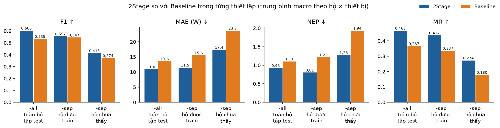{width=16cm}

2Stage tốt hơn Baseline ở đa số chỉ số: **8/11** với mô hình chung; với mô hình riêng là **11/11** trên hộ chưa thấy và **7/11** trên hộ được train. Các chỉ số 2Stage không hơn và lý do:

- **Precision** (hộ được train): 2Stage báo bật nhiều hơn để bắt được nhiều lần bật (Recall cao hơn), đổi lại có thêm một ít báo nhầm.
- **NDE:** chỉ số dùng sai số bình phương. Khi 2Stage báo bật nhầm, mask cho ra cả một chu trình công suất lớn nên sai số bình phương lớn; Baseline thường dự đoán thấp và rải đều nên ít phút sai lớn.
- **SAE và sai số năng lượng tổng:** hai chỉ số chỉ so tổng điện năng cả kỳ, nên sai thừa và sai thiếu của Baseline bù trừ nhau; 2Stage báo bật nhiều hơn nên dư một phần điện năng. Khi không cho bù trừ (NEP), 2Stage tốt hơn.

#### 3.1.2. Lớp detector có hiệu quả

2Stage khác Baseline ở detector GRU quyết định bật/tắt và mask nhân vào công suất. Nếu detector có hiệu quả, phần cải thiện phải nằm đúng ở hai việc Baseline làm kém: bắt được lần bật, và cho công suất bằng 0 khi tắt nhưng đủ biên độ khi bật. Hai bằng chứng dưới đây cho thấy điều đó. Detector và mask được đánh giá cùng nhau; chưa có ablation tách riêng từng phần.

##### (1) Bắt được nhiều lần bật hơn

Phần tăng F1 ở Bảng 3 đến từ Recall: với mô hình chung, Recall tăng từ 0,553 lên 0,699 trong khi Precision gần như không đổi (0,555 so với 0,553). Xét theo sự kiện bật (Bảng 5), 2Stage phát hiện nhiều hơn và bỏ sót ít hơn Baseline ở cả bốn thiết bị, trên cả hộ được train lẫn hộ mới.

**Bảng 5.** Phân phối sự kiện bật theo trạng thái phát hiện (gộp hai thiết kế).

<table>
  <thead>
    <tr><th rowspan="2">Thiết bị</th><th rowspan="2">Bối cảnh</th><th rowspan="2">Số sự kiện</th><th colspan="2">Phát hiện ↑</th><th colspan="2">Phát hiện một phần</th><th colspan="2">Bỏ sót ↓</th></tr>
    <tr><th>2Stage</th><th>Baseline</th><th>2Stage</th><th>Baseline</th><th>2Stage</th><th>Baseline</th></tr>
  </thead>
  <tbody>
    <tr><td rowspan="2">Dishwasher</td><td>Hộ được train</td><td align="right">1.306</td><td align="right"><b>96,8%</b></td><td align="right">92,8%</td><td align="right">1,3%</td><td align="right">2,6%</td><td align="right"><b>1,9%</b></td><td align="right">4,6%</td></tr>
    <tr><td>Hộ mới</td><td align="right">6.214</td><td align="right"><b>87,2%</b></td><td align="right">62,9%</td><td align="right">3,7%</td><td align="right">8,1%</td><td align="right"><b>9,1%</b></td><td align="right">29,0%</td></tr>
    <tr><td rowspan="2">Kettle</td><td>Hộ được train</td><td align="right">5.196</td><td align="right"><b>83,8%</b></td><td align="right">77,7%</td><td align="right">2,1%</td><td align="right">3,2%</td><td align="right"><b>14,2%</b></td><td align="right">19,1%</td></tr>
    <tr><td>Hộ mới</td><td align="right">21.876</td><td align="right"><b>74,8%</b></td><td align="right">66,1%</td><td align="right">4,4%</td><td align="right">4,7%</td><td align="right"><b>20,8%</b></td><td align="right">29,2%</td></tr>
    <tr><td rowspan="2">Microwave</td><td>Hộ được train</td><td align="right">1.957</td><td align="right"><b>50,0%</b></td><td align="right">17,3%</td><td align="right">3,4%</td><td align="right">2,9%</td><td align="right"><b>46,6%</b></td><td align="right">79,9%</td></tr>
    <tr><td>Hộ mới</td><td align="right">8.395</td><td align="right"><b>17,4%</b></td><td align="right">4,4%</td><td align="right">3,6%</td><td align="right">2,1%</td><td align="right"><b>79,0%</b></td><td align="right">93,5%</td></tr>
    <tr><td rowspan="2">WashingMachine</td><td>Hộ được train</td><td align="right">1.727</td><td align="right"><b>32,1%</b></td><td align="right">27,4%</td><td align="right">3,2%</td><td align="right">2,7%</td><td align="right"><b>64,7%</b></td><td align="right">69,9%</td></tr>
    <tr><td>Hộ mới</td><td align="right">9.345</td><td align="right"><b>17,9%</b></td><td align="right">16,6%</td><td align="right">4,4%</td><td align="right">3,7%</td><td align="right"><b>77,7%</b></td><td align="right">79,7%</td></tr>
  </tbody>
</table>

- Rõ nhất ở Dishwasher trên hộ mới (bỏ sót 9,1% so với 29,0%) và Microwave trên hộ được train (phát hiện 50,0% so với 17,3%).

Hình 4 so Recall và Precision theo phút của từng thiết bị với mô hình chung (cùng tập hộ và thiết bị như Bảng 3). Số phút TP, FP, FN của bảy hộ được cộng dồn trước khi chia, nên giá trị khác trung bình macro ở các bảng.

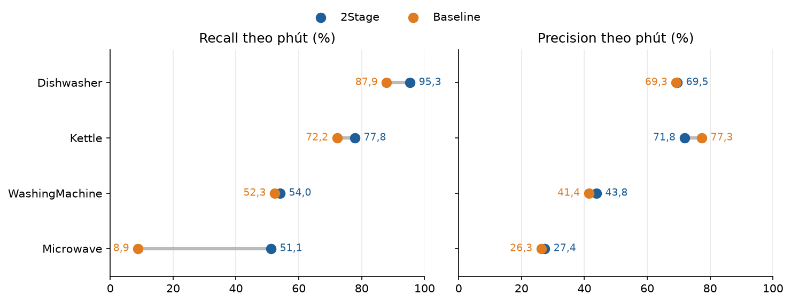{width=16cm}

- **Recall:** 2Stage bắt được nhiều phút bật hơn ở cả bốn thiết bị, rõ nhất ở Microwave (51,1% so với 8,9%) và Dishwasher (95,3% so với 87,9%); Kettle tăng ít hơn (77,8% so với 72,2%), WashingMachine gần như không đổi (54,0% so với 52,3%).
- **Precision:** gần như giữ nguyên ở Dishwasher (69,5% so với 69,3%), WashingMachine (43,8% so với 41,4%) và Microwave (27,4% so với 26,3%), tức phần Recall tăng thêm không phải đổi bằng việc báo bật bừa. Riêng Kettle, Precision giảm từ 77,3% xuống 71,8%. Microwave dù Precision không giảm vẫn có số phút báo nhầm tăng mạnh (5.289 so với 967 phút), vì 2Stage báo bật nhiều hơn hẳn.

##### (2) Công suất bằng 0 khi thiết bị tắt

Ở mức điện tổng dưới 500 W hầu như không có thiết bị đích nào bật; MAE của 2Stage chỉ 0,5–0,6 W so với 2,9–4,7 W của Baseline (Bảng 7). Đây là phần rò công suất bị mask loại bỏ.

Hình 5 vẽ điện tổng, công suất thật từng thiết bị và dự đoán ensemble của 2Stage và Baseline trên cùng hai cửa sổ 128 phút của hộ 3, với mô hình riêng train trên hộ 2 (một cặp hộ mới). Hai cửa sổ được chọn theo dữ liệu, chung cho cả hai mô hình: cửa sổ có nhiều thiết bị cùng bật nhất (trái) và cửa sổ có tổng sai số của hai mô hình lớn nhất (phải).

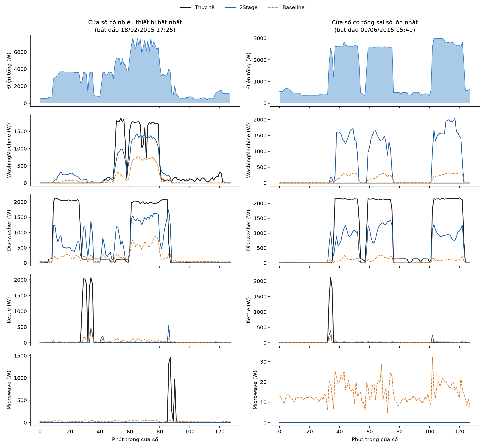{width=16cm}

- **Baseline dự đoán thiếu biên độ:** với Dishwasher công suất thật khoảng 2.100 W, Baseline chỉ dự đoán khoảng 100–800 W; 2Stage đạt khoảng 700–1.600 W, sát hơn nhưng vẫn thấp hơn thực tế. Với WashingMachine ở cửa sổ trái (thật khoảng 1.800 W), 2Stage dự đoán khoảng 1.300 W, Baseline khoảng 700 W.
- **Baseline rò công suất khi thiết bị tắt:** đường cam luôn nằm trên 0 khi thiết bị không chạy (Microwave ở cửa sổ phải khoảng 10–30 W), còn 2Stage về đúng 0. Đây là nguồn của NEP lớn hơn 1 và MAE cao của Baseline.

#### 3.1.3. 2Stage kém Baseline ở đâu và vì sao

Detector là con dao hai lưỡi. Khi phát hiện đúng, mask cho công suất bằng 0 lúc thiết bị tắt và giữ công suất dự đoán lúc thiết bị bật; nhờ đó 2Stage giảm bỏ sót và công suất rò (mục 3.1.2). Khi báo bật nhầm, mask lại giữ cả công suất dự đoán của thiết bị đang tắt. Một phút báo nhầm vì thế có thể làm sai nhiều điện năng hơn ở Baseline, vốn thường dự đoán biên độ thấp. Ba hệ quả dưới đây phù hợp với cơ chế này, nhưng chưa có ablation để khẳng định riêng đóng góp của detector và mask.

**(1) F1 giảm khi số phút báo nhầm vượt lợi ích từ số phút bắt thêm.** Với mô hình riêng trên hộ được train, F1 của 2Stage thấp hơn Baseline ở Dishwasher (0,756 so với 0,796) và WashingMachine (0,520 so với 0,558); Kettle gần ngang nhau (Bảng 6). Baseline đã bắt được 89% phút bật Dishwasher, nên 2Stage chỉ bắt thêm 871 phút nhưng báo nhầm thêm 2.244 phút. Trên hộ mới, Baseline mới bắt được 59%; 2Stage bắt thêm 22.609 phút và báo nhầm thêm 15.676 phút, nên F1 tăng. WashingMachine trên hộ mới gần như ngang nhau: F1 macro của 2Stage thấp hơn (0,313 so với 0,324), nhưng F1 tính từ tổng số phút lại cao hơn (0,321 so với 0,314).

**Bảng 6.** Kết quả mô hình riêng theo từng thiết bị.

<table>
  <thead>
    <tr><th rowspan="2">Chỉ số</th><th colspan="2">Hộ được train</th><th colspan="2">Hộ mới</th></tr>
    <tr><th>2Stage</th><th>Baseline</th><th>2Stage</th><th>Baseline</th></tr>
  </thead>
  <tbody>
    <tr><td>WashingMachine – F1 ↑</td><td align="right">0,520</td><td align="right"><b>0,558</b></td><td align="right">0,313</td><td align="right"><b>0,324</b></td></tr>
    <tr><td>WashingMachine – MAE (W) ↓</td><td align="right"><b>15,3</b></td><td align="right">19,8</td><td align="right"><b>22,6</b></td><td align="right">28,6</td></tr>
    <tr><td>WashingMachine – SAE ↓</td><td align="right">0,283</td><td align="right"><b>0,204</b></td><td align="right"><b>0,415</b></td><td align="right">0,436</td></tr>
    <tr><td>WashingMachine – Sai số năng lượng (kWh) ↓</td><td align="right">9,56</td><td align="right"><b>8,73</b></td><td align="right"><b>14,08</b></td><td align="right">14,20</td></tr>
    <tr><td>Dishwasher – F1 ↑</td><td align="right">0,756</td><td align="right"><b>0,796</b></td><td align="right"><b>0,674</b></td><td align="right">0,564</td></tr>
    <tr><td>Dishwasher – MAE (W) ↓</td><td align="right"><b>18,2</b></td><td align="right">22,7</td><td align="right"><b>28,3</b></td><td align="right">40,3</td></tr>
    <tr><td>Dishwasher – SAE ↓</td><td align="right">0,269</td><td align="right"><b>0,117</b></td><td align="right"><b>0,275</b></td><td align="right">0,580</td></tr>
    <tr><td>Dishwasher – Sai số năng lượng (kWh) ↓</td><td align="right">14,30</td><td align="right"><b>11,16</b></td><td align="right"><b>15,71</b></td><td align="right">32,06</td></tr>
    <tr><td>Kettle – F1 ↑</td><td align="right">0,723</td><td align="right"><b>0,728</b></td><td align="right"><b>0,618</b></td><td align="right">0,597</td></tr>
    <tr><td>Kettle – MAE (W) ↓</td><td align="right"><b>10,0</b></td><td align="right">14,3</td><td align="right"><b>15,2</b></td><td align="right">20,0</td></tr>
    <tr><td>Kettle – SAE ↓</td><td align="right"><b>0,111</b></td><td align="right">0,202</td><td align="right"><b>0,308</b></td><td align="right">0,391</td></tr>
    <tr><td>Kettle – Sai số năng lượng (kWh) ↓</td><td align="right"><b>4,00</b></td><td align="right">6,82</td><td align="right"><b>8,93</b></td><td align="right">12,07</td></tr>
    <tr><td>Microwave – F1 ↑</td><td align="right"><b>0,251</b></td><td align="right">0,142</td><td align="right"><b>0,079</b></td><td align="right">0,030</td></tr>
    <tr><td>Microwave – MAE (W) ↓</td><td align="right"><b>4,1</b></td><td align="right">7,2</td><td align="right"><b>5,9</b></td><td align="right">9,2</td></tr>
    <tr><td>Microwave – SAE ↓</td><td align="right">0,620</td><td align="right"><b>0,504</b></td><td align="right"><b>1,396</b></td><td align="right">1,789</td></tr>
    <tr><td>Microwave – Sai số năng lượng (kWh) ↓</td><td align="right">4,52</td><td align="right"><b>2,77</b></td><td align="right"><b>7,76</b></td><td align="right">7,99</td></tr>
  </tbody>
</table>

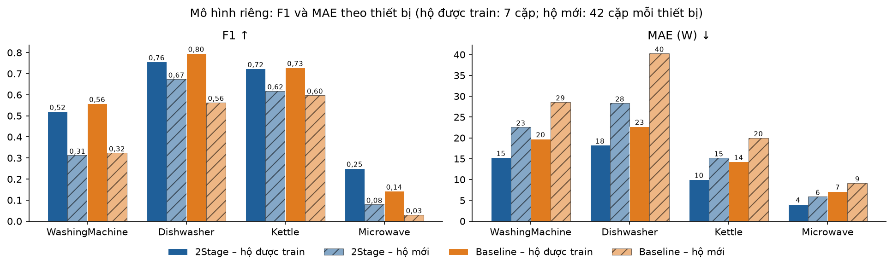{width=16cm}

**(2) Báo bật nhầm làm sai điện năng tổng.** Trên hộ được train, SAE của 2Stage cao hơn Baseline ở Dishwasher (0,269 so với 0,117) và Microwave (0,620 so với 0,504). Với Dishwasher, công suất ở các phút báo nhầm của 2Stage cao hơn, khiến điện năng dự đoán thừa trung bình 8,02 kWh mỗi hộ; Baseline thừa 2,36 kWh. SAE của Baseline còn hưởng lợi khi phần dự đoán thiếu và công suất rò bù trừ nhau, dù thời điểm bật/tắt dự đoán sai. NEP của 2Stage vẫn tốt hơn (mục 3.1.1).

**(3) Tải cao làm lỗi báo bật nhầm nặng hơn.** Khi điện tổng từ 3.000 W, 2Stage kém về F1 trên hộ được train (0,530 so với 0,572) và SAE trên cả hộ được train lẫn hộ mới (Bảng 7). Dishwasher, WashingMachine và Kettle đều có bước gia nhiệt khoảng 2 kW; khi có tải khác chạy cùng, detector dễ gán cùng một bước tăng cho nhiều thiết bị, kéo theo điện năng dự đoán thừa. Trên hộ mới, 50,5% phút báo nhầm Dishwasher của 2Stage trùng lúc thiết bị đích khác chạy, so với 27,9% của Baseline. Với WashingMachine, tỷ lệ này là 61,8%; nhầm lẫn với Dishwasher khiến detector gần như không cải thiện F1 của thiết bị này. Mục 3.1.4 kiểm tra nhận định này bằng nhãn bật/tắt thật.

**Bảng 7.** Kết quả mô hình riêng theo mức điện tổng đo ở tủ điện.

<table>
  <thead>
    <tr><th rowspan="2">Chỉ số</th><th colspan="2">Hộ được train</th><th colspan="2">Hộ mới</th></tr>
    <tr><th>2Stage</th><th>Baseline</th><th>2Stage</th><th>Baseline</th></tr>
  </thead>
  <tbody>
    <tr><td>[0, 500) – F1 ↑</td><td align="right">0,027</td><td align="right">0,027</td><td align="right"><b>0,022</b></td><td align="right">0,015</td></tr>
    <tr><td>[0, 500) – MAE (W) ↓</td><td align="right"><b>0,5</b></td><td align="right">2,9</td><td align="right"><b>0,6</b></td><td align="right">4,7</td></tr>
    <tr><td>[0, 500) – SAE ↓</td><td align="right"><b>3,136</b></td><td align="right">86,500</td><td align="right"><b>4,525</b></td><td align="right">115,832</td></tr>
    <tr><td>[500, 1500) – F1 ↑</td><td align="right"><b>0,370</b></td><td align="right">0,275</td><td align="right"><b>0,228</b></td><td align="right">0,161</td></tr>
    <tr><td>[500, 1500) – MAE (W) ↓</td><td align="right"><b>8,7</b></td><td align="right">15,6</td><td align="right"><b>10,0</b></td><td align="right">17,1</td></tr>
    <tr><td>[500, 1500) – SAE ↓</td><td align="right"><b>0,637</b></td><td align="right">1,101</td><td align="right"><b>0,883</b></td><td align="right">2,102</td></tr>
    <tr><td>[1500, 3000) – F1 ↑</td><td align="right"><b>0,625</b></td><td align="right">0,585</td><td align="right"><b>0,446</b></td><td align="right">0,408</td></tr>
    <tr><td>[1500, 3000) – MAE (W) ↓</td><td align="right"><b>96,0</b></td><td align="right">123,2</td><td align="right"><b>170,3</b></td><td align="right">197,0</td></tr>
    <tr><td>[1500, 3000) – SAE ↓</td><td align="right">0,349</td><td align="right"><b>0,327</b></td><td align="right"><b>0,885</b></td><td align="right">1,083</td></tr>
    <tr><td>[3000, ∞) – F1 ↑</td><td align="right">0,530</td><td align="right"><b>0,572</b></td><td align="right"><b>0,417</b></td><td align="right">0,412</td></tr>
    <tr><td>[3000, ∞) – MAE (W) ↓</td><td align="right"><b>217,7</b></td><td align="right">231,3</td><td align="right"><b>320,3</b></td><td align="right">367,3</td></tr>
    <tr><td>[3000, ∞) – SAE ↓</td><td align="right">0,716</td><td align="right"><b>0,310</b></td><td align="right">1,049</td><td align="right"><b>0,853</b></td></tr>
  </tbody>
</table>

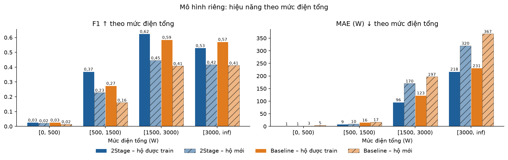{width=16cm}

#### 3.1.4. Khi nhiều thiết bị đích bật đồng thời

**(1) Chia phút theo số thiết bị bật thật.** Số thiết bị đang bật được đếm từ nhãn thật của bốn thiết bị đích, chỉ ở những phút mà các kênh có trong hộ đều có nhãn hợp lệ. Đây là số thiết bị *đích*, không phải tổng số tải trong nhà: nhóm 0 vẫn có thể có đèn, tủ lạnh hoặc tải nền. Điện tổng cao cũng không tự chứng minh có nhiều thiết bị đích cùng chạy. Trên phần test của bảy hộ có 822.272 phút hợp lệ: 789.324 phút nhóm 0 (95,99%), 31.692 phút nhóm 1 (3,85%), 1.214 phút nhóm 2 (0,148%), 42 phút nhóm 3 (0,005%) và không có phút nhóm 4. Nhóm ≥2 gộp nhóm 2 và 3, có 1.256 phút (0,153%); nhóm 3 quá nhỏ để kết luận độc lập. Mỗi phút trên hộ mới được sáu mô hình train ở hộ khác đánh giá, nên số phút của cột “hộ mới” trong Bảng 8 gấp sáu lần số phút thực.

**(2) Đánh giá từng nhóm trên cùng tập phút.** Bảng 8 so 2Stage và Baseline của thiết kế mô hình riêng, với số phút và cách tính chỉ số như ở các bảng trước. F1 và sai số điện năng tương đối không có nghĩa ở nhóm 0 vì không có thiết bị đích bật; nhóm này được xem bằng MAE và số phút báo bật nhầm. Ở các nhóm còn lại, chỉ số được cộng theo từng thiết bị trên mọi cặp hộ rồi lấy trung bình bốn thiết bị. Hàng ≥2 là tổng hợp để so sánh ổn định hơn, không phải nhóm phút mới.

**Bảng 8.** Kết quả mô hình riêng theo đúng số thiết bị đích bật thật. “≥2 (gộp)” gồm nhóm 2 và 3; số phút là tổng trên mọi cặp hộ; “—”: chỉ số không có nghĩa ở nhóm 0.

<table>
  <thead>
    <tr><th rowspan="2">Số thiết bị đích bật</th><th rowspan="2">Số phút</th><th colspan="2">F1 ↑</th><th colspan="2">MAE (W) ↓</th><th colspan="2">Sai số điện năng tương đối ↓</th></tr>
    <tr><th>2Stage</th><th>Baseline</th><th>2Stage</th><th>Baseline</th><th>2Stage</th><th>Baseline</th></tr>
  </thead>
  <tbody>
    <tr><td colspan="8"><b>Hộ mới (42 cặp hộ)</b></td></tr>
    <tr><td>0</td><td align="right">4.735.944</td><td align="right">—</td><td align="right">—</td><td align="right"><b>6,4</b></td><td align="right">11,1</td><td align="right">—</td><td align="right">—</td></tr>
    <tr><td>1</td><td align="right">190.152</td><td align="right"><b>0,512</b></td><td align="right">0,446</td><td align="right"><b>295,7</b></td><td align="right">347,0</td><td align="right"><b>0,422</b></td><td align="right">0,503</td></tr>
    <tr><td>2</td><td align="right">7.284</td><td align="right"><b>0,594</b></td><td align="right">0,518</td><td align="right"><b>517,6</b></td><td align="right">599,4</td><td align="right"><b>0,468</b></td><td align="right">0,562</td></tr>
    <tr><td>3</td><td align="right">252</td><td align="right"><b>0,644</b></td><td align="right">0,525</td><td align="right"><b>750,3</b></td><td align="right">936,0</td><td align="right"><b>0,699</b></td><td align="right">0,764</td></tr>
    <tr><td>≥2 (gộp)</td><td align="right">7.536</td><td align="right"><b>0,597</b></td><td align="right">0,519</td><td align="right"><b>525,4</b></td><td align="right">610,7</td><td align="right"><b>0,472</b></td><td align="right">0,565</td></tr>
    <tr><td colspan="8"><b>Hộ được train (7 cặp hộ)</b></td></tr>
    <tr><td>0</td><td align="right">789.324</td><td align="right">—</td><td align="right">—</td><td align="right"><b>5,2</b></td><td align="right">7,5</td><td align="right">—</td><td align="right">—</td></tr>
    <tr><td>1</td><td align="right">31.692</td><td align="right"><b>0,683</b></td><td align="right">0,619</td><td align="right"><b>170,9</b></td><td align="right">228,7</td><td align="right"><b>0,245</b></td><td align="right">0,322</td></tr>
    <tr><td>2</td><td align="right">1.214</td><td align="right"><b>0,739</b></td><td align="right">0,736</td><td align="right"><b>375,8</b></td><td align="right">448,8</td><td align="right"><b>0,299</b></td><td align="right">0,418</td></tr>
    <tr><td>3</td><td align="right">42</td><td align="right"><b>0,730</b></td><td align="right">0,689</td><td align="right"><b>656,8</b></td><td align="right">746,2</td><td align="right"><b>0,464</b></td><td align="right">0,582</td></tr>
    <tr><td>≥2 (gộp)</td><td align="right">1.256</td><td align="right"><b>0,740</b></td><td align="right">0,734</td><td align="right"><b>385,3</b></td><td align="right">458,8</td><td align="right"><b>0,301</b></td><td align="right">0,424</td></tr>
  </tbody>
</table>

Trên hộ mới, khi từ một lên hai thiết bị đích bật, MAE của 2Stage tăng từ 295,7 lên 517,6 W và sai số điện năng tương đối tăng từ 0,422 lên 0,468; với ba thiết bị, MAE là 750,3 W và sai số là 0,699, nhưng chỉ có 42 phút thực. 2Stage thấp hơn Baseline về MAE và sai số điện năng ở từng nhóm 0–3; F1 cũng cao hơn ở các nhóm có thiết bị bật. Riêng nhóm 0, 2Stage có MAE thấp hơn (6,4 so với 11,1 W) nhưng báo bật nhầm ít nhất một thiết bị trong 78.980/4.735.944 lượt phút–mô hình hộ mới, nhiều hơn Baseline (71.667 lượt). Không thể đọc F1 nhóm 2/3 cao hơn nhóm 1 thành “chồng lấp giúp mô hình”: trong nhóm nhiều thiết bị, tỷ lệ thiết bị bật cao hơn làm Precision dễ tăng, và mức điện tổng cũng khác. Vì vậy phần tiếp theo xem lỗi trong cùng mức điện tổng.

**(3) Lỗi xuất hiện ở mức điện tổng nào?** Nhóm ≥2 tập trung ở tải cao: 82,3% số phút có điện tổng từ 3.000 W, so với 23,0% ở nhóm 1. Bảng 9 đặt nhóm 1 và nhóm ≥2 vào cùng hai khoảng điện tổng để tránh nhầm tác động của chồng lấp với tác động của tải cao. Các số liệu dưới đây là của hộ mới.

**Bảng 9.** Hộ mới, mô hình riêng: nhóm 1 và nhóm ≥2 thiết bị đích bật trong cùng khoảng điện tổng.

<table>
  <thead>
    <tr><th rowspan="2">Điện tổng – số thiết bị đích bật</th><th rowspan="2">Số phút</th><th colspan="2">Precision ↑</th><th colspan="2">Recall ↑</th><th colspan="2">F1 ↑</th><th colspan="2">Sai số điện năng tương đối ↓</th></tr>
    <tr><th>2Stage</th><th>Baseline</th><th>2Stage</th><th>Baseline</th><th>2Stage</th><th>Baseline</th><th>2Stage</th><th>Baseline</th></tr>
  </thead>
  <tbody>
    <tr><td>[1.500, 3.000) W – 1</td><td align="right">111.696</td><td align="right"><b>0,530</b></td><td align="right">0,525</td><td align="right"><b>0,541</b></td><td align="right">0,430</td><td align="right"><b>0,532</b></td><td align="right">0,470</td><td align="right"><b>0,479</b></td><td align="right">0,549</td></tr>
    <tr><td>[1.500, 3.000) W – ≥2</td><td align="right">1.152</td><td align="right">0,740</td><td align="right"><b>0,752</b></td><td align="right"><b>0,453</b></td><td align="right">0,334</td><td align="right"><b>0,506</b></td><td align="right">0,434</td><td align="right"><b>0,489</b></td><td align="right">0,612</td></tr>
    <tr><td>[3.000, ∞) W – 1</td><td align="right">43.704</td><td align="right">0,471</td><td align="right"><b>0,511</b></td><td align="right"><b>0,615</b></td><td align="right">0,459</td><td align="right"><b>0,525</b></td><td align="right">0,475</td><td align="right"><b>0,585</b></td><td align="right">0,652</td></tr>
    <tr><td>[3.000, ∞) W – ≥2</td><td align="right">6.204</td><td align="right">0,660</td><td align="right"><b>0,688</b></td><td align="right"><b>0,588</b></td><td align="right">0,445</td><td align="right"><b>0,612</b></td><td align="right">0,534</td><td align="right"><b>0,478</b></td><td align="right">0,563</td></tr>
  </tbody>
</table>

Trong từng khoảng điện tổng, **bỏ sót thiết bị đang chạy là lỗi gắn với chồng lấp**: Recall của 2Stage giảm từ 0,541 xuống 0,453 ở [1.500, 3.000) W và từ 0,615 xuống 0,588 ở mức từ 3.000 W khi chuyển từ nhóm 1 sang ≥2. Baseline cũng giảm tương ứng từ 0,430 xuống 0,334 và từ 0,459 xuống 0,445. Ô nhóm ≥2 ở [1.500, 3.000) W chỉ có 192 phút thực, nên mức chênh ở ô đó cần đọc thận trọng. **Sai số điện năng lớn gắn rõ hơn với tải cao**: ngay trong nhóm chỉ một thiết bị, sai số của 2Stage tăng từ 0,479 lên 0,585 khi điện tổng vượt 3.000 W; trong nhóm ≥2 nó không tăng (0,489 xuống 0,478). Như vậy mức tải cao và chồng lấp gây hai kiểu khó khác nhau: tải cao làm lệch điện năng, chồng lấp làm dễ bỏ sót một thiết bị.

**(4) Thiết bị nào bị bỏ sót hoặc gán nhầm?** Bảng 10 đếm trực tiếp hai loại lỗi theo phút trên hộ mới. Ở nhóm ≥2, 2Stage bỏ sót ít nhất một thiết bị đang bật trong 70,5% số phút, so với 37,9% ở nhóm 1 (Baseline: 82,2% và 52,6%). Tỷ lệ “có ít nhất một bỏ sót” tự nhiên cũng tăng khi mỗi phút có nhiều thiết bị để bỏ sót; kết luận về tác động của chồng lấp vì thế dựa thêm vào Recall trong cùng mức tải ở Bảng 9. Báo bật nhầm ít nhất một thiết bị đang tắt xảy ra ở 35,6% phút nhóm ≥2 của 2Stage, so với 23,9% của Baseline.

**Bảng 10.** Hộ mới, mô hình riêng: lỗi bỏ sót và gán nhầm trong các phút có thiết bị đích bật, tính bằng % số phút của nhóm (hai hàng đầu) hoặc của trường hợp ghi ở hàng (bốn hàng sau).

<table>
  <thead>
    <tr><th rowspan="2">Loại lỗi (% số phút của nhóm) ↓</th><th colspan="2">1 thiết bị đích bật</th><th colspan="2">≥2 thiết bị đích bật</th></tr>
    <tr><th>2Stage</th><th>Baseline</th><th>2Stage</th><th>Baseline</th></tr>
  </thead>
  <tbody>
    <tr><td>Phút có ít nhất một thiết bị đang bật bị bỏ sót</td><td align="right"><b>37,9</b></td><td align="right">52,6</td><td align="right"><b>70,5</b></td><td align="right">82,2</td></tr>
    <tr><td>Phút có báo bật nhầm ít nhất một thiết bị đang tắt</td><td align="right">31,6</td><td align="right"><b>23,5</b></td><td align="right">35,6</td><td align="right"><b>23,9</b></td></tr>
    <tr><td>Chỉ WashingMachine bật (Dishwasher tắt): báo Dishwasher bật</td><td align="right">42,4</td><td align="right"><b>21,6</b></td><td align="right">58,3</td><td align="right"><b>25,0</b></td></tr>
    <tr><td>– trong đó bỏ sót luôn WashingMachine (gán nhầm hẳn)</td><td align="right">22,8</td><td align="right"><b>9,5</b></td><td align="right">22,0</td><td align="right"><b>7,9</b></td></tr>
    <tr><td>Chỉ Dishwasher bật (WashingMachine tắt): báo WashingMachine bật</td><td align="right">24,5</td><td align="right"><b>23,2</b></td><td align="right">44,2</td><td align="right"><b>35,1</b></td></tr>
    <tr><td>– trong đó bỏ sót luôn Dishwasher (gán nhầm hẳn)</td><td align="right"><b>3,1</b></td><td align="right">8,3</td><td align="right"><b>6,9</b></td><td align="right">15,5</td></tr>
  </tbody>
</table>

Lỗi gán nhầm rõ nhất là **WashingMachine → Dishwasher**: khi WashingMachine bật và Dishwasher tắt, 2Stage vẫn báo Dishwasher bật trong 42,4% phút nhóm 1 và 58,3% phút nhóm ≥2, khoảng gấp đôi Baseline (21,6% và 25,0%). Trong khoảng 22% số phút thuộc các trường hợp này, nó đồng thời bỏ sót WashingMachine, tức gán hẳn sang Dishwasher; chiều ngược lại chỉ 3,1% và 6,9%. Lỗi đã xuất hiện khi WashingMachine là thiết bị đích duy nhất bật, rồi nặng thêm khi có thiết bị đích khác chạy cùng. Cùng với Bảng 9, điều này chỉ ra vùng cần cải thiện: phân biệt các bước gia nhiệt gần nhau khi điện tổng cao và nhiều thiết bị đích cùng hoạt động.

Hình 8 cho thấy một cửa sổ minh họa, không đại diện cho toàn bộ tập test: khi WashingMachine và Dishwasher cùng bật (khoảng phút 12–26), cả hai mô hình dự đoán thiếu Dishwasher; Baseline thiếu cả WashingMachine. Khi Dishwasher và Kettle cùng bật (khoảng phút 74–78), cả hai gần như bỏ sót Kettle, còn 2Stage báo WashingMachine bật nhầm. Sau đó, khi chỉ Kettle bật (khoảng phút 83–93), 2Stage gán phần lớn công suất cho Dishwasher.

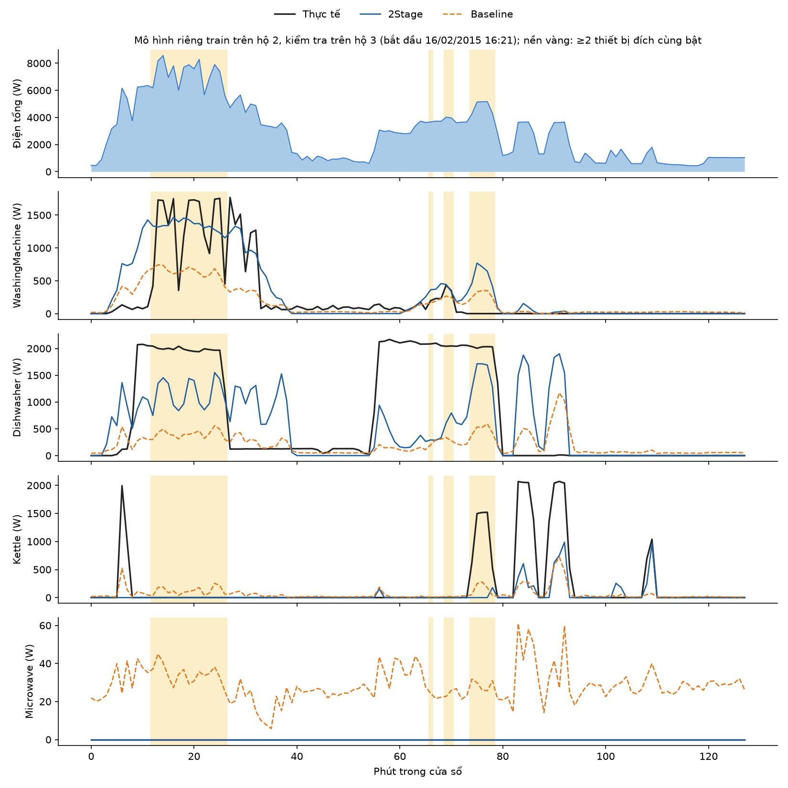{width=16cm}

#### 3.1.5. Trả lời câu hỏi 3.1

- **2Stage tốt hơn:** 8/11 chỉ số với mô hình chung (F1 0,605 so với 0,535 trên toàn bộ tập test) và cả 11/11 chỉ số trên hộ mới.
- **Detector có hiệu quả:** Recall tăng từ 0,553 lên 0,699; bỏ sót ít hơn ở cả bốn thiết bị; mask đưa công suất về 0 khi tắt (MAE dưới 500 W: 0,5 so với 2,9 W).
- **Tốt hơn ở:** Dishwasher và Kettle trên hộ mới; mức điện tổng 500–3.000 W; sự kiện dài, công suất cao.
- **Kém Baseline ở:** F1 trên hộ được train của Dishwasher, WashingMachine và Kettle, vì Baseline đã bắt gần đủ phút bật nên phần báo nhầm thêm của detector lớn hơn phần bắt thêm; năng lượng tổng (SAE) trên hộ được train, vì báo nhầm mang đủ biên độ trong khi sai số của Baseline bù trừ nhau; điện tổng từ 3.000 W, vì detector báo bật nhầm nhiều hơn, nhất là nhận WashingMachine thành Dishwasher, kể cả khi WashingMachine chạy một mình (mục 3.1.4).
- **Nhiều thiết bị đích bật đồng thời:** ở các phút có từ hai thiết bị đích cùng bật, 2Stage vẫn tốt hơn Baseline về F1, MAE và sai số điện năng trên hộ mới (F1 0,597 so với 0,519). Trong cùng khoảng điện tổng, chồng lấp chủ yếu làm tăng bỏ sót một trong các thiết bị đang bật; sai số điện năng tăng chủ yếu theo mức tải.

### 3.2. Hiệu năng suy giảm thế nào trên hộ mới?

Mục 3.1 cho thấy 2Stage tốt hơn Baseline trên hộ chưa thấy, nên mục này chỉ phân tích 2Stage. Mục này trả lời Y1.1 của đề bài 1 trên hộ mới, dùng mô hình riêng: mỗi mô hình train trên một hộ và được đánh giá trên dữ liệu của cả bảy hộ. Kết quả được vẽ thành ma trận 7 × 7 cho từng chỉ số: hàng là mô hình train trên hộ nào, cột là đánh giá trên dữ liệu hộ nào. Đường chéo (viền xanh đậm) là mô hình đánh giá trên chính hộ của nó; các ô còn lại là mô hình đánh giá trên hộ mới. Màu thể hiện mức tốt/xấu trong từng ma trận (xanh lá: tốt, đỏ: kém), không theo giá trị, nên chỉ số càng cao càng tốt và càng thấp càng tốt được đọc như nhau.

Khi sang hộ mới, F1 của 2Stage giảm khoảng 25% (0,557 xuống 0,415) và MAE tăng khoảng 1,5 lần (11,5 lên 17,4 W) (Bảng 4). Đây là phép đo suy giảm đúng nghĩa, vì cùng một hộ test vừa xuất hiện ở đường chéo (hộ được train) vừa ở vai trò hộ mới với sáu mô hình còn lại.

#### 3.2.1. Dự đoán bật/tắt

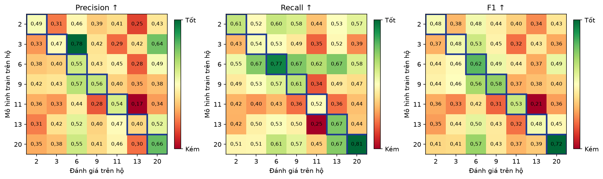{width=16cm}

**Bảng 11.** Dự đoán bật/tắt: thay đổi so với mô hình đánh giá trên chính hộ train (giá trị ô trừ giá trị đường chéo cùng hàng).

<table>
  <thead>
    <tr><th rowspan="2">Mô hình train trên hộ</th><th colspan="7">Đánh giá trên hộ</th><th rowspan="2">Trung bình ± độ lệch chuẩn</th></tr>
    <tr><th>2</th><th>3</th><th>6</th><th>9</th><th>11</th><th>13</th><th>20</th></tr>
  </thead>
  <tbody>
    <tr><td colspan="9"><b>Precision ↑</b></td></tr>
    <tr><td>Hộ 2</td><td align="right">—</td><td align="right">−0,18</td><td align="right">−0,03</td><td align="right">−0,10</td><td align="right">−0,08</td><td align="right">−0,23</td><td align="right">−0,06</td><td align="right">−0,11 ± 0,08</td></tr>
    <tr><td>Hộ 3</td><td align="right">−0,13</td><td align="right">—</td><td align="right">+0,31</td><td align="right">−0,04</td><td align="right">−0,18</td><td align="right">−0,05</td><td align="right">+0,18</td><td align="right">+0,02 ± 0,19</td></tr>
    <tr><td>Hộ 6</td><td align="right">−0,17</td><td align="right">−0,15</td><td align="right">—</td><td align="right">−0,12</td><td align="right">−0,10</td><td align="right">−0,27</td><td align="right">−0,06</td><td align="right">−0,14 ± 0,07</td></tr>
    <tr><td>Hộ 9</td><td align="right">−0,14</td><td align="right">−0,13</td><td align="right">+0,01</td><td align="right">—</td><td align="right">−0,16</td><td align="right">−0,21</td><td align="right">−0,18</td><td align="right">−0,14 ± 0,08</td></tr>
    <tr><td>Hộ 11</td><td align="right">−0,18</td><td align="right">−0,20</td><td align="right">−0,10</td><td align="right">−0,26</td><td align="right">—</td><td align="right">−0,37</td><td align="right">−0,20</td><td align="right">−0,22 ± 0,09</td></tr>
    <tr><td>Hộ 13</td><td align="right">−0,09</td><td align="right">+0,02</td><td align="right">+0,11</td><td align="right">−0,00</td><td align="right">+0,06</td><td align="right">—</td><td align="right">+0,11</td><td align="right">+0,04 ± 0,08</td></tr>
    <tr><td>Hộ 20</td><td align="right">−0,31</td><td align="right">−0,28</td><td align="right">−0,11</td><td align="right">−0,25</td><td align="right">−0,20</td><td align="right">−0,36</td><td align="right">—</td><td align="right">−0,25 ± 0,09</td></tr>
    <tr><td colspan="9"><b>Recall ↑</b></td></tr>
    <tr><td>Hộ 2</td><td align="right">—</td><td align="right">−0,09</td><td align="right">−0,00</td><td align="right">−0,02</td><td align="right">−0,17</td><td align="right">−0,08</td><td align="right">−0,04</td><td align="right">−0,07 ± 0,06</td></tr>
    <tr><td>Hộ 3</td><td align="right">−0,11</td><td align="right">—</td><td align="right">−0,01</td><td align="right">−0,05</td><td align="right">−0,19</td><td align="right">−0,02</td><td align="right">−0,15</td><td align="right">−0,09 ± 0,07</td></tr>
    <tr><td>Hộ 6</td><td align="right">−0,22</td><td align="right">−0,10</td><td align="right">—</td><td align="right">−0,10</td><td align="right">−0,15</td><td align="right">−0,10</td><td align="right">−0,19</td><td align="right">−0,15 ± 0,05</td></tr>
    <tr><td>Hộ 9</td><td align="right">−0,12</td><td align="right">−0,08</td><td align="right">−0,04</td><td align="right">—</td><td align="right">−0,27</td><td align="right">−0,13</td><td align="right">−0,15</td><td align="right">−0,13 ± 0,08</td></tr>
    <tr><td>Hộ 11</td><td align="right">−0,10</td><td align="right">−0,13</td><td align="right">−0,09</td><td align="right">−0,16</td><td align="right">—</td><td align="right">−0,16</td><td align="right">−0,09</td><td align="right">−0,12 ± 0,03</td></tr>
    <tr><td>Hộ 13</td><td align="right">−0,25</td><td align="right">−0,17</td><td align="right">−0,14</td><td align="right">−0,17</td><td align="right">−0,43</td><td align="right">—</td><td align="right">−0,23</td><td align="right">−0,23 ± 0,10</td></tr>
    <tr><td>Hộ 20</td><td align="right">−0,30</td><td align="right">−0,29</td><td align="right">−0,20</td><td align="right">−0,24</td><td align="right">−0,35</td><td align="right">−0,14</td><td align="right">—</td><td align="right">−0,25 ± 0,08</td></tr>
    <tr><td colspan="9"><b>F1 ↑</b></td></tr>
    <tr><td>Hộ 2</td><td align="right">—</td><td align="right">−0,10</td><td align="right">+0,01</td><td align="right">−0,04</td><td align="right">−0,08</td><td align="right">−0,14</td><td align="right">−0,05</td><td align="right">−0,07 ± 0,05</td></tr>
    <tr><td>Hộ 3</td><td align="right">−0,11</td><td align="right">—</td><td align="right">+0,04</td><td align="right">−0,04</td><td align="right">−0,16</td><td align="right">−0,05</td><td align="right">−0,12</td><td align="right">−0,07 ± 0,07</td></tr>
    <tr><td>Hộ 6</td><td align="right">−0,18</td><td align="right">−0,16</td><td align="right">—</td><td align="right">−0,13</td><td align="right">−0,18</td><td align="right">−0,26</td><td align="right">−0,13</td><td align="right">−0,17 ± 0,05</td></tr>
    <tr><td>Hộ 9</td><td align="right">−0,13</td><td align="right">−0,11</td><td align="right">−0,02</td><td align="right">—</td><td align="right">−0,21</td><td align="right">−0,20</td><td align="right">−0,18</td><td align="right">−0,14 ± 0,07</td></tr>
    <tr><td>Hộ 11</td><td align="right">−0,17</td><td align="right">−0,20</td><td align="right">−0,11</td><td align="right">−0,22</td><td align="right">—</td><td align="right">−0,31</td><td align="right">−0,17</td><td align="right">−0,20 ± 0,07</td></tr>
    <tr><td>Hộ 13</td><td align="right">−0,13</td><td align="right">−0,04</td><td align="right">+0,02</td><td align="right">−0,05</td><td align="right">−0,16</td><td align="right">—</td><td align="right">−0,03</td><td align="right">−0,06 ± 0,07</td></tr>
    <tr><td>Hộ 20</td><td align="right">−0,31</td><td align="right">−0,30</td><td align="right">−0,14</td><td align="right">−0,28</td><td align="right">−0,34</td><td align="right">−0,32</td><td align="right">—</td><td align="right">−0,28 ± 0,07</td></tr>
  </tbody>
</table>

- **Mọi mô hình đều kém đi trên hộ mới:** ở cả 42 ô ngoài đường chéo, F1 đều thấp hơn ô đường chéo cùng cột, tức không mô hình của hộ khác nào đạt bằng mô hình train trên chính hộ đó. Precision và Recall giảm gần như nhau (trung bình đường chéo 0,52 và 0,65, ngoài đường chéo 0,41 và 0,50), nên trên hộ mới mô hình vừa bỏ sót nhiều hơn vừa báo nhầm nhiều hơn.
- **Hộ train quyết định kiểu lỗi:** mô hình train trên hộ 6 có Recall cao trên mọi hộ (0,55–0,67) và F1 chuyển giao tốt nhất (trung bình 0,447 trên sáu hộ khác); mô hình train trên hộ 3 ngược lại, Precision cao trên hộ 6 và 20 (0,78 và 0,64) nhưng Recall thấp. Mô hình train trên hộ 11 kém nhất ở cả ba chỉ số (F1 trung bình 0,334, thấp nhất 0,21 khi đánh giá trên hộ 13), vì hộ 11 gần như không dùng Dishwasher (chỉ 20 lần bật trong phần train).
- **Hộ đánh giá cũng quan trọng:** cột hộ 6 cao với mọi mô hình (F1 0,42–0,57 ngoài đường chéo), còn cột hộ 11 và 13 thấp với hầu hết các mô hình.

#### 3.2.2. Dự đoán công suất

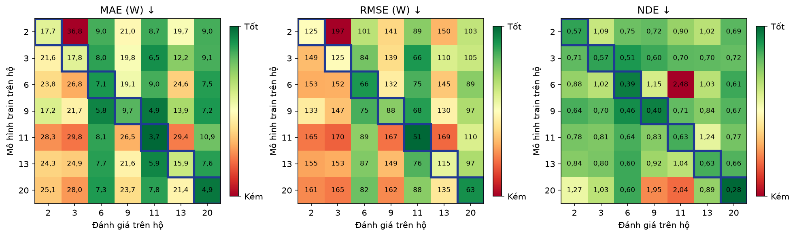{width=16cm}

**Bảng 12.** Dự đoán công suất: thay đổi so với mô hình đánh giá trên chính hộ train (giá trị ô trừ giá trị đường chéo cùng hàng).

<table>
  <thead>
    <tr><th rowspan="2">Mô hình train trên hộ</th><th colspan="7">Đánh giá trên hộ</th><th rowspan="2">Trung bình ± độ lệch chuẩn</th></tr>
    <tr><th>2</th><th>3</th><th>6</th><th>9</th><th>11</th><th>13</th><th>20</th></tr>
  </thead>
  <tbody>
    <tr><td colspan="9"><b>MAE (W) ↓</b></td></tr>
    <tr><td>Hộ 2</td><td align="right">—</td><td align="right">+19,1</td><td align="right">−8,7</td><td align="right">+3,3</td><td align="right">−9,0</td><td align="right">+2,0</td><td align="right">−8,7</td><td align="right">−0,3 ± 11,1</td></tr>
    <tr><td>Hộ 3</td><td align="right">+3,8</td><td align="right">—</td><td align="right">−9,8</td><td align="right">+2,0</td><td align="right">−11,3</td><td align="right">−5,6</td><td align="right">−8,7</td><td align="right">−4,9 ± 6,4</td></tr>
    <tr><td>Hộ 6</td><td align="right">+16,7</td><td align="right">+19,8</td><td align="right">—</td><td align="right">+12,0</td><td align="right">+1,9</td><td align="right">+17,5</td><td align="right">+0,5</td><td align="right">+11,4 ± 8,3</td></tr>
    <tr><td>Hộ 9</td><td align="right">+7,4</td><td align="right">+12,0</td><td align="right">−4,0</td><td align="right">—</td><td align="right">−4,8</td><td align="right">+4,2</td><td align="right">−2,6</td><td align="right">+2,0 ± 6,9</td></tr>
    <tr><td>Hộ 11</td><td align="right">+24,6</td><td align="right">+26,0</td><td align="right">+4,3</td><td align="right">+22,8</td><td align="right">—</td><td align="right">+25,7</td><td align="right">+7,1</td><td align="right">+18,4 ± 9,9</td></tr>
    <tr><td>Hộ 13</td><td align="right">+8,4</td><td align="right">+9,0</td><td align="right">−8,3</td><td align="right">+5,7</td><td align="right">−10,0</td><td align="right">—</td><td align="right">−8,3</td><td align="right">−0,6 ± 9,2</td></tr>
    <tr><td>Hộ 20</td><td align="right">+20,2</td><td align="right">+23,2</td><td align="right">+2,5</td><td align="right">+18,9</td><td align="right">+2,9</td><td align="right">+16,5</td><td align="right">—</td><td align="right">+14,0 ± 9,0</td></tr>
    <tr><td colspan="9"><b>RMSE (W) ↓</b></td></tr>
    <tr><td>Hộ 2</td><td align="right">—</td><td align="right">+72</td><td align="right">−24</td><td align="right">+16</td><td align="right">−36</td><td align="right">+26</td><td align="right">−22</td><td align="right">+5 ± 41</td></tr>
    <tr><td>Hộ 3</td><td align="right">+23</td><td align="right">—</td><td align="right">−42</td><td align="right">+14</td><td align="right">−59</td><td align="right">−15</td><td align="right">−20</td><td align="right">−17 ± 32</td></tr>
    <tr><td>Hộ 6</td><td align="right">+87</td><td align="right">+86</td><td align="right">—</td><td align="right">+67</td><td align="right">+10</td><td align="right">+79</td><td align="right">+23</td><td align="right">+59 ± 34</td></tr>
    <tr><td>Hộ 9</td><td align="right">+45</td><td align="right">+59</td><td align="right">−14</td><td align="right">—</td><td align="right">−21</td><td align="right">+42</td><td align="right">+9</td><td align="right">+20 ± 33</td></tr>
    <tr><td>Hộ 11</td><td align="right">+114</td><td align="right">+120</td><td align="right">+38</td><td align="right">+116</td><td align="right">—</td><td align="right">+118</td><td align="right">+59</td><td align="right">+94 ± 36</td></tr>
    <tr><td>Hộ 13</td><td align="right">+40</td><td align="right">+38</td><td align="right">−28</td><td align="right">+34</td><td align="right">−38</td><td align="right">—</td><td align="right">−18</td><td align="right">+5 ± 37</td></tr>
    <tr><td>Hộ 20</td><td align="right">+98</td><td align="right">+101</td><td align="right">+18</td><td align="right">+98</td><td align="right">+25</td><td align="right">+71</td><td align="right">—</td><td align="right">+69 ± 38</td></tr>
    <tr><td colspan="9"><b>NDE ↓</b></td></tr>
    <tr><td>Hộ 2</td><td align="right">—</td><td align="right">+0,52</td><td align="right">+0,19</td><td align="right">+0,15</td><td align="right">+0,33</td><td align="right">+0,45</td><td align="right">+0,13</td><td align="right">+0,29 ± 0,17</td></tr>
    <tr><td>Hộ 3</td><td align="right">+0,14</td><td align="right">—</td><td align="right">−0,06</td><td align="right">+0,03</td><td align="right">+0,13</td><td align="right">+0,13</td><td align="right">+0,15</td><td align="right">+0,09 ± 0,08</td></tr>
    <tr><td>Hộ 6</td><td align="right">+0,50</td><td align="right">+0,64</td><td align="right">—</td><td align="right">+0,76</td><td align="right">+2,09</td><td align="right">+0,64</td><td align="right">+0,22</td><td align="right">+0,81 ± 0,66</td></tr>
    <tr><td>Hộ 9</td><td align="right">+0,24</td><td align="right">+0,30</td><td align="right">+0,06</td><td align="right">—</td><td align="right">+0,31</td><td align="right">+0,44</td><td align="right">+0,27</td><td align="right">+0,27 ± 0,12</td></tr>
    <tr><td>Hộ 11</td><td align="right">+0,16</td><td align="right">+0,18</td><td align="right">+0,01</td><td align="right">+0,21</td><td align="right">—</td><td align="right">+0,61</td><td align="right">+0,14</td><td align="right">+0,22 ± 0,20</td></tr>
    <tr><td>Hộ 13</td><td align="right">+0,21</td><td align="right">+0,17</td><td align="right">−0,03</td><td align="right">+0,29</td><td align="right">+0,40</td><td align="right">—</td><td align="right">+0,03</td><td align="right">+0,18 ± 0,16</td></tr>
    <tr><td>Hộ 20</td><td align="right">+0,99</td><td align="right">+0,75</td><td align="right">+0,32</td><td align="right">+1,66</td><td align="right">+1,76</td><td align="right">+0,60</td><td align="right">—</td><td align="right">+1,01 ± 0,58</td></tr>
  </tbody>
</table>

- **Sai số tăng ở hầu hết các cặp:** MAE trung bình tăng từ 11,0 W trên đường chéo lên 16,7 W ngoài đường chéo, RMSE từ 91 lên 124 W; 41/42 ô RMSE và 42/42 ô NDE kém hơn ô đường chéo cùng cột.
- **MAE và RMSE phụ thuộc chủ yếu vào hộ đánh giá:** các ma trận này có dạng theo cột, vì đây là sai số tuyệt đối tính bằng W, nên hộ dùng thiết bị nhiều (hộ 2, 3, 9, 13) luôn có sai số lớn hơn hộ dùng ít (hộ 6, 11, 20), bất kể mô hình nào. Để so mức độ chuyển giao cần xem NDE, chỉ số đã chuẩn hóa theo năng lượng tín hiệu thật.
- **NDE gần gấp đôi trên hộ mới** (trung bình 0,50 lên 0,91). Mô hình có NDE tốt nhất trên chính hộ của nó lại chuyển giao kém nhất: mô hình hộ 20 đạt 0,28 trên hộ 20 nhưng 1,95 trên hộ 9 và 2,04 trên hộ 11 (trung bình 1,30 trên sáu hộ khác). Mô hình hộ 6 cũng lên tới 2,48 trên hộ 11. NDE lớn hơn 1 nghĩa là sai số còn lớn hơn khi dự đoán luôn bằng 0, do mô hình dự đoán các chu trình công suất lớn ở hộ ít dùng thiết bị.

#### 3.2.3. Dự đoán năng lượng

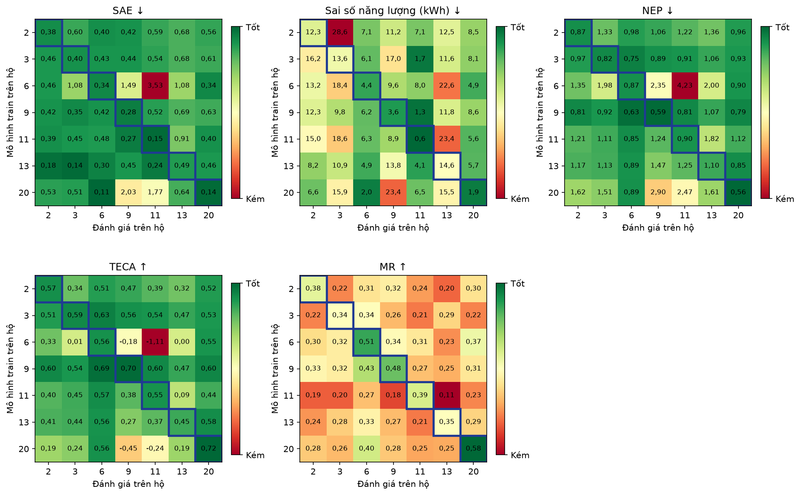{width=16cm}

**Bảng 13.** Dự đoán năng lượng: thay đổi so với mô hình đánh giá trên chính hộ train (giá trị ô trừ giá trị đường chéo cùng hàng).

<table>
  <thead>
    <tr><th rowspan="2">Mô hình train trên hộ</th><th colspan="7">Đánh giá trên hộ</th><th rowspan="2">Trung bình ± độ lệch chuẩn</th></tr>
    <tr><th>2</th><th>3</th><th>6</th><th>9</th><th>11</th><th>13</th><th>20</th></tr>
  </thead>
  <tbody>
    <tr><td colspan="9"><b>SAE ↓</b></td></tr>
    <tr><td>Hộ 2</td><td align="right">—</td><td align="right">+0,22</td><td align="right">+0,02</td><td align="right">+0,05</td><td align="right">+0,21</td><td align="right">+0,30</td><td align="right">+0,19</td><td align="right">+0,16 ± 0,11</td></tr>
    <tr><td>Hộ 3</td><td align="right">+0,06</td><td align="right">—</td><td align="right">+0,03</td><td align="right">+0,04</td><td align="right">+0,14</td><td align="right">+0,27</td><td align="right">+0,20</td><td align="right">+0,12 ± 0,10</td></tr>
    <tr><td>Hộ 6</td><td align="right">+0,12</td><td align="right">+0,74</td><td align="right">—</td><td align="right">+1,15</td><td align="right">+3,19</td><td align="right">+0,74</td><td align="right">−0,00</td><td align="right">+0,99 ± 1,16</td></tr>
    <tr><td>Hộ 9</td><td align="right">+0,14</td><td align="right">+0,07</td><td align="right">+0,14</td><td align="right">—</td><td align="right">+0,24</td><td align="right">+0,41</td><td align="right">+0,35</td><td align="right">+0,22 ± 0,13</td></tr>
    <tr><td>Hộ 11</td><td align="right">+0,24</td><td align="right">+0,30</td><td align="right">+0,33</td><td align="right">+0,12</td><td align="right">—</td><td align="right">+0,77</td><td align="right">+0,26</td><td align="right">+0,34 ± 0,22</td></tr>
    <tr><td>Hộ 13</td><td align="right">−0,30</td><td align="right">−0,35</td><td align="right">−0,19</td><td align="right">−0,03</td><td align="right">−0,24</td><td align="right">—</td><td align="right">−0,03</td><td align="right">−0,19 ± 0,13</td></tr>
    <tr><td>Hộ 20</td><td align="right">+0,39</td><td align="right">+0,37</td><td align="right">−0,03</td><td align="right">+1,88</td><td align="right">+1,63</td><td align="right">+0,50</td><td align="right">—</td><td align="right">+0,79 ± 0,78</td></tr>
    <tr><td colspan="9"><b>Sai số năng lượng (kWh) ↓</b></td></tr>
    <tr><td>Hộ 2</td><td align="right">—</td><td align="right">+16,3</td><td align="right">−5,2</td><td align="right">−1,1</td><td align="right">−5,1</td><td align="right">+0,2</td><td align="right">−3,8</td><td align="right">+0,2 ± 8,2</td></tr>
    <tr><td>Hộ 3</td><td align="right">+2,5</td><td align="right">—</td><td align="right">−7,5</td><td align="right">+3,4</td><td align="right">−11,9</td><td align="right">−2,0</td><td align="right">−5,5</td><td align="right">−3,5 ± 6,0</td></tr>
    <tr><td>Hộ 6</td><td align="right">+8,9</td><td align="right">+14,1</td><td align="right">—</td><td align="right">+5,2</td><td align="right">+3,7</td><td align="right">+18,2</td><td align="right">+0,5</td><td align="right">+8,4 ± 6,7</td></tr>
    <tr><td>Hộ 9</td><td align="right">+8,7</td><td align="right">+6,2</td><td align="right">+2,6</td><td align="right">—</td><td align="right">−2,3</td><td align="right">+8,2</td><td align="right">+5,0</td><td align="right">+4,7 ± 4,1</td></tr>
    <tr><td>Hộ 11</td><td align="right">+14,3</td><td align="right">+18,0</td><td align="right">+5,7</td><td align="right">+8,3</td><td align="right">—</td><td align="right">+22,7</td><td align="right">+5,0</td><td align="right">+12,3 ± 7,2</td></tr>
    <tr><td>Hộ 13</td><td align="right">−6,4</td><td align="right">−3,8</td><td align="right">−9,8</td><td align="right">−0,8</td><td align="right">−10,6</td><td align="right">—</td><td align="right">−8,9</td><td align="right">−6,7 ± 3,8</td></tr>
    <tr><td>Hộ 20</td><td align="right">+4,7</td><td align="right">+14,0</td><td align="right">+0,1</td><td align="right">+21,5</td><td align="right">+4,7</td><td align="right">+13,7</td><td align="right">—</td><td align="right">+9,8 ± 7,9</td></tr>
    <tr><td colspan="9"><b>NEP ↓</b></td></tr>
    <tr><td>Hộ 2</td><td align="right">—</td><td align="right">+0,46</td><td align="right">+0,12</td><td align="right">+0,19</td><td align="right">+0,35</td><td align="right">+0,50</td><td align="right">+0,10</td><td align="right">+0,29 ± 0,18</td></tr>
    <tr><td>Hộ 3</td><td align="right">+0,16</td><td align="right">—</td><td align="right">−0,07</td><td align="right">+0,07</td><td align="right">+0,10</td><td align="right">+0,25</td><td align="right">+0,12</td><td align="right">+0,10 ± 0,10</td></tr>
    <tr><td>Hộ 6</td><td align="right">+0,48</td><td align="right">+1,11</td><td align="right">—</td><td align="right">+1,48</td><td align="right">+3,35</td><td align="right">+1,13</td><td align="right">+0,03</td><td align="right">+1,26 ± 1,15</td></tr>
    <tr><td>Hộ 9</td><td align="right">+0,22</td><td align="right">+0,32</td><td align="right">+0,03</td><td align="right">—</td><td align="right">+0,21</td><td align="right">+0,48</td><td align="right">+0,20</td><td align="right">+0,24 ± 0,15</td></tr>
    <tr><td>Hộ 11</td><td align="right">+0,31</td><td align="right">+0,21</td><td align="right">−0,04</td><td align="right">+0,34</td><td align="right">—</td><td align="right">+0,92</td><td align="right">+0,22</td><td align="right">+0,33 ± 0,32</td></tr>
    <tr><td>Hộ 13</td><td align="right">+0,07</td><td align="right">+0,03</td><td align="right">−0,21</td><td align="right">+0,37</td><td align="right">+0,16</td><td align="right">—</td><td align="right">−0,25</td><td align="right">+0,03 ± 0,23</td></tr>
    <tr><td>Hộ 20</td><td align="right">+1,07</td><td align="right">+0,96</td><td align="right">+0,33</td><td align="right">+2,34</td><td align="right">+1,91</td><td align="right">+1,06</td><td align="right">—</td><td align="right">+1,28 ± 0,73</td></tr>
    <tr><td colspan="9"><b>TECA ↑</b></td></tr>
    <tr><td>Hộ 2</td><td align="right">—</td><td align="right">−0,23</td><td align="right">−0,06</td><td align="right">−0,10</td><td align="right">−0,18</td><td align="right">−0,25</td><td align="right">−0,05</td><td align="right">−0,14 ± 0,09</td></tr>
    <tr><td>Hộ 3</td><td align="right">−0,08</td><td align="right">—</td><td align="right">+0,03</td><td align="right">−0,03</td><td align="right">−0,05</td><td align="right">−0,12</td><td align="right">−0,06</td><td align="right">−0,05 ± 0,05</td></tr>
    <tr><td>Hộ 6</td><td align="right">−0,24</td><td align="right">−0,56</td><td align="right">—</td><td align="right">−0,74</td><td align="right">−1,68</td><td align="right">−0,56</td><td align="right">−0,02</td><td align="right">−0,63 ± 0,57</td></tr>
    <tr><td>Hộ 9</td><td align="right">−0,11</td><td align="right">−0,16</td><td align="right">−0,02</td><td align="right">—</td><td align="right">−0,11</td><td align="right">−0,24</td><td align="right">−0,10</td><td align="right">−0,12 ± 0,07</td></tr>
    <tr><td>Hộ 11</td><td align="right">−0,15</td><td align="right">−0,10</td><td align="right">+0,02</td><td align="right">−0,17</td><td align="right">—</td><td align="right">−0,46</td><td align="right">−0,11</td><td align="right">−0,16 ± 0,16</td></tr>
    <tr><td>Hộ 13</td><td align="right">−0,04</td><td align="right">−0,01</td><td align="right">+0,10</td><td align="right">−0,19</td><td align="right">−0,08</td><td align="right">—</td><td align="right">+0,12</td><td align="right">−0,01 ± 0,12</td></tr>
    <tr><td>Hộ 20</td><td align="right">−0,53</td><td align="right">−0,48</td><td align="right">−0,16</td><td align="right">−1,17</td><td align="right">−0,96</td><td align="right">−0,53</td><td align="right">—</td><td align="right">−0,64 ± 0,36</td></tr>
    <tr><td colspan="9"><b>MR ↑</b></td></tr>
    <tr><td>Hộ 2</td><td align="right">—</td><td align="right">−0,15</td><td align="right">−0,07</td><td align="right">−0,06</td><td align="right">−0,14</td><td align="right">−0,18</td><td align="right">−0,07</td><td align="right">−0,11 ± 0,05</td></tr>
    <tr><td>Hộ 3</td><td align="right">−0,12</td><td align="right">—</td><td align="right">−0,00</td><td align="right">−0,08</td><td align="right">−0,13</td><td align="right">−0,05</td><td align="right">−0,12</td><td align="right">−0,09 ± 0,05</td></tr>
    <tr><td>Hộ 6</td><td align="right">−0,22</td><td align="right">−0,20</td><td align="right">—</td><td align="right">−0,17</td><td align="right">−0,20</td><td align="right">−0,29</td><td align="right">−0,15</td><td align="right">−0,20 ± 0,05</td></tr>
    <tr><td>Hộ 9</td><td align="right">−0,15</td><td align="right">−0,16</td><td align="right">−0,05</td><td align="right">—</td><td align="right">−0,21</td><td align="right">−0,23</td><td align="right">−0,17</td><td align="right">−0,16 ± 0,06</td></tr>
    <tr><td>Hộ 11</td><td align="right">−0,20</td><td align="right">−0,20</td><td align="right">−0,12</td><td align="right">−0,22</td><td align="right">—</td><td align="right">−0,28</td><td align="right">−0,17</td><td align="right">−0,20 ± 0,05</td></tr>
    <tr><td>Hộ 13</td><td align="right">−0,11</td><td align="right">−0,06</td><td align="right">−0,02</td><td align="right">−0,08</td><td align="right">−0,13</td><td align="right">—</td><td align="right">−0,06</td><td align="right">−0,08 ± 0,04</td></tr>
    <tr><td>Hộ 20</td><td align="right">−0,30</td><td align="right">−0,31</td><td align="right">−0,18</td><td align="right">−0,30</td><td align="right">−0,33</td><td align="right">−0,33</td><td align="right">—</td><td align="right">−0,29 ± 0,06</td></tr>
  </tbody>
</table>

- **Năng lượng suy giảm mạnh nhất trong ba nhóm:** SAE tăng gấp đôi (0,31 lên 0,66), TECA giảm từ 0,59 xuống 0,34, MR giảm từ 0,43 xuống 0,27 (MR kém hơn đường chéo ở cả 42/42 ô).
- **Mô hình chuyển giao tốt về bật/tắt chưa chắc tốt về năng lượng:** mô hình hộ 6 có F1 chuyển giao tốt nhất nhưng lại kém nhất về năng lượng (SAE trung bình 1,33, TECA −0,07). Trên hộ 11, mô hình này có SAE 3,53 và TECA −1,11: nó báo bật với đủ biên độ ở một hộ gần như không dùng Dishwasher, nên điện năng dự đoán lớn gấp nhiều lần thực tế. Mô hình hộ 20 cũng có TECA âm trên hộ 9 và 11. Đây là cùng cơ chế đã phân tích ở mục 3.1.3: Recall cao đi kèm báo nhầm mang đủ biên độ.
- **Sai số năng lượng tính bằng kWh cũng theo cột** như MAE: hộ dùng nhiều điện cho thiết bị đích (hộ 2, 3, 9, 13) luôn có sai số kWh lớn hơn.
- **Mô hình hộ 9 và hộ 13 chuyển giao năng lượng tốt nhất** (NEP trung bình 0,84 và TECA 0,58 với hộ 9; SAE trung bình 0,30 với hộ 13).

#### 3.2.4. Tổng hợp mức suy giảm

**Bảng 14.** Thay đổi khi đánh giá trên hộ mới so với trên chính hộ train, tính trên 42 cặp hộ ngoài đường chéo.

| Nhóm | Chỉ số | Thay đổi (trung bình ± độ lệch chuẩn) | Thay đổi tương đối (trung vị) | Số cặp kém đi |
|---|---|---:|---:|---:|
| Bật/tắt | Precision ↑ | −0,116 ± 0,140 | −25% | 35/42 |
| Bật/tắt | Recall ↑ | −0,148 ± 0,093 | −21% | 42/42 |
| Bật/tắt | F1 ↑ | −0,143 ± 0,098 | −25% | 39/42 |
| Công suất | MAE (W) ↓ | +5,7 ± 11,6 | +47% | 29/42 |
| Công suất | RMSE (W) ↓ | +34 ± 50 | +34% | 30/42 |
| Công suất | NDE ↓ | +0,41 ± 0,47 | +57% | 40/42 |
| Năng lượng | SAE ↓ | +0,35 ± 0,63 | +57% | 34/42 |
| Năng lượng | Sai số năng lượng (kWh) ↓ | +3,6 ± 9,0 | +78% | 27/42 |
| Năng lượng | NEP ↓ | +0,50 ± 0,71 | +34% | 38/42 |
| Năng lượng | TECA ↑ | −0,25 ± 0,35 | −21% | 38/42 |
| Năng lượng | MR ↑ | −0,162 ± 0,086 | −36% | 42/42 |

Cả 11 chỉ số đều kém đi trên hộ mới: bật/tắt giảm khoảng 21–25%, công suất (NDE) và năng lượng (SAE) tăng sai số khoảng 57%. Recall và MR kém đi ở cả 42/42 cặp. MAE, RMSE và sai số kWh có ít cặp kém đi hơn (27–30/42) vì là sai số tuyệt đối, phụ thuộc vào mức dùng điện của hộ đánh giá.

Hai cặp có F1 giảm nhiều nhất đều dùng mô hình train trên hộ 20: hộ 20 → hộ 11 (−0,34) và hộ 20 → hộ 13 (−0,32). Hình 12 so tỷ lệ phút bật theo giờ của hộ 20 và hộ 11, cặp suy giảm lớn nhất; hai hộ dùng cùng thang màu để có thể so sánh tần suất trực tiếp.

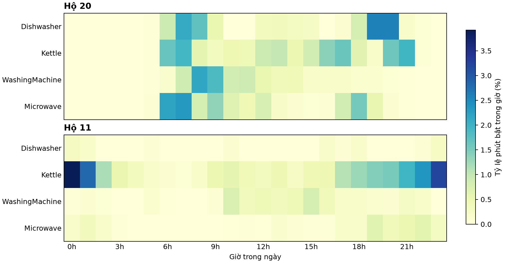{width=16cm}

- **Hộ 20 → hộ 11: khác giờ và khác tần suất.** Hộ 11 gần như không dùng Dishwasher; Kettle bật nhiều quanh nửa đêm trong khi hộ 20 bật buổi sáng và tối; Microwave của hộ 20 tập trung buổi sáng, của hộ 11 buổi tối.
- **Hộ 20 → hộ 13: cùng giờ nhưng khác tần suất.** Dishwasher và WashingMachine của hộ 13 bật cùng khung giờ với hộ 20 nhưng nhiều gấp 2–3 lần; Microwave của hộ 13 không có đỉnh buổi sáng như hộ 20.

#### 3.2.5. Trả lời câu hỏi 3.2

- **Hiệu năng suy giảm rõ khi sang hộ mới, ở cả ba nhóm chỉ số:** F1 của 2Stage giảm khoảng 25% (0,557 xuống 0,415), NDE gần gấp đôi, SAE gấp đôi; F1 và MR của mọi mô hình trên hộ mới đều thấp hơn mô hình train trên chính hộ đó.
- **Mức suy giảm phụ thuộc vào cả hộ train và hộ đánh giá:** mô hình train trên hộ 11, nơi gần như không dùng Dishwasher, kém nhất; hộ 6 dễ đánh giá với mọi mô hình. Dishwasher và Kettle chuyển giao tương đối tốt (F1 trên hộ mới 0,674 và 0,618); WashingMachine (0,313) và Microwave (0,079) chưa đạt.
- **Năng lượng suy giảm mạnh hơn bật/tắt:** mô hình vẫn nhận ra phần lớn lần bật nhưng gán thừa điện năng ở hộ ít dùng thiết bị; mô hình tốt nhất về F1 (hộ 6) lại kém nhất về năng lượng.

### 3.3. Mô hình chung và mô hình riêng: hiệu năng và chi phí

Mục này trả lời đề bài 2 (Y2.1, Y2.2). Với mỗi hộ test, bốn cấu hình được kiểm tra trên cùng 20% thời gian cuối: **2Stage riêng, Baseline riêng** (cá nhân hóa: train chỉ trên dữ liệu đo riêng từng thiết bị của chính hộ đó) và **2Stage chung, Baseline chung** (không cá nhân hóa: một mô hình train trên hộ 6, 9, 11, 20). Với hộ 6, 9, 11, 20, câu hỏi là mô hình riêng có tốt hơn mô hình chung đã học cả hộ đó không; với hộ 2, 3, 13, câu hỏi là có đáng đo riêng từng thiết bị tại hộ mới thay vì dùng ngay mô hình chung không. Các số sơ bộ trong hồ sơ về tinh chỉnh theo hộ và Trợ lý AI không thuộc thực nghiệm này và không được dùng.

**Giả định.** So sánh này yêu cầu các hộ có cùng một bộ thiết bị cần dự đoán. Vì vậy thực nghiệm chỉ giữ bảy hộ có đủ cả bốn thiết bị đích (mục 2.2): mô hình chung dự đoán cùng bốn đầu ra cho mọi hộ, và một hộ thiếu thiết bị sẽ không có nhãn để train hay kiểm tra thiết bị đó.

**Giả thuyết.** Mục 3.2 cho thấy đặc tính sử dụng thiết bị khác nhau giữa các hộ và mô hình giảm hiệu năng khi sang hộ khác. Nếu vậy, mô hình train riêng trên một hộ sẽ khớp với đặc tính của hộ đó hơn và cho kết quả tốt hơn mô hình chung khi đánh giá trên chính hộ đó. Mục này kiểm tra giả thuyết bằng cách so 2Stage riêng với 2Stage chung trên cùng hộ; Baseline được giữ trong bảng để so với NILM cơ sở.

#### 3.3.1. Độ chính xác

**Bảng 15.** Dự đoán bật/tắt của bốn cấu hình. "Riêng" là mô hình train trên chính hộ test; tên nhóm cột chỉ xét theo mô hình chung.

<table>
  <thead>
    <tr><th rowspan="2">Chỉ số</th><th colspan="4">Hộ có trong mô hình chung (6, 9, 11, 20)</th><th colspan="4">Hộ mới với mô hình chung (2, 3, 13)</th></tr>
    <tr><th>2Stage riêng</th><th>2Stage chung</th><th>Baseline riêng</th><th>Baseline chung</th><th>2Stage riêng</th><th>2Stage chung</th><th>Baseline riêng</th><th>Baseline chung</th></tr>
  </thead>
  <tbody>
    <tr><td>Precision ↑</td><td align="right">0,581</td><td align="right">0,627</td><td align="right">0,604</td><td align="right"><b>0,637</b></td><td align="right">0,453</td><td align="right"><b>0,471</b></td><td align="right"><b>0,471</b></td><td align="right">0,455</td></tr>
    <tr><td>Recall ↑</td><td align="right">0,701</td><td align="right"><b>0,732</b></td><td align="right">0,613</td><td align="right">0,587</td><td align="right">0,605</td><td align="right"><b>0,659</b></td><td align="right">0,526</td><td align="right">0,512</td></tr>
    <tr><td>F1 ↑</td><td align="right">0,623</td><td align="right"><b>0,664</b></td><td align="right">0,604</td><td align="right">0,588</td><td align="right">0,479</td><td align="right"><b>0,535</b></td><td align="right">0,480</td><td align="right">0,473</td></tr>
  </tbody>
</table>

**Bảng 16.** Dự đoán công suất của bốn cấu hình.

<table>
  <thead>
    <tr><th rowspan="2">Chỉ số</th><th colspan="4">Hộ có trong mô hình chung (6, 9, 11, 20)</th><th colspan="4">Hộ mới với mô hình chung (2, 3, 13)</th></tr>
    <tr><th>2Stage riêng</th><th>2Stage chung</th><th>Baseline riêng</th><th>Baseline chung</th><th>2Stage riêng</th><th>2Stage chung</th><th>Baseline riêng</th><th>Baseline chung</th></tr>
  </thead>
  <tbody>
    <tr><td>MAE (W) ↓</td><td align="right">6,7</td><td align="right"><b>6,3</b></td><td align="right">9,5</td><td align="right">8,4</td><td align="right">17,1</td><td align="right"><b>16,4</b></td><td align="right">22,7</td><td align="right">19,7</td></tr>
    <tr><td>RMSE (W) ↓</td><td align="right">69,5</td><td align="right"><b>68,8</b></td><td align="right">73,7</td><td align="right">70,6</td><td align="right">121,6</td><td align="right">125,3</td><td align="right"><b>119,8</b></td><td align="right">126,8</td></tr>
    <tr><td>NDE ↓</td><td align="right"><b>0,397</b></td><td align="right">0,439</td><td align="right">0,399</td><td align="right">0,406</td><td align="right">0,591</td><td align="right">0,691</td><td align="right"><b>0,565</b></td><td align="right">0,603</td></tr>
  </tbody>
</table>

**Bảng 17.** Dự đoán năng lượng của bốn cấu hình.

<table>
  <thead>
    <tr><th rowspan="2">Chỉ số</th><th colspan="4">Hộ có trong mô hình chung (6, 9, 11, 20)</th><th colspan="4">Hộ mới với mô hình chung (2, 3, 13)</th></tr>
    <tr><th>2Stage riêng</th><th>2Stage chung</th><th>Baseline riêng</th><th>Baseline chung</th><th>2Stage riêng</th><th>2Stage chung</th><th>Baseline riêng</th><th>Baseline chung</th></tr>
  </thead>
  <tbody>
    <tr><td>SAE ↓</td><td align="right">0,240</td><td align="right">0,250</td><td align="right"><b>0,164</b></td><td align="right">0,337</td><td align="right">0,422</td><td align="right">0,351</td><td align="right">0,381</td><td align="right"><b>0,198</b></td></tr>
    <tr><td>Sai số năng lượng (kWh) ↓</td><td align="right">2,91</td><td align="right">1,99</td><td align="right"><b>1,61</b></td><td align="right">2,97</td><td align="right">13,50</td><td align="right">8,01</td><td align="right">13,66</td><td align="right"><b>6,67</b></td></tr>
    <tr><td>NEP ↓</td><td align="right"><b>0,707</b></td><td align="right">0,795</td><td align="right">1,032</td><td align="right">1,038</td><td align="right"><b>0,927</b></td><td align="right">1,092</td><td align="right">1,443</td><td align="right">1,192</td></tr>
    <tr><td>TECA ↑</td><td align="right"><b>0,647</b></td><td align="right">0,603</td><td align="right">0,484</td><td align="right">0,481</td><td align="right"><b>0,537</b></td><td align="right">0,454</td><td align="right">0,279</td><td align="right">0,404</td></tr>
    <tr><td>MR ↑</td><td align="right">0,506</td><td align="right"><b>0,533</b></td><td align="right">0,405</td><td align="right">0,418</td><td align="right">0,356</td><td align="right"><b>0,391</b></td><td align="right">0,258</td><td align="right">0,308</td></tr>
  </tbody>
</table>

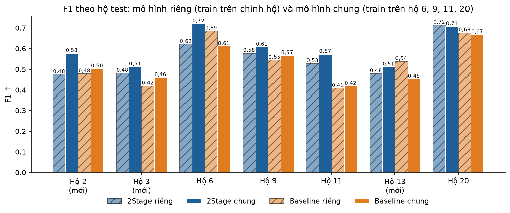{width=16cm}

**Kết quả kiểm định (2Stage riêng so với 2Stage chung, số hộ mô hình riêng tốt hơn trên 7 hộ):**

| Nhóm | Mô hình riêng tốt hơn | Mô hình chung tốt hơn |
|---|---|---|
| Bật/tắt | — | F1 (6/7 hộ), Recall (5/7), MR (6/7) |
| Công suất | NDE (6/7 hộ) | MAE (4/7) |
| Năng lượng | NEP, TECA (4/7 hộ, và tốt hơn ở cả hai nhóm hộ trong Bảng 17) | Sai số năng lượng (5/7) |

- **Giả thuyết chỉ đúng với độ khớp biên độ và năng lượng:** mô hình riêng có NDE thấp hơn ở 6/7 hộ, NEP và TECA tốt hơn ở cả hai nhóm hộ. Mô hình học đúng mức công suất và điện năng của chính hộ đó.
- **Giả thuyết sai với phát hiện bật/tắt:** mô hình chung có F1 cao hơn ở 6/7 hộ (chỉ hộ 20 ngược lại), kể cả trên ba hộ nó chưa từng thấy (0,535 so với 0,479 của mô hình train trên chính hộ đó). Mô hình chung được train trên lượng dữ liệu khoảng gấp 4 lần và nhiều kiểu sử dụng khác nhau, nên nhận ra lần bật tốt hơn; lợi ích này lớn hơn lợi ích từ việc khớp đặc tính riêng của một hộ.
- **So với NILM cơ sở:** 2Stage chung là cấu hình tốt nhất về F1, Recall, MAE và MR; F1 cao hơn Baseline chung 0,076 trên hộ có trong train và 0,062 trên hộ mới.

#### 3.3.2. Yêu cầu phần cứng

**Bảng 18.** Phần cứng cần để train và chạy bốn cấu hình.

| Hạng mục | 2Stage riêng | 2Stage chung | Baseline riêng | Baseline chung |
|---|---|---|---|---|
| Số mô hình cần train | 1 mỗi hộ | 1 cho mọi hộ | 1 mỗi hộ | 1 cho mọi hộ |
| Train (1 GPU L40S, 5 seed) | khoảng 20 phút mỗi hộ | khoảng 66 phút, một lần | khoảng 4 phút mỗi hộ | khoảng 17 phút, một lần |
| Chạy suy luận 1 ngày dữ liệu (CPU 1 luồng, 5 seed) | khoảng 0,24 s | khoảng 0,24 s | khoảng 0,20 s | khoảng 0,20 s |
| Cảm biến tại hộ dùng | cảm biến tổng + 4 ổ cắm đo trong khoảng 333 ngày | chỉ cảm biến tổng | cảm biến tổng + 4 ổ cắm đo trong khoảng 333 ngày | chỉ cảm biến tổng |

**Cấu hình tối thiểu để chạy (demo Docker, 2Stage chung):** không cần GPU; 1 lõi CPU và 512 MB RAM là đủ (bộ nhớ đỉnh 354 MB); image 1,21 GB, trọng số 10,4 MB; phân rã 1.536 phút (khoảng 1 ngày) dữ liệu trong 0,33–0,36 s, kết quả khớp tuyệt đối với bản chạy ngoài container.

#### 3.3.3. Trả lời câu hỏi 3.3

- **Học từ nhiều hộ tốt hơn về phát hiện bật/tắt, học từ một hộ tốt hơn về khớp năng lượng:** với 2Stage, mô hình chung có F1 cao hơn mô hình riêng ở 6/7 hộ (kể cả hộ chưa thấy: 0,535 so với 0,479); mô hình riêng có NDE tốt hơn ở 6/7 hộ và NEP, TECA tốt hơn. Giả thuyết "đặc tính hộ khác nhau nên mô hình riêng tốt hơn" chỉ đúng một phần: lượng và độ đa dạng dữ liệu của mô hình chung quan trọng hơn với việc nhận ra lần bật.
- **Đánh đổi về train:** mô hình chung train một lần lâu hơn (khoảng 66 phút GPU) nhưng dùng cho mọi hộ; mô hình riêng phải train lại cho từng hộ.
- **Đánh đổi về cảm biến:** mô hình chung chỉ cần cảm biến tổng tại hộ dùng; mô hình riêng cần thêm 4 ổ cắm đo tại mỗi hộ trong khoảng 333 ngày để thu dữ liệu train.
- **Đánh đổi về phạm vi:** mô hình chung chỉ dự đoán được bộ thiết bị chung của các hộ train; hộ có thiết bị khác cần thu thêm dữ liệu có nhãn cho thiết bị đó.
- **Triển khai:** cả hai cách đều chạy được trên CPU, không cần GPU: 1 lõi và 512 MB RAM xử lý khoảng 1 ngày dữ liệu trong khoảng 0,35 s.

## 4. Kết luận

### 4.1. Đánh giá NILM trên hộ và thiết bị mới

**Y1.1 – Hiệu năng trên hộ mới.** Thực nghiệm tách phần kiểm tra theo thời gian của từng hộ và đánh giá chéo 7 × 7 cặp hộ train–test. Với mô hình train riêng một hộ, khi chuyển sang hộ khác, F1 của 2Stage giảm từ 0,557 xuống 0,415 và MAE tăng từ 11,5 lên 17,4 W; Baseline giảm F1 từ 0,547 xuống 0,374 và tăng MAE từ 15,6 lên 23,7 W (Bảng 4). Bảng theo thiết bị, mức điện tổng và ma trận theo cặp hộ ở mục 3.1–3.2 cho thấy mức giảm không đồng đều: Dishwasher và Kettle chuyển giao tương đối tốt, còn WashingMachine và Microwave yếu; F1 của Microwave trên hộ mới chỉ đạt 0,079. 2Stage giảm bỏ sót Dishwasher nhưng cũng báo bật nhầm nhiều hơn, nên lợi ích về F1 cần đọc cùng sai số điện năng.

**Y1.2 – Nhiều thiết bị chạy đồng thời.** Mô hình dự đoán công suất của bốn thiết bị cùng lúc từ điện tổng; Hình 5 minh họa điện tổng và từng thiết bị trên cùng cửa sổ thời gian. Ở mức điện tổng từ 3.000 W, các bước gia nhiệt gần 2 kW dễ bị gán nhầm giữa Dishwasher, WashingMachine và Kettle: 2Stage kém Baseline về F1 trên hộ được train (0,530 so với 0,572) và SAE trên hộ mới (1,049 so với 0,853). Khi chia phút test theo số thiết bị đích thực sự bật (mục 3.1.4), phút có từ hai thiết bị đích cùng bật chỉ chiếm 0,15%. Ở nhóm này, trên hộ mới, 2Stage vẫn tốt hơn Baseline: F1 0,597 so với 0,519, MAE 525 so với 611 W, sai số điện năng tương đối 0,472 so với 0,565 (Bảng 8). So trong cùng khoảng điện tổng, chồng lấp làm Recall giảm, tức mô hình bỏ sót một trong các thiết bị đang chạy, còn sai số điện năng tăng chủ yếu theo mức tải (Bảng 9). Lỗi gán nhầm rõ nhất là 2Stage nhận WashingMachine thành Dishwasher: trong 42,4% số phút WashingMachine chạy một mình và 58,3% khi có thiết bị đích khác chạy cùng, khoảng gấp đôi Baseline (Bảng 10, Hình 8). Bài cũng **chưa kiểm tra loại thiết bị chưa thấy**: mọi hộ trong thí nghiệm đều có cùng bốn thiết bị đích, nên chưa thể kết luận khả năng nhận ra thiết bị mới.

### 4.2. Lợi ích và chi phí triển khai

**Y2.1–Y2.2 – Mô hình và phần cứng.** Trên cùng đầu vào, 2Stage chung có F1 cao hơn Baseline chung ở cả hộ đã thấy (0,664 so với 0,588) và hộ chưa thấy (0,535 so với 0,473). So với 2Stage train riêng trên chính hộ test, mô hình chung có F1 cao hơn ở 6/7 hộ, kể cả ba hộ chưa thấy (0,535 so với 0,479); mô hình riêng lại có NDE tốt hơn ở 6/7 hộ và NEP, TECA tốt hơn ở cả hai nhóm hộ. Do đó dữ liệu nhiều hộ giúp phát hiện bật/tắt, còn dữ liệu riêng giúp khớp biên độ và năng lượng. “Cá nhân hóa” trong bài là train một mô hình riêng từ dữ liệu có nhãn của hộ, chưa phải tinh chỉnh mô hình chung tại hộ.

2Stage chung cần khoảng 66 phút train một lần trên GPU L40S với 5 seed, so với khoảng 20 phút **cho mỗi hộ** nếu train riêng. Khi dùng mô hình chung, hộ chỉ cần cảm biến điện tổng; train riêng cần thêm bốn ổ cắm đo thiết bị trong khoảng 333 ngày. Suy luận một ngày dữ liệu mất khoảng 0,24 s trên CPU một luồng; bản demo Docker chạy với 1 lõi CPU, 512 MB RAM, dùng đỉnh 354 MB và mất 0,33–0,36 s. Các số này chứng minh khả năng chạy gọn của **khối suy luận NILM**, chưa phải chi phí tiền tệ hoặc chi phí vận hành toàn hệ thống.

**Y2.3 – Trợ lý AI.** Trợ lý đọc dữ liệu điện tổng và kết quả NILM để trả lời người dùng, không thay đổi dự đoán phân rã; vì vậy bản có và không có trợ lý dùng cùng đầu ra NILM.

## Tài liệu tham khảo

[1] Hart, G. W. (1992). Nonintrusive appliance load monitoring. *Proceedings of the IEEE*, 80(12), 1870–1891. https://doi.org/10.1109/5.192069

[2] Zoha, A., Gluhak, A., Imran, M. A., Rajasegarar, S. (2012). Non-intrusive load monitoring approaches for disaggregated energy sensing: A survey. *Sensors*, 12(12), 16838–16866. https://doi.org/10.3390/s121216838

[3] Petralia, A., Charpentier, P., Kadhi, Y., Palpanas, T. (2025). NILMFormer: Non-intrusive load monitoring that accounts for non-stationarity. *Proc. 31st ACM SIGKDD*. https://doi.org/10.1145/3711896.3737251

[4] Murray, D., Stankovic, L., Stankovic, V. (2017). An electrical load measurements dataset of United Kingdom households from a two-year longitudinal study. *Scientific Data*, 4, 160122. https://doi.org/10.1038/sdata.2016.122

[5] Pereira, L., Nunes, N. (2018). Performance evaluation in non-intrusive load monitoring: Datasets, metrics, and tools — A review. *WIREs Data Mining and Knowledge Discovery*, 8(6), e1265. https://doi.org/10.1002/widm.1265
