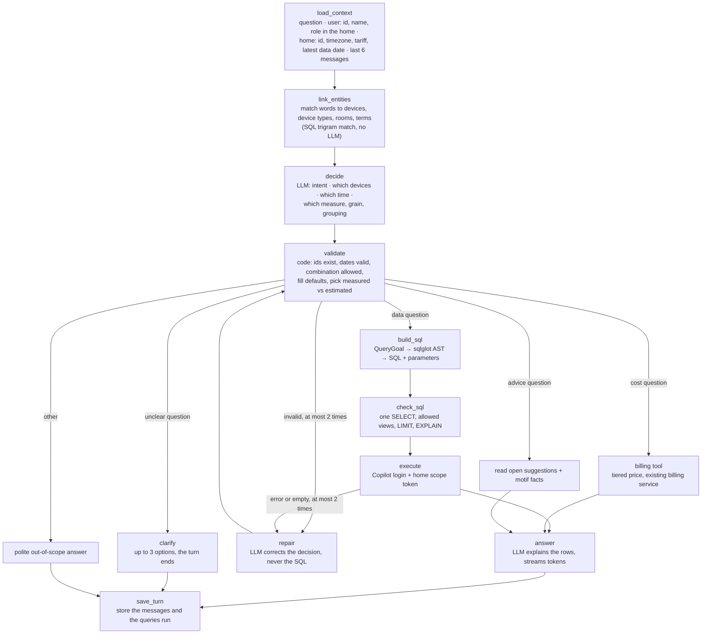

# Spec: Energy Copilot — ask about your energy, get advice that saves money

Status: ready for review · Date: 2026-11-06 · Replaces the earlier draft of this file.
Stack: FastAPI, SQLAlchemy async (asyncpg), TimescaleDB 2.31 / PostgreSQL 17, pg_trgm + unaccent, LangGraph,
OpenRouter. Demo data: the legacy dump `data/wattprint_dump_20261103 (4)`, loaded into the energy schema by the
legacy migration CLI.

## Problem Statement

A household sees kWh charts and a bill, but cannot ask simple questions about them ("How much did the washing
machine use yesterday?", "Why was Thursday so high?") and gets no advice on what to change. Today:

- the mobile app's Copilot screens call `/demo/copilot/*` endpoints that exist only in the old demo backend; the
  new backend has none, and its Copilot tables (`copilot.*`, `copilot_ro.*`) are empty;
- a general chatbot cannot answer either: it does not know this home's devices, readings, NILM estimates or
  tariff, and it invents numbers;
- nothing turns the data into advice: `copilot.suggestion`, `insight.device_cycle` and `insight.alert` are empty.

## Solution

An **Energy Copilot** with two flows that share one rule: **the LLM chooses and explains; every number comes
from SQL or a deterministic function.** The model never writes SQL.

1. **Ask (Text-to-SQL).** The user asks in Vietnamese or English, with or without tone marks. The Copilot links
   the words to the home's devices and to a fixed set of measures, builds one safe SQL query, runs it inside the
   home's read-only scope, and answers with the number, how much data it covers, whether it is measured or
   NILM-estimated, and the query it ran.
2. **Advise (behaviour recommendation).** Once a day per home, the Copilot finds behaviour patterns ("motifs")
   in the data, checks them against rules (shipped expert rules plus the household's own), prices the saving at
   the home's tariff tier, ranks by "money the user will likely actually save", and stores up to three
   suggestions. The user accepts, rejects or snoozes; the Copilot learns from that and measures the real saving
   afterwards.

### The whole flow at a glance

**Ask** — one LangGraph run per question:



**Advise** — one LangGraph run per home per day, plus feedback afterwards:

```mermaid
flowchart LR
  J["Daily job / refresh button"] --> LH["load_home<br/>home, tariff, enabled rules"]
  LH --> D["derive_cycles<br/>appliance on/off cycles"]
  D --> M["detect_motifs<br/>facts for the last 7 days"]
  M --> E["evaluate_rules<br/>expert + household rules"]
  E --> PR["price<br/>kWh saved → VND at the marginal tier"]
  PR --> RK["rank<br/>saving × chance of acceptance"]
  RK --> PH["phrase<br/>LLM writes text; numbers come from facts"]
  PH --> ST["store up to 3 suggestions"]
  ST --> U["App: accept / reject / snooze / done"]
  U --> FB["acceptance model"]
  U --> SV["measure_savings<br/>7 days after acceptance"]
  FB -. next run .-> RK
```



| Step | Who does it |
| --- | --- |
| Gather the question, the user, the home, the history | Code |
| Link words to devices, types, rooms, terms | SQL (trigram + unaccent) |
| Decide intent, devices, time, measure, grain | LLM, structured output, from the candidates only |
| Check the decision, fill defaults, spot an unclear question | Code |
| Build and run SQL | Code (sqlglot AST), Copilot login |
| Cost in VND | Billing service |
| Detect motifs, evaluate rules, price, rank | Code / SQL |
| Explain the answer, phrase a suggestion | LLM (numbers filled in from facts) |

## User Stories

**Asking questions (household)**

1. As a household member, I want to ask "how much electricity did we use yesterday?" and get the kWh for my local
   day, so that I don't have to read charts.
2. As a household member, I want to ask about one appliance by its name ("the washing machine", "máy giặt"), so
   that I learn what each appliance costs me.
3. As a household member, I want to type without tone marks ("may giat hom qua"), so that I can type fast on my
   phone.
4. As a household member, I want to ask in English or Vietnamese and get the answer in the language I used, so
   that the Copilot feels natural.
5. As a household member, I want to ask "which day last week used the most?", so that I can find unusual days.
6. As a household member, I want to compare periods ("this week vs last week"), so that I see whether I improve.
7. As a household member, I want to ask "which appliance used the most this week?", so that I know where to act.
8. As a household member, I want hourly breakdowns ("when during the day do we use most?"), so that I understand
   my routine.
9. As a household member, I want to ask what my electricity cost this month in VND, so that the tiered tariff is
   applied for me.
10. As a household member, I want to know whether a figure is measured by a plug or estimated by NILM, so that I
    know how much to trust it.
11. As a household member, I want to be told when data is missing ("data covers 60% of that day"), so that I am
    not misled by a low number.
12. As a household member, I want a clear "no data for that day; latest data is 4 Nov" answer, so that I know the
    meter is behind rather than my use being zero.
13. As a household member, I want a clear "I can't find a device called 'dryer' in your home" answer, so that I
    can fix the name.
14. As a household member, I want follow-up questions ("and the day before?") to understand the earlier question,
    so that I can have a conversation.
15. As a household member, I want to see the query the Copilot ran, so that I can trust or report the number.
16. As a household member, I want the answer to stream word by word, so that the app feels fast.
17. As a household member, I want questions outside energy to get a short polite refusal, so that the Copilot
    stays on topic.
18. As a household member, when my question is unclear ("that machine", a name that fits two devices, a question
    that could mean usage or advice), I want the Copilot to ask me with a few options, so that it doesn't guess
    wrong.
19. As a household member, when I leave out the time or the appliance, I want the Copilot to assume the last 7
    days or the whole home and say so, so that I get an answer without being asked.
20. As a household member, I want the Copilot to know who I am (my name, whether I own the home), so that it
    addresses me properly and only offers actions I am allowed to do.

**Defining my own words (terms)**

21. As a household member, when the Copilot doesn't know a word I use ("bình tắm", "giờ cao điểm"), I want it to
    offer what it might mean, so that I can pick one in a tap.
22. As a household member, I want the meaning I picked to be remembered for my home, so that I am not asked again.
23. As a household member, I want to name a device my way ("the kitchen kettle" → Kettle), so that questions use
    my words.
24. As a household member, I want to define a time window ("peak hours = 17:00–20:00"), so that I can ask about it.
25. As a household member, I want to see, edit and delete my home's terms, so that a wrong definition can be fixed.

**Getting advice (behaviour recommendation)**

26. As a household member, I want at most three suggestions at a time, each with the expected saving in VND per
    month, so that I act on what matters most.
27. As a household member, I want each suggestion to show the evidence ("night load 2,729 W on 30 Oct vs 327 W
    usually"), so that I believe it.
28. As a household member, I want to be told when my pace will push the bill into a higher price tier, and how
    many kWh a day to cut to avoid it, so that I can react before the bill comes.
29. As a household member, I want to accept, reject, snooze or mark a suggestion done, so that the Copilot learns
    what I am willing to do.
30. As a household member, I want rejected kinds of advice to stop coming back, so that I am not nagged.
31. As a household member, I want to see the measured saving a week after I accepted a suggestion, so that I know
    it worked.
32. As a household member, I want to ask "what should I do to save?" in the chat and get my open suggestions, so
    that advice and questions live in one place.
33. As a household member, I want a "refresh advice" action, so that a demo or a new device shows results now.

**Writing my own rules**

34. As a household owner, I want to add a rule such as "tell me when the night load is above 300 W on at least 3
    nights a week", so that the Copilot watches what I care about.
35. As a household owner, I want a rule I write to be checked when I save it, with a clear message if it is
    invalid, so that I don't save something that silently never fires.
36. As a household owner, I want to see how many times my rule would have fired in the last 7 days when I save it,
    so that I can tune its threshold.
37. As a household owner, I want to switch a rule off without deleting it, so that I can pause it.

**Experts and the team**

38. As an energy expert on the team, I want to write shared rules in the same format, versioned with the code, so
    that every home gets reviewed advice.
39. As a developer, I want every executed query logged with its SQL, duration and success, so that I can debug
    wrong answers.
40. As a developer, I want questions the Copilot could not answer logged with the unmatched words, so that I know
    which terms and measures to add next.
41. As a developer, I want the Copilot to be off with a clear 503 when no OpenRouter key or model is configured,
    so that the rest of the API keeps working.
42. As a demo presenter, I want the whole flow to work on the legacy dump (REFIT House 2, 7 days), so that I can
    show it without a live meter.
43. As an operator, I want the Copilot's SQL to run under its own read-only database login, scoped to one home,
    so that a bad query can never read or change another home's data.

## Implementation Decisions

### Proposed fixes to the current database and code

Found while checking the live DB on 2026-11-06. Evidence is in "Retrieval: search engine, links and indexes"; all
of these go into the one migration (except 11–12) and are listed per file in "Implementation Plan".

| # | Fix | Why |
| --- | --- | --- |
| 1 | `copilot_ro.match_key(text)`: lower case, no tone marks, question syllables dropped; used on both sides of a match | plain matching linked "tivi tốn điện" to *Xe điện*; stripping only the question broke "xe điện" |
| 2 | `catalog.device_type.synonyms text[]`, seeded (tivi, bình tắm, ấm siêu tốc, máy rửa chén, máy lạnh, máy sấy, quạt trần, …) | everyday and regional names missed or matched the wrong type |
| 3 | new device type `fan`; "Overhead Fan" re-typed from `other`; the REFIT name mapping learns "fan" | "quạt" could never match "Khác" |
| 4 | unique `(home_id, id)` on `core.device`; device links of `copilot.suggestion`, `insight.alert`, `billing.bill_item`, `insight.device_cycle` become `(home_id, device_id)` with `ON DELETE SET NULL (device_id)` | a row could point at another home's device and silently fall out of the Copilot's joins |
| 5 | new links: suggestion → rule, suggestion → motif instance, term → message, rule → home | "why this advice?" and "where did this word come from?" become one join |
| 6 | index `copilot.message (conversation_id, created_at DESC)` replacing the one-column index | history is always "last 6 messages" |
| 7 | index `copilot.suggestion (home_id, status)` | open suggestions and the ranking's duplicate check |
| 8 | index `insight.motif_instance (home_id, motif, start_ts DESC)` | rules read one motif's recent instances |
| 9 | expired `copilot.scope_token` rows deleted when a new one is issued | there is no cleanup job today (noted in the database design) |
| 10 | `copilot_ro` views `lexicon`, `term`, `rule`, `motif_instance` with grants | the Copilot login can read only `copilot_ro` |
| 11 | `COPILOT_DB_PASSWORD` set before migrating, `COPILOT_DATABASE_URL` for the API | the Copilot login is NOLOGIN today |
| 12 | device rooms filled in through the device API | all 9 rooms are empty, so room words cannot link |

### Stack and dependencies

- Add **LangGraph** (1.2.x), **langchain-openai** (1.7.x) and **sqlglot**. The chat model is `ChatOpenAI` pointed at
  OpenRouter's OpenAI-compatible API (base URL, key and model from the `OPENROUTER_*` settings already added). The
  reference project `ai-agent-superset-code` uses the same pairing.
- **No LangGraph checkpointer in v1.** Each question is one graph run; conversation memory is the last messages
  read from `copilot.message`. A clarification ends the turn with a card, and the user's choice arrives as the
  next request. This avoids `langgraph-checkpoint-postgres`, which needs psycopg 3 next to asyncpg. Add it only
  if a flow needs to pause mid-run (LangGraph `interrupt`).
- **No separate search engine and no embeddings in v1.** All retrieval is PostgreSQL: `pg_trgm` + `unaccent` for
  words, SQL on the TimescaleDB aggregates for numbers (see "Retrieval: search engine, links and indexes").
- The agent package is split by role: `config/` (YAML prompts and model settings), `agents/` (graphs, state,
  LLM), `nodes/` (one file per step of the flow), `tools/`, `skills/`, `memory/`, `utils/` (see "Implementation
  Plan"). The graphs are compiled once, at import. Their
  dependencies (chat model, the two DB session factories, the clock) come through LangGraph's runtime
  **context**, whose defaults are the real ones, so tests swap them without patching and `langgraph dev` runs
  them as they are.
- Settings: an empty OpenRouter key or model turns the Copilot endpoints into 503; the advice job still runs and
  uses template text.

### Database access

- Two sessions per run: the **app session** (role `wattprint_app`) for writes to `copilot.*` and `insight.*`, and
  the **Copilot session** (its own login, `wattprint_copilot_ro`) for every generated query.
- The Copilot role becomes a login when `COPILOT_DB_PASSWORD` is set before migrating (an empty password keeps it
  NOLOGIN, as today).
- Per run, the app session writes a `copilot.scope_token` row for the home (5-minute expiry). The Copilot session
  opens a read-only transaction and sets it with `set_config('app.copilot_token', :token, true)` as a bind
  parameter. Every `copilot_ro` view then shows only that home; a missing or expired token shows nothing (fail
  closed). The role's `statement_timeout` is 5 s.
- Generated SQL never runs on the API's connection. The API (and Alembic) connect with `DATABASE_URL`, which is
  `postgres` today. Fixed Copilot code uses that session, filtered by home id. Switching the API to
  `wattprint_app` needs a separate migration URL and is a follow-up; the hard boundary, generated SQL on the
  Copilot login, does not depend on it.

### Which tables each node may touch

There is one database (`wattprint`) and two logins. Three rules decide everything below:

1. **LLM nodes get no connection.** `decide`, `repair`, `clarify`, `answer` and `phrase` see only the graph state.
2. **Anything built from user or model input runs on the Copilot login**: generated SQL and compiled household
   rules. That login can read nothing but the `copilot_ro` views (one home, through the scope token), `catalog`
   and the tariff tables. It cannot write.
3. **Fixed code uses the app login**, always filtered by the run's home id. It never reads raw
   `energy.reading` / `energy.device_estimate` (it has no grant; it reads the 1m/1h/1d aggregates).

No node reads `public.refresh_tokens`, `users.hashed_password`, `ops.*`, `knowledge.*` (v1) or `alembic_version`.

**Ask graph**

| Node | Login | Reads | Writes |
| --- | --- | --- | --- |
| `load_context` | app | `users` (name only), `core.home_member` (role), `core.home`, `copilot.message` (history) | `copilot.conversation` (new thread), `copilot.message` (the question), `copilot.scope_token` |
| | Copilot | `copilot_ro.reading_1d` (latest data date) | — |
| `link_entities` | Copilot | `copilot_ro.lexicon` (new) | — |
| `decide` | none (LLM) | state | — |
| `validate` | Copilot | `copilot_ro.reading_1d` (plug coverage, to choose measured vs estimated) | — |
| `build_sql` | none | — | — |
| `check_sql` | Copilot | `EXPLAIN` of the built query | — |
| `execute` | Copilot | only `copilot_ro.reading_1m/1h/1d`, `copilot_ro.device_estimate_1m/1h/1d`, `copilot_ro.device`, `copilot_ro.device_cycle` | — |
| `repair` | none (LLM) | state | — |
| `billing tool` | app | `core.home`, `energy.series`, `energy.reading_1d`, `billing.tariff_*` (through the billing service) | `billing.bill`, `billing.bill_item` (the service upserts the cycle's bill) |
| `read suggestions` | Copilot | `copilot_ro.suggestion`, `copilot_ro.motif_instance` (new) | — |
| `clarify`, `answer` | none (LLM) | state | — |
| `save_turn` | app | — | `copilot.message` (the answer), `copilot.tool_call` (each query run) |

**Advise graph**

| Node | Login | Reads | Writes |
| --- | --- | --- | --- |
| `load_home` | app | `core.home`, `core.home_member`, `billing.tariff_version`, `billing.tariff_tier`, `copilot.rule` (enabled, shared + this home) | `copilot.scope_token` |
| `derive_cycles` | app | `energy.series`, `energy.reading_1m` (plug), `energy.device_estimate_1m`, `core.device`, `catalog.device_type` (on-thresholds) | `insight.device_cycle` |
| `detect_motifs` | app | `energy.reading_1h`, `energy.reading_1d` (main), `insight.device_cycle` | `insight.motif_instance` |
| `evaluate_rules` | Copilot | compiled rules over `copilot_ro.motif_instance`, `copilot_ro.device` | — |
| `price` | none | state (tariff from `load_home`) | — |
| `rank` | app | `copilot.suggestion` (open, snoozed, rejected), `copilot.suggestion_feedback` | — |
| `phrase` | none (LLM) | state | — |
| `store` | app | — | `copilot.suggestion` |
| `measure_savings` | app | `copilot.suggestion_feedback` (accepted 7+ days ago), `energy.reading_1d`, `insight.motif_instance` | `copilot.savings_measure` |

**APIs outside the graphs**

| API | Login | Reads | Writes |
| --- | --- | --- | --- |
| terms | app | `copilot.term` | `copilot.term` |
| rules | app; Copilot for the dry run | `copilot.rule`, `core.home_member` (owner check) | `copilot.rule` |
| feedback | app | `copilot.suggestion` | `copilot.suggestion_feedback`, `copilot.suggestion.status` |

The existing grants already allow all of this except the new tables: the migration adds them to the app's DML list
and gives the Copilot login SELECT on the new `copilot_ro` views.

### Ask graph: state and nodes

State carried between nodes:

| Field | Meaning |
| --- | --- |
| question | as typed; the answer uses the same language |
| user | id, display name, role in the home (`owner` or `member`) |
| home | id, name, timezone, tariff plan, latest local date with data |
| history | last 6 messages of the conversation |
| candidates | linked entities: device / device type / room / term, id, matched phrase, score |
| decision | what `decide` chose: intent, devices, time, measure, grain, grouping, comparison, ranking, and the defaults it assumed |
| goal | the checked QueryGoal (below) |
| sql, params, rows, coverage, source_used | what ran and what came back |
| attempts, error | repair loop counter (max 2) and the last error |
| clarification | the options when the question is unclear |
| answer, steps | final text; one entry per node for the trace shown in the app |

Nodes, in order:

1. `load_context` (code): reads the user's name and role, the home, the latest local date with data and the last
   6 messages; creates the conversation if it is new, stores the question, writes the scope token.
2. `link_entities` (SQL): normalize the question with the database's own unaccent + lower, match it against the
   **lexicon** view: `strict_word_similarity` on the match keys of both sides (question words removed), keep
   ≥ 0.6, top 5 per kind (see "Retrieval").
3. `decide` (LLM, temperature 0, structured output) is the **action node**. In one call it makes every choice the
   query needs:
   - **intent**: data, cost, advice, unclear, other;
   - **devices**: candidate ids, or the whole home;
   - **time**: start and end local dates from words such as "hôm qua", "tuần trước", "29/10", given today and the
     latest data date;
   - **what to compute**: measure, grain, grouping, comparison, ranking;
   - **assumptions**: the defaults it used, so the answer can state them.

   It may only use candidate ids; it never sees a database.
4. `validate` (code) turns the decision into a QueryGoal or rejects it:
   - ids are among the candidates; dates are ≤ today with start ≤ end; the period is ≤ 400 days (retention) and ≤ 7
     days at minute grain; the measure fits the target (cycles need a device);
   - it fills the defaults (see "Unclear questions");
   - for source "best", it chooses measured vs estimated with one coverage query;
   - it routes: invalid and fixable → `repair`; ambiguous → `clarify`; otherwise by intent.
5. `build_sql` (code): QueryGoal → SQL text + parameters (see "How the SQL is built").
6. `check_sql` (code): exactly one SELECT; only the tables `execute` may read (next section); functions from an
   allowlist (sum, avg, min, max, count, round, date_trunc, extract, timezone); a LIMIT ≤ 1000; an `EXPLAIN` must
   succeed.
7. `execute` (Copilot login): runs it, computes coverage, keeps SQL, unit and duration in the state.
8. `repair` (LLM): gets the decision and the error, returns a corrected decision, back to `validate`; after 2
   failures the answer says it could not get the data.
9. `answer` (LLM, streamed): explains the rows in the user's language and must mention coverage below 95%,
   "estimated" for NILM figures, the defaults assumed, and the latest data date when the period has no data.
10. `save_turn` (code): stores the answer and one `copilot.tool_call` row per query run.
11. Side branches: `billing tool` (the existing tiered billing computation for cost questions), `read
    suggestions` (open suggestions and their evidence), `clarify` (up to 3 options), `other` (short refusal).

### Schema linking, in three levels

1. **Entity linking** — words → home devices, device types, rooms and the home's terms, via the lexicon (above).
2. **Measure linking** — `decide` picks one measure from a fixed list; a code-side semantic catalog maps it to
   a column, an aggregation and a unit, and forbids meaningless ones (never a SUM of average watts).
3. **Table and join linking** — (measure, source, grain) selects exactly one view. The `copilot_ro` aggregate
   views already carry `device_id` and the series `kind`, so filtering needs no join; the only join is to
   `copilot_ro.device` for device names (and `device_type_code` when filtering by type).

| Measure | Column and aggregation | Unit |
| --- | --- | --- |
| energy | SUM(`energy_wh`) / 1000 | kWh |
| average power | AVG(`avg_w`) | W |
| peak power | MAX(`max_w`) | W |
| cycles | COUNT(*) over `device_cycle` | cycles |
| cycle energy | SUM(`energy_wh`) / 1000 over `device_cycle` | kWh |

| Source | Series kind | Views |
| --- | --- | --- |
| whole home | `main` | `reading_1m/1h/1d` |
| device, measured | `plug` | `reading_1m/1h/1d` |
| device, estimated | `device` | `device_estimate_1m/1h/1d` |
| device, best | plug if it covers at least 95% of the period's minutes, else estimated; the answer says which | |

Grain: hour → `_1h`, day / week / month → `_1d`, minute → `_1m` (7 days at most). Days are the home's local days.

Why there is no join-graph search (the reference project uses Dijkstra + Steiner trees): every question here
starts at one aggregate view and needs at most one join, so a lookup table is enough. Add the graph search only
if one query must span bills, alerts and suggestions.

### QueryGoal

| Field | Values |
| --- | --- |
| measure | energy, average power, peak power, cycles, cycle energy |
| target | whole home, or a list of device ids, or a list of device type codes |
| source | measured, estimated, best (default) |
| period | start and end local dates, inclusive, ≤ today |
| grain | none, hour, day, week, month |
| group_by | none, device, hour of day, weekday |
| compare_to | none, previous period of the same length |
| order, top_n | optional, for "which day / which device most" |

Questions this shape cannot express are answered with "I can't answer that yet" and logged as misses.

### Unclear questions

`validate` sends a question to `clarify` only when it cannot pick one meaning:

| Case | Example | The card offers |
| --- | --- | --- |
| the thing to measure is not named and the history doesn't say | "Cái máy đó dùng bao nhiêu?" in a new conversation | the home's tracked appliances |
| a phrase fits two or more devices about equally (scores within 0.1) | "ấm đun nước" in a home with two kettles | each device, by name and room |
| a word matches nothing and it names what to measure | "cái bình dùng bao nhiêu?" | the closest devices and device types; the choice is saved as a home term |
| the words don't tell data from advice | "máy giặt thì sao?" | "how much it used" or "how to save on it" |

Missing details are not unclear. They get a default, and the answer states it:

| Missing | Default |
| --- | --- |
| time | the last 7 days with data ("29 Oct–4 Nov") |
| device | the whole home |
| measure | energy in kWh |
| source | best: plug if it covers the period, else the NILM estimate |

The card ends the turn. Tapping an option sends a new request carrying the choice; a word choice is saved as a home
term first, so the same word is not asked about again.

### How the SQL is built (new: nothing builds SQL today)

No code in the backend builds SQL from a goal yet, and sqlglot is not a dependency. A throwaway prototype written
for this spec built the queries below and ran them on the live DB, as the Copilot would (scope token +
`copilot_ro` views), inside a rolled-back transaction. The results match the acceptance set.

The builder is one pure function: QueryGoal + home timezone → SQL text + parameters. It adds nodes to a single
sqlglot SELECT tree in five steps:

1. **View**: an hourly grain or hour-of-day grouping picks `_1h`, otherwise `_1d`; the source picks `reading_*`
   (measured) or `device_estimate_*` (NILM).
2. **Measure**: the aggregation from the semantic catalog, rounded, with the unit in the column name
   (`energy_kwh`).
3. **Comparison**: "previous period" becomes one query over both periods with a `CASE` label `current` /
   `previous`, not two queries.
4. **Grouping**: day / week / month → `DATE_TRUNC` on the bucket in the home's timezone; hour of day / weekday →
   `EXTRACT` on it; device → the only join, to `copilot_ro.device` for names.
5. **Filters**: series kind (`main`, `plug` or `device`); bucket ≥ start and < end, where start and end are local
   midnights converted to UTC in code; device ids `IN (…)`. Then `ORDER BY` the value when ranking, and
   `LIMIT top_n` or 1000.

**Values never enter the SQL text.** Each one is a positional parameter (`$1`, `$2`, …), the form asyncpg takes,
and the query runs on the raw asyncpg connection, as the ingest service already does. Prototype finding: sqlglot's
PostgreSQL output writes *named* placeholders as `%(name)s` (psycopg style), so the builder must use positional
ones, which it renders as `$n`.

`check_sql` checks the finished tree, not the text.

From the prototype, "máy giặt hôm qua" (energy, Washing Machine, estimated, 4 Nov), shown in the positional form:

```sql
SELECT d.name AS device,
  ROUND(CAST(CAST(SUM(v.energy_wh) AS DOUBLE PRECISION) / 1000 AS DECIMAL), 2) AS energy_kwh,
  SUM(v.covered_minutes) AS covered_minutes
FROM copilot_ro.device_estimate_1d AS v
JOIN copilot_ro.device AS d ON d.id = v.device_id
WHERE v.kind = $1 AND v.bucket >= $2 AND v.bucket < $3 AND v.device_id IN ($4)
GROUP BY device
LIMIT 1000
-- $1 = 'device', $2 = 2026-11-03 17:00 UTC, $3 = 2026-11-04 17:00 UTC, $4 = the Washing Machine's id
```

| Question (prototype run) | Goal, in short | Result |
| --- | --- | --- |
| "Hôm qua nhà tôi dùng bao nhiêu điện?" | energy, whole home, measured, 4 Nov | 17.25 kWh, 1,440 of 1,440 minutes |
| "Máy giặt hôm qua?" | energy, Washing Machine, estimated, 4 Nov | 1.62 kWh |
| "Ngày nào tuần qua dùng nhiều nhất?" | energy, whole home, 29 Oct–4 Nov, by day, top 1 | 30 Oct, 36.72 kWh |
| "4 ngày gần đây so với 4 ngày trước?" | energy, whole home, 1–4 Nov vs the previous 4 days | 66.92 vs 77.04 kWh; the earlier period covers 4,320 of 5,760 minutes (75%: 28 Oct has no data) |
| "Ấm đun nước hay dùng lúc mấy giờ?" | energy, Kettle, estimated, by hour of day, top 3 | 16:00 0.70, 17:00 0.69, 09:00 0.51 kWh |

### Terms (the household's own words)

- New table `copilot.term`, **home words only**: home, phrase, match key, kind (`device`, `device_type`,
  `time_window`, `threshold`), target (device id, type code, hours, or a measure + comparison + value), created
  by, created from (a link to the `copilot.message` that asked), timestamps. Unique on home + match key.
- Created from a clarification choice or the terms API; effective immediately for that home.
- Words everyone uses ("bình tắm", "tivi", "máy rửa chén") are not terms: they are **synonyms on the device type**
  (`catalog.device_type.synonyms`), seeded by the migration and reviewed as code. There is no approval workflow.
- Precedence: home term > device type synonym or label > device name.
- The lexicon is a plain `copilot_ro` view: device type labels (vi, en) and synonyms, the home's device names and
  rooms, and the home's terms, each with its match key. At a few dozen rows per home it needs no index or
  materialized view.

### Motifs (behaviour patterns), v1

Each motif is SQL written and tested in code; rules and terms only set its parameters. Detected instances are
stored in a new table `insight.motif_instance` (home, motif, device, start, end, facts as JSON, kWh involved,
detected at), unique on home + motif + device + start.

| Motif | Fires when | Facts kept | Demo data (7 local days, 29 Oct–4 Nov 2026) |
| --- | --- | --- | --- |
| night baseline | the lowest hourly average between 00:00 and 05:00 is above a threshold (default 1.5 × the median night) | night, min W, median W | median night 327 W; 30 Oct night 2,729 W fires |
| day above usual | daily kWh > 1.3 × the median day of the window | day, kWh, median kWh | median 17.25 kWh; 29 Oct (24.78) and 30 Oct (36.72) fire |
| repeat use | the same device runs ≥ k cycles within Δ (kettle re-boiling: k = 3, Δ = 30 min) | device, cycles, kWh | from derived cycles |
| long run | one cycle lasts longer than D for its device type | device, minutes, kWh | from derived cycles |
| tier crossing | month-to-date kWh + average daily kWh × days left reaches a higher tier | projected kWh, tier, kWh/day to cut | 20.6 kWh/day ≈ 617 kWh/month, tier 4 (400–700 kWh, 3,456 VND/kWh before VAT) |

`derive_cycles` fills `insight.device_cycle` first: consecutive minutes at or above an on-threshold per device type
(e.g. kettle 1,000 W, washing machine and dishwasher 100 W), merging gaps under 3 minutes. It uses the plug series
when the device has data there, otherwise the NILM estimate, and records which.

### Rules (the household's and the experts')

- A rule is **when** a condition holds over one motif's instances in a window **then** a suggestion kind for a
  device (or the home).
- Conditions: comparisons of instance facts with numbers, `and` / `or` / `not`, and three quantifiers over the
  instances in the window: **at least one**, **every**, **at least n**.
- This is a safe fragment of first-order logic: every quantifier ranges over the finite set of instances of a
  motif in a bounded window, so there are no free or unbounded variables and every rule compiles to one SELECT
  over `copilot_ro.motif_instance`.
- Example: "at least 3 nights in the last 7 with night baseline min W > 300 ⇒ suggest *find standby loads*".
  In logic: `|{ n ∈ night_baseline(last 7 days) : min_w(n) > 300 }| ≥ 3 ⇒ suggest(standby_hunt, home)`.
- Saving a rule (rules API): parse → every motif, fact and suggestion kind must exist → units checked (W, kWh,
  minutes) → compile → run `check_sql` → dry run over the last 7 days, returning how many times it would have
  fired → store with a content hash. Invalid rules return 422 with the reason.
- New table `copilot.rule`: home (null = shared), name, condition tree as JSON, then-kind, compiled SQL, enabled,
  version, content hash, created by. Shared rules are seeded from a file versioned in the repository. A home
  rule is created and changed by the home's `owner` member only.
- The LLM does not write rules in v1.

### Pricing and ranking

- Each suggestion kind has a deterministic saving formula in kWh per month from its facts, for example night
  baseline: (min W − median W) × 24 h × 30 / 1000; repeat use: the extra cycles' kWh × 30 / 7; tier crossing: the
  kWh to cut to stay in the current tier.
- ΔVND = ΔkWh × the price of the home's current marginal tier from the valid tariff version, VAT included. The
  current version (from 2026-11-01) has 5 tiers.
- Chance of acceptance `p` per home and suggestion kind: (accepts + 1) / (accepts + rejects + 2), from
  `copilot.suggestion_feedback`.
- Score = ΔVND × p. This is the concept note's "saving weighted by acceptance" without its comfort constraints,
  since there are no indoor sensors.
- Keep the top 3, skipping a kind that is already open, snoozed in the last 7 days, or rejected twice in the last
  30 days.

### Phrasing and storage

- The LLM gets the kind, device name, facts and language and returns a title and body with placeholders for the
  numbers. Code fills the placeholders from the facts and rejects text containing any other number. Without an
  LLM, or when it fails, a per-kind template is used.
- `copilot.suggestion` gets new columns `rule_id` (link to `copilot.rule`), `motif_instance_id` (link to the
  instance that triggered it, so "why this advice?" is one join) and `evidence` (the facts shown); `expected_kwh` and
  `expected_amount` hold the saving.

### Feedback and measured saving

- The feedback API writes `copilot.suggestion_feedback` (accept, reject, snooze, done) and updates the suggestion's
  status.
- Seven days after acceptance, the advice run writes `copilot.savings_measure`: baseline = the motif's measure over
  the 7 days before acceptance, actual = the 7 days after, with the method described in text. The weather-adjusted
  value stays empty (no weather data yet).

### API contracts (all under `/api/v1/copilot`, Bearer token, home from the signed-in account)

| Endpoint | Purpose |
| --- | --- |
| `POST /ask` | `{question, conversation_id?}` → `{conversation_id, answer, steps[], result?{columns, rows, sql, coverage, source}, clarification?, suggestions?}`. With `Accept: text/event-stream`: events `step`, `token`, `result`, `clarification`, `done`. |
| `GET /conversations`, `GET /conversations/{id}/messages` | history |
| `GET/POST/PATCH/DELETE /terms` | the home's terms; POST also confirms a clarification option |
| `GET/POST/PATCH/DELETE /rules` | the home's rules (owner only for writes); POST returns the dry-run count |
| `GET /suggestions?status=open` | current advice with evidence |
| `POST /suggestions/{id}/feedback` | `{action, note?}` |
| `POST /suggestions/refresh` | run the advice graph for this home now |

The daily advice run for all homes is a CLI entry point, like the existing NILM and legacy-migration CLIs, run by
cron or a compose job.

### Database today (live DB, 2026-11-06, Alembic head `f3a9c1e5b7d2`)

36 tables in 9 schemas, 6 continuous aggregates and 17 views. "Copilot" says how this spec uses each table:
**reads** (through `copilot_ro`), **writes** (app session), or nothing.

| Schema | Table | Holds | Rows | Copilot |
| --- | --- | --- | --- | --- |
| public | `users` | accounts (email, password hash, name) | 1 | — |
| public | `refresh_tokens` | login refresh tokens | 2 | — |
| public | `alembic_version` | migration head | 1 | — |
| core | `home` | household: timezone, tariff plan, area, occupants | 1 | reads (home facts) |
| core | `home_member` | who belongs to a home, with role (`owner`) | 1 | reads (who may write rules) |
| core | `home_invite` | invitations to join a home | 0 | — |
| core | `meter` | the home's meter (serial, status, firmware) | 1 | — |
| core | `device` | appliances: name, room, type, plug or NILM | 9 | reads (lexicon, joins) |
| core | `device_alert_rule` | per-device alert settings | 0 | — (superseded by `copilot.rule`) |
| catalog | `device_type` | 22 appliance types, vi/en labels, typical watts, tip | 22 | reads (lexicon, cycle thresholds) |
| catalog | `metric` | measured quantities and their aggregation | 5 | reads (semantic catalog check) |
| energy | `series` | one time series per meter channel: `main`, `plug`, `device` | 14 | reads (picks the source) |
| energy | `reading` *(hypertable)* | measured watts per minute (main meter, plugs) | 15,840 | reads via `reading_1m/1h/1d` |
| energy | `device_estimate` *(hypertable)* | NILM estimate per appliance per minute | 40,320 | reads via `device_estimate_1m/1h/1d` |
| energy | `inference_run` | which model run produced the estimates | 1 | — |
| energy | `weather_hourly` | outdoor weather | 0 | — (weather-adjusted savings later) |
| billing | `tariff_plan` | tariff plans (`vn_residential`) | 1 | reads (pricing) |
| billing | `tariff_version` | dated versions of a plan, VAT rate | 2 | reads (current version) |
| billing | `tariff_tier` | kWh tiers and prices (6 old + 5 current) | 11 | reads (marginal tier price) |
| billing | `bill` | computed bills per cycle | 0 | reads (cost answers, once computed) |
| billing | `bill_item` | per-device share of a bill | 0 | reads |
| insight | `device_cycle` *(hypertable)* | appliance on/off cycles | 0 | **writes** (`derive_cycles`), reads |
| insight | `alert` | detected anomalies | 0 | reads |
| insight | `forecast_snapshot` | bill forecast, tier-crossing date | 0 | reads (later; v1 projects from readings) |
| insight | `cohort_stat` | percentiles of similar homes | 0 | — (one home in the demo) |
| copilot | `conversation` | one chat thread per home and user | 0 | **writes** |
| copilot | `message` | user and assistant turns | 0 | **writes**, reads (history) |
| copilot | `tool_call` | each SQL or tool the Copilot ran | 0 | **writes** (audit) |
| copilot | `scope_token` | 5-minute token that scopes `copilot_ro` to one home | 0 | **writes** (per run) |
| copilot | `suggestion` | advice shown to the user | 0 | **writes** (advice run), reads |
| copilot | `suggestion_feedback` | accept / reject / snooze / done | 0 | **writes** (feedback API), reads (ranking) |
| copilot | `savings_measure` | baseline vs actual kWh after acceptance | 0 | **writes** |
| knowledge | `document` | source documents for RAG | 0 | — (out of scope) |
| knowledge | `chunk` | text chunks, full-text + `vector(1024)` | 0 | — (out of scope) |
| ops | `ingest_batch` | one row per ingest call | 1 | — |
| ops | `ingest_checkpoint` | last ingested point per series | 5 | — |

Continuous aggregates (rows today): `energy.reading_1m` 15,840 · `reading_1h` 264 · `reading_1d` 11 ·
`device_estimate_1m` 40,320 · `device_estimate_1h` 672 · `device_estimate_1d` 28.

Views: `copilot_ro.*` (15: `home`, `device`, `series`, `bill`, `bill_item`, `alert`, `device_cycle`, `suggestion`,
`forecast_snapshot`, and the six aggregates above), plus `ops.series_daily_coverage` and `ops.stale_series`.

In short: the energy data is there, the reference tables (catalog, tariff) are seeded, and everything the
Copilot produces (`copilot.*`, `insight.*`, bills) is empty, so the advice run and the ask flow fill them for the
first time.

### Retrieval: search engine, links and indexes

**Search engine: PostgreSQL itself.** There is no Elasticsearch, OpenSearch or Meilisearch, and none is needed:

| What is searched | How | Status |
| --- | --- | --- |
| words → devices, device types, rooms, terms | `pg_trgm` `strict_word_similarity` on unaccented, lower-cased match keys | extension installed; no index needed at this size |
| numbers (kWh, W, cycles) | SQL on the TimescaleDB 1m/1h/1d aggregates | indexed, checked below |
| documents (later, `knowledge.*`) | hybrid: full-text `tsvector('simple', unaccent(body))` with GIN + pgvector HNSW, cosine, `vector(1024)` | indexes exist, tables empty, no embedding model chosen |

The `simple` text-search configuration is right for Vietnamese: no stemming is needed because words are syllables
and do not inflect.

**Word matching, tested on the live DB with how people name appliances:**

| Question | Plain `word_similarity`, labels only (first draft) | Strict, with synonyms, question words removed (this spec) |
| --- | --- | --- |
| "máy giặt hôm qua", "may giat" | Máy giặt 1.00 | Máy giặt 1.00 |
| "tivi tốn điện không" | **Xe điện (electric car) 0.63: wrong**, because "điện" is in almost every question | Ti vi 1.00 |
| "quạt trần" | no fan type exists (the fan is `other`) | fan 1.00 |
| "bình tắm" | water heater 0.36: missed | water heater 1.00 |
| "ấm siêu tốc" | Toaster 0.25: wrong | kettle 1.00 |
| "máy rửa chén" (southern word) | dishwasher 0.67: passed by luck | dishwasher 1.00 |
| "máy lạnh phòng ngủ" | — | air conditioner 1.00 |
| "xe điện sạc bao nhiêu" | — | electric car 1.00 |
| "điện hôm qua" | — | no device, so whole home (correct) |

Decisions that follow:

1. **Match key** — a database function `copilot_ro.match_key(text)`: lower case, tone marks removed, and question
   syllables dropped ("điện", "dùng", "tốn", "bao", "nhiêu", "hôm", "qua", "không", "cái", "kwh"). It is applied
   to **both** the lexicon phrase and the question. Dropping them only from the question broke "xe điện"; dropping
   them from both sides got all 11 test questions right. The list is code-reviewed and changed by migration.
2. **Synonyms on device types** — new column `catalog.device_type.synonyms text[]`, seeded with the regional and
   everyday names (máy rửa chén, tivi / TV, bình tắm / máy nước nóng, ấm siêu tốc / ấm điện, máy lạnh, máy sấy,
   quạt trần / quạt đứng, …).
3. **A `fan` device type** ("Quạt"). The REFIT provisioning's name-to-type mapping, which falls back to `other`,
   maps "Overhead Fan" (and any "fan") to it; nobody asks about "Khác". The migration re-types the existing device.
4. **Rooms are empty** for all 9 devices, so "điều hoà phòng ngủ" can match the type but not the room. This is a
   data gap, not a schema change: the device API must let users set rooms.

**Links (foreign keys).** The 41 existing foreign keys cover every join the Copilot makes. Two changes:

5. **Same-home links.** `copilot.suggestion.device_id`, `insight.alert.device_id`, `billing.bill_item.device_id`
   and `insight.device_cycle(home_id, device_id)` point at `core.device(id)` alone, so a row could name another
   home's device. In the home-scoped views such a row silently falls out of the join: wrong counts, not a leak. Add
   a unique `(home_id, id)` on `core.device` and make device links composite `(home_id, device_id)` for the new
   `insight.motif_instance` and the existing four. The tables are empty or tiny now, so this is cheap.
6. **New links**: `copilot.suggestion.rule_id` → `copilot.rule`, `copilot.suggestion.motif_instance_id` →
   `insight.motif_instance`, `copilot.term` → `copilot.message` (created from), `copilot.rule` → `core.home`.

**Indexes.** The time-series side needs none: `EXPLAIN ANALYZE` of the generated washing-machine query (as the
Copilot, with a scope token) uses `uq_series_home_kind_device_metric`, `ix_series_device_id` and the materialized
aggregate's `(series_id, bucket DESC)` index. For the Copilot's own reads:

7. `copilot.message (conversation_id, created_at DESC)` in place of the single-column index: "last 6 messages".
8. `copilot.suggestion (home_id, status)`: open suggestions and the ranking's duplicate check.
9. `insight.motif_instance (home_id, motif, start_ts DESC)`: rules read one motif's recent instances.

### Schema changes (one migration)

- New tables: `copilot.term`, `copilot.rule`, `insight.motif_instance`.
- New columns: `catalog.device_type.synonyms`; `copilot.suggestion.rule_id`, `.motif_instance_id`, `.evidence`.
- New data: the `fan` device type and the synonym seed; "Overhead Fan" re-typed.
- New function: `copilot_ro.match_key`.
- Links and indexes: items 5–9 above.
- `copilot_ro` views `lexicon`, `term`, `rule`, `motif_instance`, scoped by `current_home()`, with SELECT for the
  Copilot login; the new tables are added to the app login's DML grants.

### Data the demo runs on

The legacy dump has two old houses (2 and 99) on REFIT days 5–11 Jan 2015. The legacy migration merges them into
one home, "REFIT House 2", on local days 29 Oct–4 Nov 2026:

- main meter, every minute of 7 days (144 kWh; samples clipped at 10 kW);
- NILM estimates for kettle, microwave, dishwasher and washing machine, every minute of 7 days;
- plug sub-meter truth for the same 4 appliances on 29 Oct only;
- no cycles, alerts, bills, forecasts, cohort statistics, weather or knowledge rows.

## Testing Decisions

- A good test drives the feature from the outside and checks what a user or the database would see: the answer's
  numbers, the rows and query returned, the suggestions stored, the error message. It never asserts which node
  ran or what a prompt contained.
- **Seam 1 — the Copilot HTTP API.** Async HTTP client against a migrated TimescaleDB test database loaded with
  the dump through the legacy migration service. The chat model is replaced through the graph's runtime context by
  a scripted fake that returns fixed structured outputs. "Today" is pinned to 2026-11-05.
- **Seam 2 — the advice run's entry point**, for one home with a pinned date, against the same database, with no
  LLM (template text), so it is deterministic. Asserts the stored suggestions, their order, deduplication,
  feedback effects and measured savings.
- **One exception — the SQL guard** gets direct tests with hostile SQL (two statements, `set_config`, `pg_*`
  functions, non-whitelisted tables, no LIMIT), because by design no API path can hand it raw SQL.
- The per-node access rules rest on database grants, which the existing role tests already cover (the Copilot
  login cannot read base tables, and sees nothing without a valid scope token); the new views and tables are
  added to those tests.
- Prior art: the DB test fixtures that build a migrated database per session and the ingest DB tests (loading the
  dump goes through the same ingest services); the API tests that use the async HTTP client; the legacy-migration
  tests that write small dump CSVs to a temporary folder. There is no prior art for a fake chat model: the
  scripted fake is new.
- Acceptance set (expected values from the dump as loaded today):

| Ask or run | Expected |
| --- | --- |
| "Hôm qua nhà tôi dùng bao nhiêu điện?" | 17.25 kWh (4 Nov), coverage 100%, measured |
| "Ngày nào tuần qua dùng nhiều điện nhất?" | 30 Oct, 36.72 kWh |
| "Tuần qua ấm đun nước dùng bao nhiêu?" | 5.20 kWh, estimated (the plug covers only 29 Oct, 1 of 7 days, so "best" uses the estimate and says so) |
| "may giat hom qua" | Washing Machine, 1.62 kWh, estimated |
| "Tivi tốn điện không?" | links to the Television, never to the electric car type |
| "Quạt trần dùng bao nhiêu?" | links to the Overhead Fan (type `fan`); it has no data, and the answer says so |
| "Điện hôm qua?" | no device linked, so whole home: 17.25 kWh |
| "Ngày 29/10 lò vi sóng thực đo bao nhiêu?" | 0.06 kWh, measured by plug (the estimate says 0) |
| "Tủ lạnh dùng bao nhiêu?" | device exists, no data in the period: says so |
| "Máy sấy dùng bao nhiêu?" | no such device: says so, logged as a miss |
| "Thời tiết mai thế nào?" | out-of-scope answer, no SQL run |
| "4 ngày gần đây so với 4 ngày trước?" | 66.92 vs 77.04 kWh, and says the earlier period covers only 75% |
| "Dùng bao nhiêu điện?" (no time, no device) | assumes the whole home and the last 7 days: 143.96 kWh, and says so |
| "Cái máy đó dùng bao nhiêu?" (new conversation) | unclear: a card with the 4 tracked appliances; no SQL run |
| A `member` (not `owner`) saves a rule | 403 |
| Advice run, 5 Nov | night baseline (30 Oct, 2,729 W vs 327 W) and day above usual (29 and 30 Oct) fire; tier crossing reports tier 4 at the current pace |
| Rule with a quantifier over an unknown motif | 422 naming the motif |
| No OpenRouter key | `/ask` returns 503; the advice run still stores template suggestions |

## Implementation Plan: files and their logic

Legend: `+` new file, `~` changed file. The agent package is split by role: config, agents, nodes named after
their step, tools (database and SQL), skills (internal logic), memory, utils. The agent package sits inside `app/`, so
it imports the models, config and services like every other module. The rest follows the codebase: models /
schemas / routers by layer, CLIs under `app/cli`, one Alembic revision.

```text
wattprint-backend/
├── langgraph.json                           + LangGraph CLI config: the two graphs and .env (langgraph dev / Studio)
├── pyproject.toml                           ~ langgraph, langchain-openai, sqlglot; dev group: langgraph-cli[inmem]
├── .env                                     (exists, gitignored) OPENROUTER_*, COPILOT_DATABASE_URL
├── .env.example                             ~ COPILOT_DATABASE_URL; set COPILOT_DB_PASSWORD before migrating
├── docker-compose.yml                       ~ COPILOT_DATABASE_URL for the api service
├── alembic/versions/
│   └── 20261106_<rev>_copilot_retrieval_and_advice.py   + the one migration (fixes 1–10, new tables)
├── app/
│   ├── copilot/                             + the agent package (the template's my_agent/)
│   │   ├── __init__.py
│   │   ├── config/
│   │   │   ├── llm_config.yaml              temperature, timeout, retries (the key and model name stay in .env)
│   │   │   ├── prompts.yaml                 the system prompts: decide, repair, answer, phrase
│   │   │   └── settings.py                  loads both YAML files; re-exports the app's env settings
│   │   ├── agents/
│   │   │   ├── router.py                    the orchestrator: both graphs, the routing functions, MAX_ATTEMPTS
│   │   │   ├── base_agent.py                CopilotContext: the runtime context both graphs share
│   │   │   ├── state.py                     AskState, AdviseState; Decision, QueryGoal, Fact… (shapes the LLM fills)
│   │   │   └── llm.py                       chat model on OpenRouter, structured() and text() calls
│   │   ├── nodes/                           one file per step, named after its logic
│   │   │   ├── context_node.py              load_context, link_entities
│   │   │   ├── decision_node.py             decide, validate, repair
│   │   │   ├── query_node.py                build_sql, check_sql, execute (Text2SQL)
│   │   │   ├── tool_call_node.py            billing_tool, read_suggestions
│   │   │   ├── answer_node.py               clarify, answer, save_turn
│   │   │   ├── pattern_node.py              advise: load_home, derive_cycles, detect_motifs, evaluate_rules
│   │   │   └── suggestion_node.py           advise: price, rank, phrase, store, measure_savings
│   │   ├── tools/                           what touches the database
│   │   │   ├── db_connector.py              scope token, read-only Copilot transaction, run(sql, params)
│   │   │   ├── sql_builder.py               build(): QueryGoal → SQL + params; check_text(): the guard
│   │   │   ├── home_data.py                 home facts, plug coverage, suggestions, billing, feedback, savings
│   │   │   └── catalog.py                   measures, views, allowed tables per node, question syllables
│   │   ├── skills/                          internal logic, no I/O except motifs and rules SQL
│   │   │   ├── query_planning.py            Decision → QueryGoal: validate, period, source
│   │   │   ├── answer_facts.py              facts from rows, the answer without an LLM
│   │   │   ├── advice.py                    price, rank, templates, fill_placeholders, feedback actions
│   │   │   ├── motifs.py                    derive_cycles + the 5 motif detectors
│   │   │   └── rules.py                     rule body → validated, compiled SQL; dry run
│   │   ├── memory/
│   │   │   ├── short_term.py                the conversation's messages and tool calls
│   │   │   └── long_term.py                 the household's words → devices, types, rooms (lexicon)
│   │   └── utils/helpers.py                 detect_lang, as_json
│   ├── config.py                            ~ copilot_database_url; copilot_enabled
│   ├── database.py                          ~ second engine + session factory for the Copilot login
│   ├── main.py                              ~ register the copilot router
│   ├── models/
│   │   ├── catalog.py                       ~ DeviceType.synonyms
│   │   ├── copilot.py                       ~ Term, Rule; Suggestion.rule_id, .motif_instance_id, .evidence
│   │   └── insight.py                       ~ MotifInstance
│   ├── schemas/copilot.py                   + request and response models of the API
│   ├── routers/copilot.py                   + /api/v1/copilot/*: runs ask_graph / advise_graph, JSON and SSE
│   └── cli/
│       ├── copilot_advise.py                + daily advice run (all homes, or one)
│       └── provision_refit.py               ~ "fan" → device type fan
└── tests/
    ├── data/wattprint_dump_20261103.tar.gz  + the legacy dump as a fixture (compressed, ~220 KB)
    ├── test_copilot_sql.py                  + builder output and guard vs hostile SQL (no database)
    └── db/
        ├── conftest.py                      ~ fixtures: demo home loaded from the dump; scripted fake LLM
        ├── test_copilot_ask.py              + seam 1: the API, the acceptance questions
        ├── test_copilot_advise.py           + seam 2: the advice run
        └── test_roles.py                    ~ the new views and tables in the grant tests
```

How the template maps here:

| Template | Here | Note |
| --- | --- | --- |
| `my_agent/` | `app/copilot/` | inside `app/`, to reuse the models, config and billing service |
| `config/` | `config/llm_config.yaml`, `prompts.yaml`, `settings.py` | the env (key, model name) stays in `app/config.py` |
| `agents/` | `router.py`, `base_agent.py`, `state.py`, `llm.py` | two graphs; `base_agent` is the shared runtime context |
| `nodes/` | one file per step, named after its logic | thin node functions: call a tool, a skill or the LLM |
| `tools/` | `db_connector`, `sql_builder`, `home_data`, `catalog` | everything that reads or writes the database |
| `skills/` | `query_planning`, `answer_facts`, `advice`, `motifs`, `rules` | the deterministic business logic |
| `memory/` | `short_term` (messages), `long_term` (lexicon) | no vector store: retrieval is pg_trgm |
| `.env` | `.env` | already exists (OpenRouter settings) |
| `requirements.txt` | `pyproject.toml` | the project uses uv |
| `langgraph.json` | `langgraph.json` | for `langgraph dev` and Studio |

"Tools" here are plain async functions that nodes call. They are **not** LangChain tools the LLM may call: the
graph's edges decide what runs, never the model. Wrap a function with `@tool` only if a later flow lets the model
choose.

### Migration `20261106_<rev>_copilot_retrieval_and_advice`

Revises `f3a9c1e5b7d2`. Upgrade, in this order:

1. `catalog.device_type.synonyms text[] NOT NULL DEFAULT '{}'`; insert `fan` (Quạt / Fan); set the synonym seed per
   code.
2. Re-type devices named like "fan" from `other` to `fan`.
3. `copilot_ro.match_key(text)`, `IMMUTABLE`: `lower(knowledge.immutable_unaccent($1))`, split on spaces, drop the
   question syllables, join again. EXECUTE granted to the Copilot login.
4. Unique `(home_id, id)` on `core.device`. Drop the four single-column device FKs; add `(home_id, device_id)`
   FKs with `ON DELETE SET NULL (device_id)`. `insight.device_cycle` is a hypertable; FKs from a hypertable to a
   plain table are supported.
5. New tables with their indexes:
   - `copilot.term` (unique home + match key);
   - `copilot.rule`;
   - `insight.motif_instance`, unique `(home_id, motif, device_id, start_ts) NULLS NOT DISTINCT`.

   New `copilot.suggestion` columns and their FKs.
6. Index changes 6–8 of the fix list.
7. Views `copilot_ro.lexicon` (device names and rooms of the home, every device type's labels and synonyms, the
   home's terms, each with `match_key`), `term`, `rule`, `motif_instance`, all filtered by `current_home()`,
   `security_barrier`; SELECT for the Copilot login; DML on the new tables for `wattprint_app`.

Downgrade reverses each step. The re-typed devices go back to `other`.

### `app/config.py`, `app/database.py`, `app/main.py`

- Config: `copilot_database_url` (empty means the Copilot is off), plus the `openrouter_*` settings already added.
  `copilot_enabled` is true when the database URL, the OpenRouter key and the model are all set.
- Database: `copilot_engine` and `CopilotSessionLocal` from `copilot_database_url`, small pool, `pool_pre_ping`.
- Main: include `routers.copilot`. The graphs need no startup step: `app.copilot.agent` compiles them at import.

### `app/models/*` and `app/schemas/copilot.py`

- `DeviceType.synonyms: list[str]`.
- `Term`: home_id, phrase, match_key, kind, target (JSONB), created_by, created_from_message_id.
- `Rule`: home_id (null = shared), name, motif, body (JSONB rule tree), suggest_kind, compiled_sql, enabled,
  version, content_hash, created_by.
- `MotifInstance`: home_id, motif, device_id, start_ts, end_ts, facts (JSONB), kwh, detected_at.
- `Suggestion` gains rule_id, motif_instance_id, evidence.
- Schemas:
  - `AskIn {question, conversation_id?}`;
  - `AskOut {conversation_id, answer, steps[], result?, clarification?, suggestions?}`;
  - `TermIn/Out`, `RuleIn/Out` (with `dry_run_hits`), `SuggestionOut` (with evidence), `FeedbackIn {action, note?}`.

### `langgraph.json`

```json
{
  "dependencies": ["."],
  "graphs": {
    "copilot_ask": "./app/copilot/agents/router.py:ask_graph",
    "copilot_advise": "./app/copilot/agents/router.py:advise_graph"
  },
  "env": ".env",
  "python_version": "3.12"
}
```

- `uv run langgraph dev` (dev dependency `langgraph-cli[inmem]`, Python ≥ 3.11) serves both graphs locally. Studio
  can then run a question and step through every node.
- Production runs through the FastAPI router, not LangGraph Server.
- When `langgraph dev` serves the graphs it attaches its own checkpointer, so **state must be serializable**:
  plain values and Pydantic models only, never a DB session or a sqlglot tree. Sessions and the model come from
  `CopilotContext`, whose defaults are the real ones, so a Studio run only needs the input
  `{question, user_id}`.

### `app/copilot/agents/router.py`

Builds the two graphs at import time and exports the compiled objects. The router, the CLI, the tests and
`langgraph.json` all use the same two objects.

- `ask_graph`: `StateGraph(AskState, context_schema=CopilotContext, input_schema=AskInput)`.
  - Nodes and edges are exactly the Ask diagram.
  - Conditional edges use `route_after_validate` and `route_after_execute` from `nodes.py`.
  - `.compile()` with no checkpointer: memory is `copilot.message`.
- `advise_graph`: `StateGraph(AdviseState, context_schema=CopilotContext)`. It runs `load_home → derive_cycles →
  detect_motifs → evaluate_rules → price → rank → phrase → store → measure_savings`. One conditional edge skips
  straight to `measure_savings` when no rule fired.

### `app/copilot/agents/state.py` and `agents/base_agent.py`

- `CopilotContext` (dataclass), the runtime context:
  - `chat_model` (built lazily, so the advice run works without a key);
  - `app_sessions` (default `SessionLocal`) and `copilot_sessions` (default `CopilotSessionLocal`);
  - `today` (default: the local today).

  Tests pass a fake model and a pinned `today`.
- `AskInput`: `question`, `user_id`, `conversation_id?`.
- `AskState` (TypedDict): the fields of the state table above. `steps` is `Annotated[list, operator.add]`, so each
  node appends its trace line.
- `AdviseState`: home_id, today, tariff (tiers, VAT), rules, instances, candidates, priced, ranked, stored ids.
- Pydantic shapes:
  - `Candidate`;
  - `Decision` (what `decide` returns: intent, device_ids, device_type_codes, start, end, measure, grain,
    group_by, compare_to, order, top_n, assumptions);
  - `QueryGoal`;
  - `Unclear {reason, options}`, `Invalid {message}`;
  - `RuleBody` and `Condition` (the rule format of `rules.py`);
  - `Phrasing {title, body}`.

### `app/copilot/nodes/`

Every node is `async def node(state, runtime: Runtime[CopilotContext]) -> dict` and returns only the keys it
changes, plus one `steps` entry. Nodes hold no SQL and no business rules: they call `tools` or the LLM.

**Ask graph**

| Node | Logic |
| --- | --- |
| `load_context` | load the user's name and role, the home, the latest data date (`max(bucket)` of `copilot_ro.reading_1d`), the last 6 messages; create the conversation if needed; store the question; issue the scope token (`db.issue_scope_token`) |
| `link_entities` | `tools.link_entities(question)` |
| `decide` | structured call with `Decision`; the prompt lists only the candidates |
| `validate` | `tools.plug_coverage(...)` when the source is "best", then `tools.validate(...)` |
| `route_after_validate` | data → `build_sql`; cost → `billing_tool`; advice → `read_suggestions`; `Unclear` → `clarify`; `Invalid` and attempts < 2 → `repair`; otherwise `answer` with the error |
| `build_sql` | `sql.build(goal, tz)` → SQL text + params into the state |
| `check_sql` | `sql.check_text(sql, "execute")`, then `EXPLAIN` in `db.copilot_tx` |
| `execute` | `db.run(...)` in `db.copilot_tx`; coverage = Σ `covered_minutes` / minutes in the period |
| `route_after_execute` | a failure or an empty result and attempts < 2 → `repair`; otherwise `answer` |
| `repair` | structured call with the decision and the error → a new `Decision` |
| `billing_tool` | `tools.billing(...)` |
| `read_suggestions` | `tools.read_suggestions(...)` |
| `clarify` | structured call → up to 3 options, each with the term it would save |
| `answer` | streamed call; tokens leave through the `messages` stream mode |
| `save_turn` | insert the answer message and one `tool_call` per query (tool, input goal, SQL text, unit, duration, ok) |

**Advise graph**

| Node | Logic |
| --- | --- |
| `load_home` | home, the valid tariff version and its tiers, enabled shared + home rules; issue the scope token |
| `derive_cycles`, `detect_motifs` | `motifs.derive_cycles` (yesterday), `motifs.detect` (last 7 days) |
| `evaluate_rules` | `rules.evaluate(...)` for each compiled rule in `db.copilot_tx` → candidates `{rule, device, instance ids, facts}` |
| `price` | `tools.price(candidate, tariff)` for each candidate |
| `rank` | `tools.rank(priced, feedback)`, top 3 |
| `phrase` | structured call with `Phrasing`; `tools.fill_placeholders` rejects digits outside placeholders; fallback to per-kind vi/en templates |
| `store` | insert `copilot.suggestion` with rule_id, motif_instance_id, evidence, expected kWh and VND |
| `measure_savings` | `tools.measure_savings(...)` |

Streaming: `ask_graph.astream(input, context=ctx, stream_mode=["updates", "messages"])`. The router maps updates
to `step` events and message chunks to `token` events.

### `app/copilot/tools/home_data.py`, `skills/query_planning.py`, `skills/answer_facts.py`, `skills/advice.py`, `memory/`

Deterministic, async where they touch the database, unit-sized:

- `link_entities(conn, question)` runs `SELECT kind, target, phrase, strict_word_similarity(match_key,
  copilot_ro.match_key($1)) AS score` over `copilot_ro.lexicon`, keeps ≥ 0.6 and the top 5 per kind, and returns
  `list[Candidate]`.
- `plug_coverage(conn, device_ids, period)` → Σ `covered_minutes` of the plug series over the period, from
  `copilot_ro.reading_1d`.
- `validate(decision, candidates, home, today, coverage)` → `QueryGoal | Unclear | Invalid`:
  1. every id must be a candidate; a device type becomes the home's devices of that type: none → an answer
     "no such device in your home", two or more → `Unclear`;
  2. dates: start ≤ end ≤ today; the period is ≤ 400 days; minute grain is ≤ 7 days;
  3. fill the defaults (last 7 days with data, whole home, energy, best) and record them in `assumptions`;
  4. source "best" → measured if the plug covers ≥ 95% of the period's minutes, else estimated;
  5. the combination must fit (cycles need a device, `compare_to` needs a period).
- `billing(session, home, period)`: the existing `compute_bill` for the billing cycle that contains the period.
- `read_suggestions(conn)`: open suggestions and their evidence from `copilot_ro.suggestion` and
  `copilot_ro.motif_instance`.
- `price(candidate, tariff)`: ΔkWh/month from the per-kind formula; ΔVND = ΔkWh × the marginal tier price ×
  (1 + VAT).
- `rank(priced, feedback)`:
  - p = (accepts + 1) / (accepts + rejects + 2) per home and kind;
  - score = ΔVND × p;
  - drop kinds that are open, snoozed in the last 7 days, or rejected twice in 30 days;
  - keep the top 3.
- `fill_placeholders(phrasing, facts)` fills `{placeholders}` from the facts and raises on any other digit.
- `measure_savings(session, home_id, today)`: for suggestions accepted 7+ days ago with no measure, the motif's
  measure over the 7 days before and after → `copilot.savings_measure`.

### `app/copilot/tools/sql_builder.py`

- `build(goal, tz)` → `(sql, params)`: the five steps of "How the SQL is built", taken from the prototype, with
  `exp.Parameter` for positional `$n` values. Start and end are local midnights converted to UTC in Python. It
  returns text, not the tree, to keep the state serializable.
- `build_cycles(goal, tz)`: the same for the cycle measures over `copilot_ro.device_cycle`.
- `check_text(sql, node)` parses with sqlglot (`read="postgres"`), requires exactly one statement, and raises
  `UnsafeSql` unless:
  - the root is a `SELECT` (CTEs and subqueries only when they are SELECTs);
  - every table is in `catalog.ALLOWED_TABLES[node]`;
  - every function is in `catalog.FUNCTIONS`;
  - there is no `exp.Command` or `SET`;
  - there is a LIMIT ≤ 1000.

  Generated queries, compiled rules and the hostile-SQL tests all go through it.

### `app/copilot/skills/motifs.py`

- `derive_cycles(session, home_id, since, until)`, for each plug or estimate series of the home:
  1. **on-minutes**: `avg_w ≥ max(20, 10% of typical_watts)` in `reading_1m` (plug) or `device_estimate_1m`;
     20 W when the type has no typical watts (`other`, `always_on`);
  2. **islands**: consecutive on-minutes (gaps-and-islands with a `row_number()` difference);
  3. **merge** islands less than 3 minutes apart;
  4. **upsert** `insight.device_cycle` (device_id, start_ts) with energy = Σ `avg_w` / 60 and peak = max `max_w`.

  The plug series is used when it covers the day, else the estimate.
- `detect(session, home_id, today)` runs the five detectors as SQL and upserts `insight.motif_instance` with their
  facts:
  - night baseline: min of `reading_1h` at 00–05 local per night vs the window median;
  - day above usual: `reading_1d` vs 1.3 × the median;
  - repeat use: cycles of one device with ≥ k starts within Δ;
  - long run: cycle duration > D per type;
  - tier crossing: month-to-date + average daily × days left, against the tiers of the valid tariff version.
- `FACTS[motif]`: the typed facts each motif writes (name, type, unit). `rules.py` validates against it.

### `app/copilot/skills/rules.py`

- A rule body (`RuleBody`) is `{motif, window_days, when: {quantifier: at_least_one | every | at_least, n?,
  where: condition}, then: {suggest: kind, per: device | home}}`.
- A condition is `{all: [...]}`, `{any: [...]}`, `{not: …}` or `{fact, op, value}`.
- `validate(body)` checks:
  - the motif and every fact exist in `motifs.FACTS`;
  - each op fits the fact's type;
  - values have the fact's unit;
  - `n ≥ 1`, `window_days ≤ 30`;
  - the suggestion kind exists.
- `compile(body)` returns `SELECT device_id, count(*) FILTER (WHERE c) AS hits, array_agg(id) FILTER (WHERE c) AS
  instances FROM copilot_ro.motif_instance WHERE motif = $1 AND start_ts >= $2 GROUP BY device_id HAVING …`:
  - at least n → `count(*) FILTER (WHERE c) >= n`;
  - every → `bool_and(c) AND count(*) > 0`;
  - per home → no `device_id` column and no grouping.

  Here `c` is the condition with each fact read as `(facts->>'name')::type`. The result goes through
  `sql.check_text(…, "evaluate_rules")`.
- `evaluate(conn, rule, since)` runs one compiled rule and returns its candidates. `dry_run(conn, body)` returns
  the hit count over the last 7 days, for the rules API.

### `app/copilot/agents/llm.py` and `config/`

- `chat_model()` returns `ChatOpenAI(base_url=openrouter_base_url, api_key=…, model=openrouter_model,
  temperature=0, timeout=30, max_retries=2)`. Raises `CopilotDisabled` (the router turns it into 503) when the
  Copilot is off.
- Structured output with `with_structured_output(Schema, method="function_calling")`: tool calling is the most
  widely supported structured mode across OpenRouter models.
- The prompts, as constants:
  - `DECIDE`: rules, candidates, today, latest data date, user and home facts;
  - `REPAIR`: the decision plus the error;
  - `ANSWER`: rows, coverage, source, assumptions, language;
  - `CLARIFY`: the ambiguity → up to 3 options;
  - `PHRASE`: kind, facts, placeholders, language.

### `app/copilot/tools/db_connector.py`

- `issue_scope_token(app_session, home_id)`: delete this home's expired tokens (fix 9), insert a new one, commit,
  return the token.
- `copilot_tx(sessions, token)`: an async context manager that opens a Copilot session, starts a transaction, runs
  `SET TRANSACTION READ ONLY` and `set_config('app.copilot_token', :token, true)`, and yields the raw asyncpg
  connection, the same way the ingest service reaches it. Generated SQL uses positional `$n` parameters there.
- `run(conn, sql, params)` → rows as dicts, plus duration in ms. Any database error becomes `QueryFailed(message)`
  for the repair loop.

### `app/copilot/tools/catalog.py`

Static data, no I/O:

- `MEASURES`: energy → (`energy_wh`, SUM, ÷1000, kWh); average power → (`avg_w`, AVG, W); peak power → (`max_w`,
  MAX, W); cycles → (`device_cycle`, COUNT); cycle energy → (`device_cycle.energy_wh`, SUM, ÷1000, kWh).
- `view_for(source, grain, group_by)` → the `copilot_ro` view name; `kind_for(source, target)` → `main`, `plug`
  or `device`.
- `ALLOWED_TABLES[node]`: the read sets from "Which tables each node may touch". `check_text()` uses them, so the
  table in this spec and the code are one list.
- `FUNCTIONS`: the function allowlist for the guard.
- `QUESTION_SYLLABLES`: the same list the migration puts in `match_key`, kept in step by a test that compares them.

### `app/routers/copilot.py` and `app/cli/copilot_advise.py`

- Router: the endpoints of "API contracts".
  - Each request resolves the home with `require_home`.
  - `/ask` runs `ask_graph` with a `CopilotContext`. With `Accept: text/event-stream` it returns a
    `StreamingResponse` of `step` / `token` / `result` / `clarification` / `done` events; otherwise it returns the
    final `AskOut`.
  - Rule writes check that the user is the home's `owner` (403 otherwise); the dry run uses `rules.dry_run`.
  - `/suggestions/refresh` runs `advise_graph` for the user's home.
- CLI: `python -m app.cli.copilot_advise [--home ID] [--today YYYY-MM-DD]` runs `advise_graph` per home, like the
  other CLIs (argparse, async `main`). Cron calls it once a day.

### Tests

- `test_copilot_sql.py`:
  - the prototype's five goals build to SQL with no literal values and `$n` parameters;
  - the guard rejects two statements, `set_config`, `pg_sleep`, `pg_cancel_backend`, a non-allowed table, a
    missing LIMIT, and `INSERT … RETURNING` inside a CTE;
  - `QUESTION_SYLLABLES` equals the list inside `match_key`.
- `tests/db/conftest.py`:
  - a `demo_home` fixture: register a user, unpack the dump fixture, `read_legacy` → `make_plan(replay_end =
    2026-11-04, today = 2026-11-05)` → `migrate(session, legacy, plan, house=2, owner_email)` into the migrated test
    database;
  - a `FakeChatModel` whose `with_structured_output(schema)` returns scripted instances per question and whose
    streaming yields a fixed answer; tests pass it in `CopilotContext` with a pinned `today`.
- `test_copilot_ask.py`: one test per acceptance row, through the HTTP client with `today = 2026-11-05`.
- `test_copilot_advise.py`:
  - the advice run on the demo home → the expected suggestions, order and evidence;
  - feedback → ranking changes;
  - accept, then advance `today` → a measured saving.
- `test_roles.py`: the Copilot login can SELECT the new views, cannot read `copilot.term`, `copilot.rule` or
  `insight.motif_instance` directly, and sees nothing without a token.

### Build order

1. Migration, models, catalog synonyms and match key, plus the `test_roles` additions (retrieval works in SQL).
2. `tools/catalog.py`, `tools/sql_builder.py`, `test_copilot_sql.py` (builder and guard, no LLM).
3. `agents/state.py`, `tools/db_connector.py`, `agents/llm.py`, the Ask tools, skills and nodes,
   `agents/router.py` with `ask_graph`, `langgraph.json`, the router's `/ask`, and `test_copilot_ask.py` with the fake
   model. From here `uv run langgraph dev` shows the Ask graph in Studio.
4. `skills/motifs.py`, `skills/rules.py`, the Advise skills and nodes, `advise_graph`, the rest of
   the router, the CLI, and `test_copilot_advise.py`.

## Implementation notes (2026-11-06)

Built as planned above; where the code differs, this is why.

- **Same-home links.** `billing.bill_item` keeps its plain device link: it has no `home_id` (its view
  reaches the home through the bill). `insight.device_cycle` and `insight.motif_instance` use
  `ON DELETE CASCADE` on the composite link: `device_id` is part of the cycle's key, and an instance
  about a deleted device means nothing.
- **Question syllables** also drop `do`, `nay`, `kia`, `nao`, `the` (đó, này, kia, nào, thế): with the
  real model, "cái máy đó" ("that machine") linked to "máy sấy đồ" because đó and đồ both become `do`.
- **The Copilot transaction** runs `SET LOCAL ROLE wattprint_copilot_ro` and `statement_timeout` itself.
  On the Copilot login that is a no-op; any other login still gets only the Copilot's grants (the tests
  and `scripts/copilot_eval.py` rely on it).
- **Linking** also runs on the previous user message, so "and the day before?" keeps its device.
- **`clarify` needs no LLM**: `validate` already knows the options (tracked appliances, the devices of
  a type, usage or saving), so the card is deterministic.
- **An empty result** (a device with no data in the period) goes straight to the answer ("no data;
  latest data is 4 Nov"); `repair` runs only on errors, since a new decision cannot create data.
- **`decide` without a usable tool call** (seen once with `qwen/qwen3.7-flash`): one retry, then the
  run goes to `repair` with the error instead of failing.
- **Night-baseline saving** counts the 5 night hours, scaled by the share of nights it fired
  (`excess W × 5 h × 30 / window days`), not 24 h: one high night out of seven is not a standby load
  all day and all month.
- **Feedback actions** keep the existing database values: `reject` → `dislike`, `snooze` → `ignore`
  (status `dismissed`), `accept` → `accepted`, `done` → `done`.
- **The rule format** (`RuleBody`) lives in `rules.py`, next to its compiler.
- **Mobile app alignment.** `POST /ask` also returns `message` in the app's `ChatMessage` shape
  (`who`, `text`, `facts[{k, v}]`, `cta`, `ctaDesc`); `facts` are built in code, never by the LLM.
  The app's Copilot chat calls the API once an access token is stored and keeps its demo answers
  otherwise (the app has no login yet).
- **Live check.** `scripts/copilot_eval.py` asks the acceptance questions with the configured model on a
  database holding the dump and scores the numbers.

## Out of Scope

- Free-form SQL written by the LLM (even behind the guard); add it only if the QueryGoal misses too many
  questions.
- Knowledge answers from documents (`knowledge.*`, Graph-RAG, embeddings) and citations.
- Comfort and indoor-air advice (PMV, CO₂, PM2.5): there are no indoor sensors.
- Time-of-use advice ("run the dishwasher off-peak"): the tariff in the database is tiered only, so shifting time
  saves nothing.
- Weather-adjusted savings, cohort comparison between homes (one home in the demo), forecasting models.
- An admin approval workflow for shared terms and rules (they are reviewed as code); LLM-drafted rules.
- Moving the mobile app from `/demo/copilot/*` to these endpoints, and adding login to the app.
- A LangGraph checkpointer and pausing a run mid-way.

## Further Notes

- **Borrowed from `nguyenddat/ai-agent-superset-code`** (ideas only: the repository has no license):
  - the model chooses only from given ids and code re-checks every id;
  - SQL is built as a sqlglot AST, never typed by the model;
  - user clarifications are saved as personal definitions;
  - a guard on free-text fields;
  - unanswered questions are logged as gaps.

  Not borrowed: dumping the whole catalog into the prompt (no tokenizer or index there), its join-graph search,
  and its rule format (a flat AND of comparisons on one table, which cannot say "at least 3 nights" or "more than
  usual").
- **NILM data quality limits what the Copilot can claim.** On 29 Oct, where plug truth exists, the model estimated
  1.16 kWh for the dishwasher against 9.46 kWh measured, and 0.92 kWh for the washing machine against 0 kWh.
  The microwave estimate is always 0 and kettle peaks reach 6.1 kW. Answers must say "estimated", and motifs
  prefer plug data. A model trained on more than REFIT house 2 is the real fix.
- **The demo data ends on 4 Nov 2026.** On a later real date, "yesterday" has no data. Re-run the legacy migration
  with a recent `--replay-end` before a demo; the tests pin the date instead.
- **Open questions:**
  1. Which OpenRouter model, given it must support structured outputs?
  2. Should the daily advice run be a host cron, a compose service, or a TimescaleDB job calling out?
  3. Should a home `member` (not only the `owner`) be allowed to write rules?
